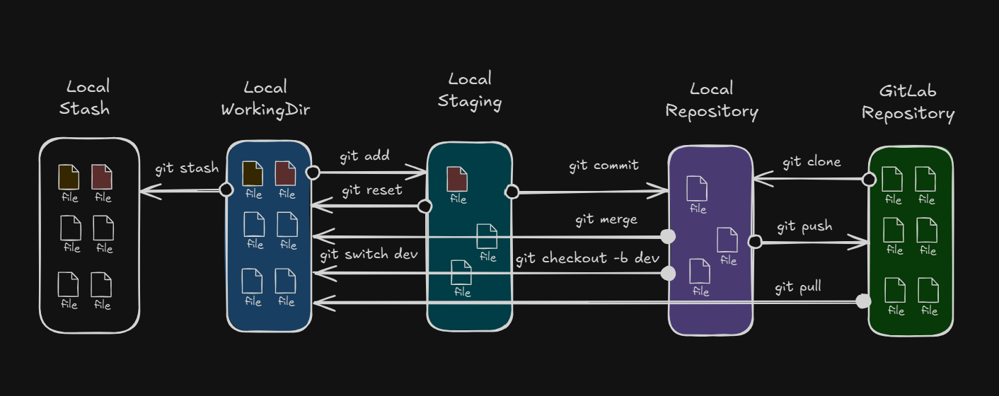
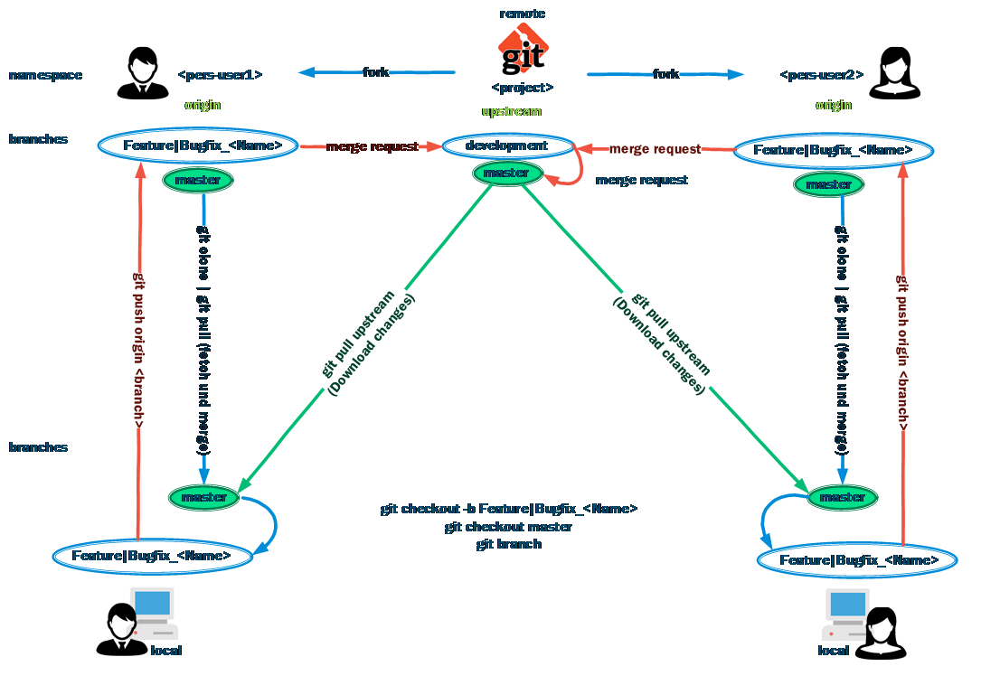

## Table of Contents

- [Git offline Installation](#git-offline-installation)
- [Git Configuration](#git-configuration)
     - [List global settings](#list-global-settings)
     - [List system settings](#list-system-settings)
     - [Show all settings](#show-all-settings)
     - [Define identity with name and email](#define-identity-with-name-and-email)
     - [Proxy](#proxy)
- [Work with Git](#work-with-git)
     - [Git clone](#git-clone)
     - [Working Directory](#working-directory)
          - [Create new branch](#create-new-branch)
     - [Staging](#staging)
     - [Commit](#commit)
     - [Update remote repository](#update-remote-repository)
     - [Merge](#merge)
     - [Update local Repository](#update-local-repository)
     - [List all local branches](#list-all-local-branches)
     - [Remove branch](#remove-branch)
- [GitHub](#github)
- [See also](#see-also)

## Git offline Installation

VSCode integrates Git version control. Download and install Git.

[Download Source](https://git-scm.com/downloads)

## Git Configuration

Git global settings are saved in ````"$($env:USERPROFILE)\.gitconfig"```` while local settings are saved in the root folder of the respective project.

The global settings can be set from ````"$($env:USERPROFILE)\.gitconfig"```` to another path by setting the environment variable ````HOME```` to the desired path (Example: ````$env:home = 'D:\github'````).

### List global settings

````powershell
git config --global -l
````

### List system settings

````powershell
git config --system -l
````

these settings can only be changed with admin rights.

### Show all settings

Show all settings of all gitconfig-files:

````powershell
git config --list --show-origin
````

### Define identity with name and email

````powershell
git config --global user.name "John Doe"
git config --global user.email johndoe@example.com
````

**gitconfig:**

````powershell
[user]
     name = John Doe
     email = johndoe@example.com
````

### Proxy

**gitconfig:**

````powershell
[http "https://gitlab.company.int"]
	proxy = http://proxy.company.int:8080/
[credential]
	helper = wincred
[credential "https://gitlab.company.int"]
     username = 'Tinu'
````

If you need Proxy credentials then you can create a file .netrc and putting the settings in to this file.

**netrc:**

````powershell
machine <Fully qualified name of the proxy>
login <login user>
password <password>
````

**gitconfig:**

````powershell
[http]
     sslverify = true
     sslBackend = schannel
	proxy = http://proxy.company.int:8080/
[user]
     name = John Doe
     email = johndoe@example.com
[credential "https://gitlab.company.int"]
     username = 'tinu'
````

## Work with Git

Working with a remote Repository like GitLab.



### Git clone

The first thing that you should do, is to clone the remote Repository to a locale Repository.

````powershell
git clone <git-url>
````

### Working Directory

If you have a locale Repository, then you also have a local working area (WorkingDir).

In this directory, you make your changes like add folders/files, update/remove folders/files.

**But before you make a change, please create a new branch.**

#### Create new branch

````powershell
git checkout -b <new_branch>
````

Make your changes in the new branch and add the changes to the local staging area.

### Staging

````powershell
git add <file to add> # or git add . to stage all changes
````

### Commit

Commit your changes to your local Repository.

````powershell
git commit -m "Commit message"
````

### Update remote repository

If all changes are commited, then push the branch to the remote Repository.

````powershell
git push --set-upstream origin <new_branch>
````

### Merge

In GitLab you have to create a Merge Request to merge the new_branch in to the main branch and merge it.

### Update local Repository

After the Merge ist completed, you should update your local Repository.

**Switch** to the main branch:

````powershell
git switch main
````

**Update** the main branch:

````powershell
git pull
````

### List all local branches

````powershell
git branch
````

### Remove branch

````powershell
git branch -d <new_branch>
git branch -D <new_branch> # delete force
````

## GitHub

If you work in a Team on GitHub, then every Member should make a Fork of the remote Repository.



# See also

[git --fast-version-control](https://git-scm.com/doc).
