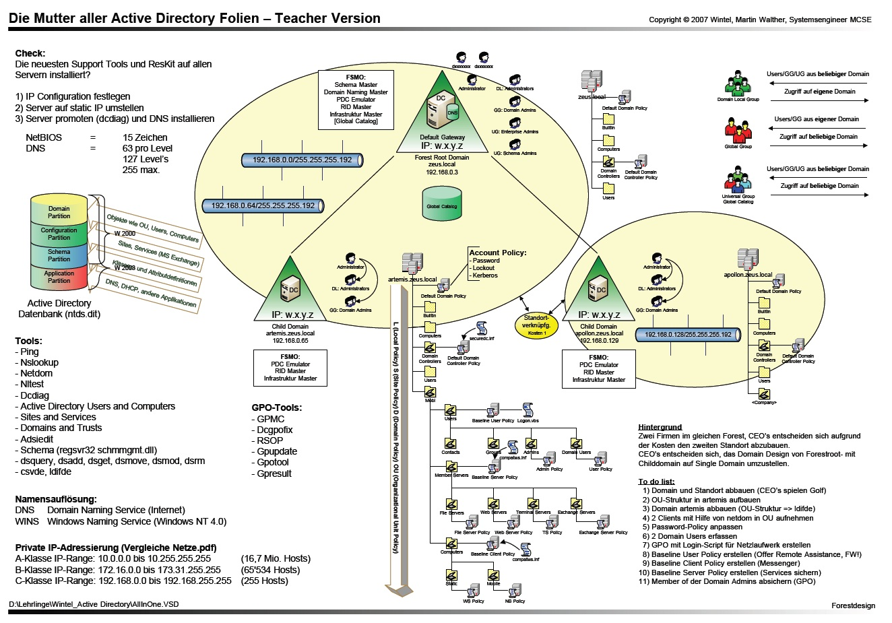

Active Directory wird in jedem Windows Netzwerk benötigt in welchem mehr als 5 Computer und Benutzer bereitgestellt werden soll. Mit Active Directory werden die Ressourcen wie Computer, Drucker, Benutzer, Gruppen usw. zentral verwaltet.

## Active Directory Design (Forest/Domain)

 Active Directory soll so einfach aufgebaut werden wie möglich. Es macht keinen Sinn, Unternehmen in mehrere Domains aufzusplitten, es sei denn sie sind über mehrere Kontinente verteilt und werden vor Ort verwaltet. **Single Forest mit Single Domain ist das beste Design, warum soll es mehr sein?** Die Sicherheitsgrenze ist ein Forest und nicht eine Domain, deshalb sollte jede Domain in einem eigenen Forest sein. Mit einem Trust kann jede Domain erweitert werden, z.B. bei einer Konstellation Account Domain und Resource Domain. 

## Domain Controller

 Damit ein Active Directory aufgebaut werden kann, wird mindestens ein Domain Controller (besser zwei aus Redundanzgründen) benötigt. Der erste Domain Controller muss zwingend ein read-write Domain Controller sein, der zweite kann auch als read-only Domain Controller (RODC) konfiguriert sein. Auf den Domain Controllern sollte Active Directory-integrated DNS konfiguriert sein, wenn es keine andere Richtlinie für DNS in der Firma gibt. 

## Organizational Units

 Die Ressourcen werden in sogenannten Organizational Units (OUs) gegliedert und verwaltet. Es sollte eine einfache OU-Struktur aufgebaut werden, welche den Verwaltungszwecken entsprechend ist und nicht die Organisation der Firma abbildet. 

## Die Mutter aller Active Directory Folien

  Download [Active\_Directory\_Grundlagen](/assets/wiki/Active_Directory_Grundlagen.pdf "Die Mutter aller Active Directory Folien als PDF herunterladen") als PDF.