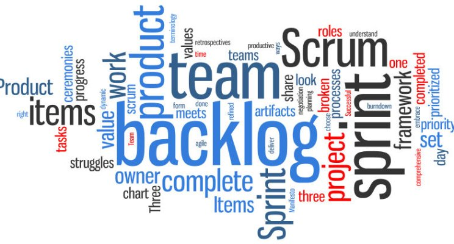

## 

## Legacy Windows Betrieb

Einzelene Server werden manuel durch den System Manager per RDP verbunden und auf dem Windows Server werden die gewünschten Arbeiten wie z.B. Windows Updates installieren durchgeführt. Am Schluss der Arbeiten ein Logoff und ab zum nächsten Server - und das auf 170 Servern? **Nein danke!**

## Agile Windows Betrieb

50 oder mehr Server werden in einer Schleife abgearbeitet und automatisch dieselben Arbeiten wie oben per RDP aufgezeigt durchgeführt. Am Ende wird das Resultat zusammengefasst in einem einzigen Report den Shareholdern veröffentlicht. **Das ist doch eine Illusion?**Aber nein, das ist ganz einfach möglich: Mit PowerShell-Scripts werden die Arbeiten automatisiert und mit einem Configuration Management Tool wie z.B. SCCM, Puppet oder DSC auf die gewünschten 50 Server zeitgesteuert ausgeführt. Am Ende wird mit dem Resultat der einzelnen Server ein Report auf einer SharePoint-Lösung per RestAPI aufgeschaltet. **So wird heute in einem agile Windows Betrieb gearbeitet!**