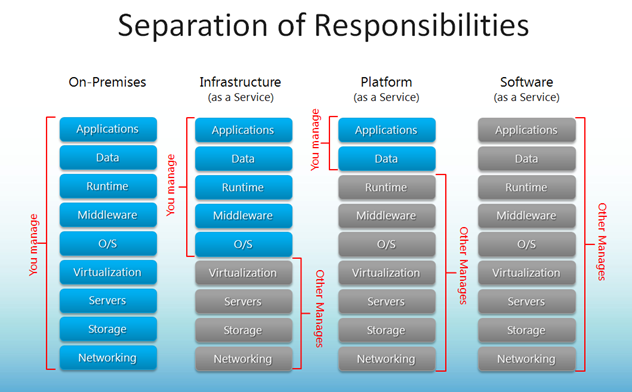

## Cloud-Modelle

Allgemeine Definitionen der Cloud-Modelle \[caption width="632" id="attachment\_1357" align="alignnone"\] Cloud-Modelle\[/caption\]Image Source: [blogs.technet.com](http://blogs.technet.com/b/kevinremde/archive/2011/04/03/saas-paas-and-iaas-oh-my-quot-cloudy-april-quot-part-3.aspx)

### On-Premise

On-Premises ist ein Nutzungsmodell für serverbasierte Computerprogramme (Software). Dabei erwirbt der Nutzer ein solches Computerprogramm und betreibt dieses im eigenen Rechnenzentrum, also auf eigener oder eigenverwalteter Hardware. 

### IaaS - Infrastructure as a Service

Dieses Modell stellt grundlegende IT-Ressourcen wie **Rechenleistung**, **Storage** oder **Netzwerkkapazitäten** zur Verfügung. Der Anwender hat dabei die Kontrolle über Betriebssysteme und Anwendungen, er muss in der Regel die Infrastruktur selbst aus den benötigten Recheninstanzen und Speichern zusammenstellen. Example: Windows Azure, Amazon, ... 

### PaaS - Platform as a Service

Bei PaaS handelt es sich um einen Typ von Service, der ein Programmiermodell und Entwicklerwerkzeuge bereitstellt, um Cloud-basierte Anwendungen zu erstellen und auszuführen. Ein PaaS-Provider sollte alle benötigten Ressourcen wie **Rechenleistung**, **Speicher**, **Netzwerk**, **Middleware** wie Message Queuing oder Load Balancing und **Datenbanken** automatisch beim Deployment der Applikation zur Verfügung stellen und diese abhängig von den Anforderungen skalieren ("fabric"). Erwartet werden zudem eingebaute **Monitoring-Funktionen**, mit denen sich das Laufzeitverhalten der Anwendungen überwachen lässt. Example: Windows Azure, Webhosting Providers 

### SaaS - Software as a Service

SaaS repräsentiert die oberste Schicht im Cloud-Modell, bei dem der Provider seine eigenen **Anwendungen** **für die Benutzer bereitstellt**. Darin unterscheidet sich SaaS vom Vorläufer ASP (Application Service Provider), bei dem die Dienstleister Applikationen von anderen Herstellern zur Miete anboten. Diese waren zumeist nicht mandantenfähig, während die Unterstützung für mehrere Mandanten bei SaaS die Regel ist. Example: Office 365 

### Public-Cloud

Cloud für mehrere Kunden. 

### Private-Cloud

Cloud für nur einen einzigen Kunden. Kann im Kundenrechenzentrum oder beim Provider gehostet werden. 

### Hybrid-Cloud

Eine Mischform aus Private- und Public-Cloud. 

## Cloud Tools

Automatisiertes Aufsetzen von Servern → Foreman 

- Servername
- IP Adresse
- Subnetz
- Puppet Module
- ...

Automatisiertes Configuration Management → Puppet, DSC 

- Windows Features
- Registry Settings
- Folders
- ...

Requirements DSC:

- ab Windows Server 2008 R2 SP1
- .NET Framework 4.5
- Windows Management Framework 4.0

Installieren von Tools → NuGet, Chocolatey 

- NuGet installiert Chocolatey
- Chocolatey installiert alle möglichen Tools 
    - Git
    - Notepad++
    - Firefox
    - Java Runtime
    - Windows Management Framework 5.0
    - Sysinternals
    - ...

Requirements Chocolatey:

- ab Windows Server 2003
- .NET Framework 4.0
- PowerShell 2.0