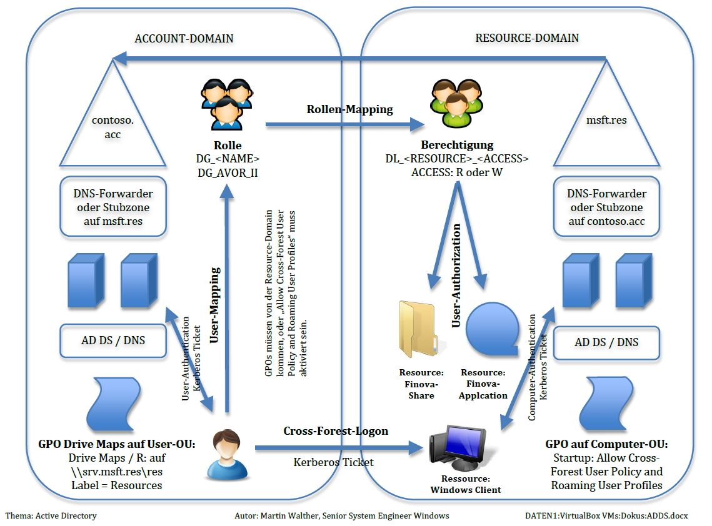
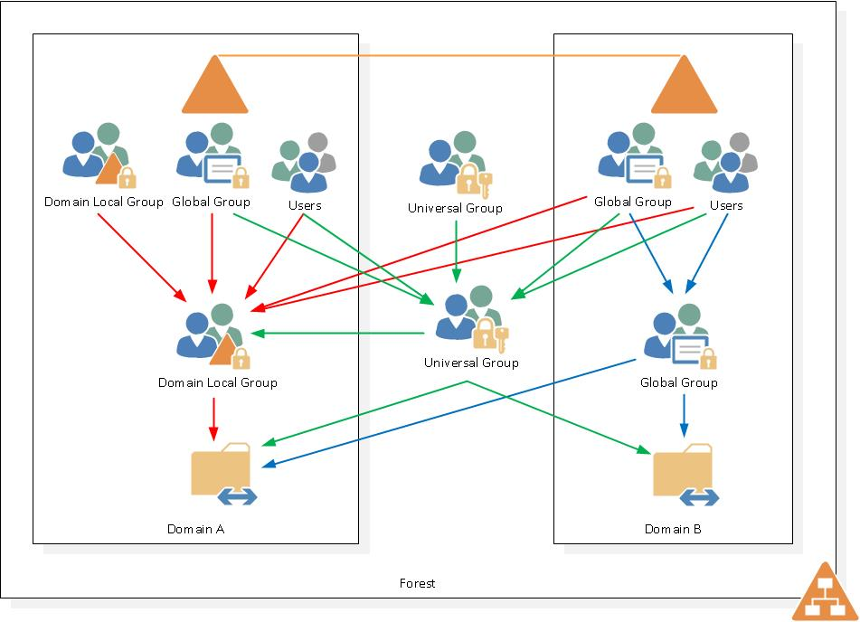

# Account- und Resource Domain

Copyright (c) 2014 Martin Walther 

## Trust verifizieren

```
Get-ADObject -Filter {objectClass -eq "trustedDomain"} -Properties TrustPartner,TrustDirection,trustType | FT Name,TrustPartner,TrustDirection,TrustType
```

## Der Mythos mit den Gruppen und Berechtigungen

Ausgehend von einem Domainfunctional Level Windows 2000 native oder Windows Server 2003 oder höher. 

### Global Group

Grösse: 8 Bytes **MemberOf:**Accounts und Global Groups aus der eigenen Domain. **Permission to:**auf Ressourcen beliebiger Domains. **Speicherort der Gruppe:**Im Domainkontext der eigenen Domain. 

### Domain Local Group

Grösse: 40 Bytes **MemberOf:**Accounts, Global Groups und Universal Groups aus allen Domains. Domain Local Groups nur aus der eigenen Domain. **Permission to:**auf Ressourcen der eigenen Domain. **Speicherort der Gruppe:**Im Domainkontext der eigenen Domain. 

### Universal Group

Grösse: 8 Bytes **MemberOf:**Accounts, Global Groups und Universal Groups aus allen Domains innerhalb des Forests. **Permission to:**auf Ressourcen aller Domains innerhalb des Forests. **Speicherort der Gruppe:**Im Global Catalog (Forest). Und hier das ganze Bild dazu mit einem Forest und zwei Domains: 

# Active Directory Federation Services

## Identity Provider

Kontenverwaltung: Verwaltung der Benutzer, die Firma in der die Benutzer arbeiten. Zugriff auf Web-Applikation beim Provider kann über Gruppenmitgliedschaft gesteuert werden. 

## Application Provider

Web-Applikation, z.B. SharePoint oder Cloud-Service. Zugriff mit Account aus Identity Provider Active Directory.