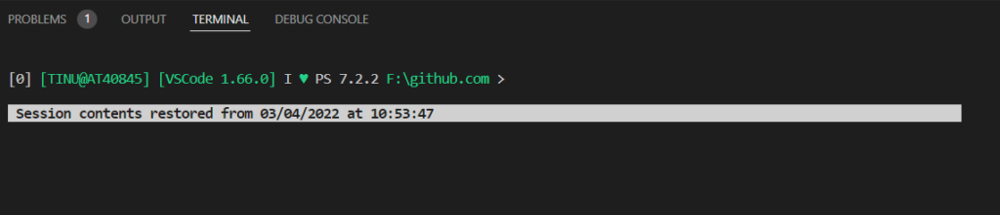
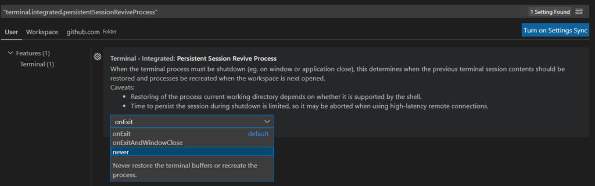
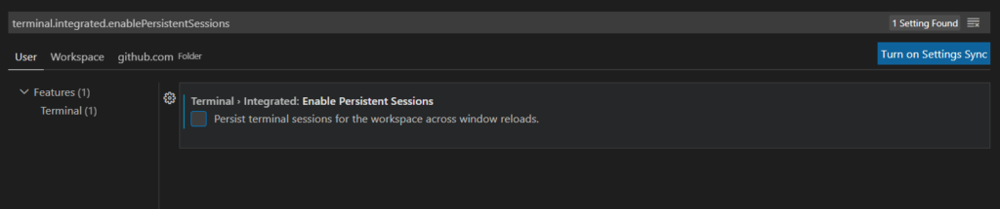

Beim Starten von VS Code werden automatisch jedesmal die Sessions von den letzten Benutzungen wiederhergestellt.

## Disable Session Restore

Settings öffnen mit Ctrl + ,

Search String: terminal.integrated.persistentSessionReviveProcess eingeben und im Dropdown auf **never** einstellen.

Search String: terminal.integrated.enablePersistentSessions eingeben und deaktivieren.

VS Code neu starten - Fertig, die Sessions werden nicht mehr wiederhergestellt und VSCode startet schneller.

## References

[Visual Studio Code Wiki](https://github.com/microsoft/vscode/wiki/)

