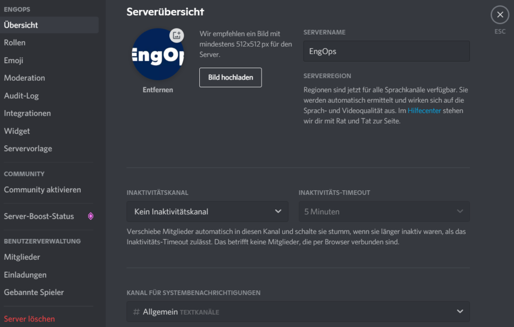
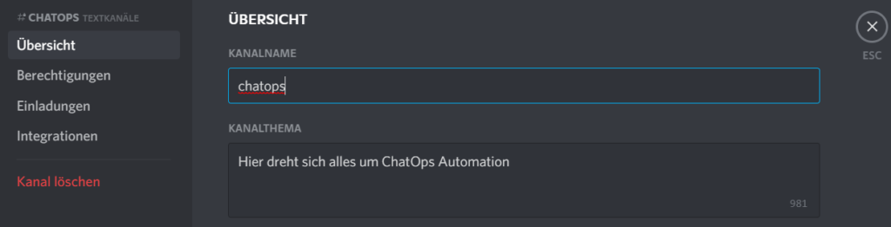
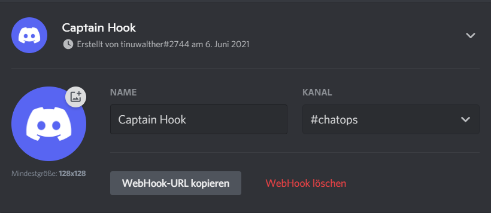
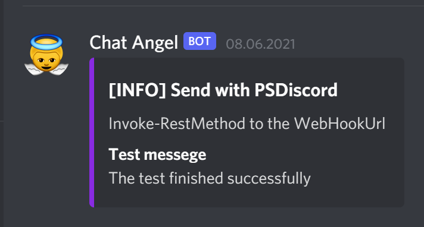
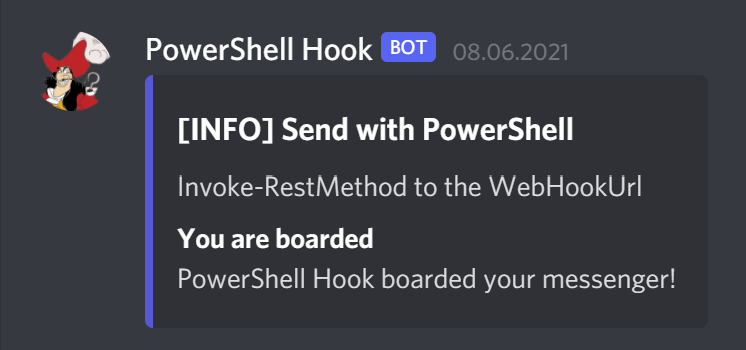
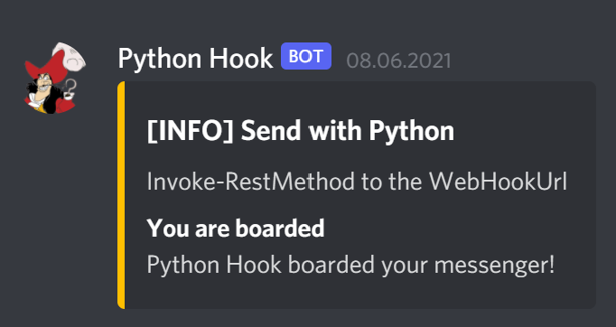

Discord ist ein eine kostenloser Messenger und ermöglicht, einfach über einen Desktop-Client, über den Internetbrowser oder über eine App (iOS und Android) mit Freunden zu chatten.

Das wichtigste für mich ist, mit Discord kann ich über das Internet wie mit MS Teams entwickeln und z.B. WebHook Integrationen oder Bots entwickeln.

## Prerequisites

### Discord Account

Account auf [discord.com](https://discord.com/register) erstellen.

### Discord Server

Eigenen Server erstellen.

[](/assets/wiki/Server.png)### Channel

Channel für den WebHook erstellen.

[](/assets/wiki/Channel.png)### WebHook

WebHook in Channel erstellen.

[](/assets/wiki/WebHook.png)## Send Message with PSDiscord

Mit PowerShell Discord Message an WebHook/Channel versenden.

```
Import-Module PSDiscord -Force

$WebhookUri       = 'your webhook address'
$ChatAngel        = "https://www.emojibase.com/resources/img/emojis/apple/x1f47c.png.pagespeed.ic.d2IjV3gUvN.png"
$SectionFactName  = "Test message"
$SectionColor     = "BlueViolet"
$SectionTitleInfo = "[INFO] Send with PSDiscord"
$SectionFactInfo  = New-DiscordFact -Name $SectionFactName -Value "The test finished successfully" -Inline $false

$Section = New-DiscordSection `
 -Title       $SectionTitleInfo `
 -Description 'Invoke-RestMethod to the WebHookUrl' `
 -Color       $SectionColor `
 -Facts       $SectionFactInfo `
 #-Author     $ChatAngel
Send-DiscordMessage -WebHookUrl $WebhookUri -Sections $Section -AvatarName 'Chat Angel' -AvatarUrl $ChatAngel
```

[](/assets/wiki/PSDiscord.png)## Send Message with PowerShell

Mit PowerShell Discord Message an WebHook/Channel versenden.

```
# Initialize variables
$webhook_url         = 'your webhook address'
$author_name         = 'PowerShell Hook'
$author_avatar       = 'http://img1.wikia.nocookie.net/__cb20111027212138/pichipichipitchadventures/es/images/thumb/f/fd/Captain-Hook-Wallpaper-disney-villains-976702_1024_768.png/456px-Captain-Hook-Wallpaper-disney-villains-976702_1024_768.png'

$section_title       = '[INFO] Send with PowerShell'
$section_description = 'Invoke-RestMethod to the WebHookUrl'
$section_color       = 5789910 #5858D6

$fact_title          = 'You are boarded'
$fact_message        = 'PowerShell Hook boarded your messenger!'

# New section as embed object
$embeds = @{
    'title'       = $section_title
    'description' = $section_description
    'color'       = $section_color
    "fields"      = @(
        @{'name' = $fact_title; 'value' = $fact_message; "inline" = $false}
    )
}

# Full message
$data = @{
    'username'   = $author_name
    'avatar_url' = $author_avatar
    "embeds"     = @($embeds)
}

# Content-Type
$headers = 'application/json; charset=UTF-8'

Invoke-RestMethod -Uri $webhook_url -Body (ConvertTo-Json -Depth 6 -InputObject $data) -Method Post -ContentType $headers
```

[](/assets/wiki/PSWebHook.png)## Send Message with Python

Mit Python Discord Message an WebHook/Channel versenden.

```
import requests, json

# Initialize variables
webhook_url         = 'your webhook address'
author_name         = 'Python Hook'
author_avatar       = 'http://img1.wikia.nocookie.net/__cb20111027212138/pichipichipitchadventures/es/images/thumb/f/fd/Captain-Hook-Wallpaper-disney-villains-976702_1024_768.png/456px-Captain-Hook-Wallpaper-disney-villains-976702_1024_768.png'

section_title       = '[INFO] Send with Python'
section_description = 'Invoke-RestMethod to the WebHookUrl'
section_color       = 16760576 #FFBF00

fact_title          = "You are boarded"
fact_message        = "Python Hook boarded your messenger!"

# New section as embed object
embeds = {
    'title'       : section_title,
    'description' : section_description,
    'color'       : section_color,
    'fields'      : [
        {"name" : fact_title, "value" : fact_message, "inline": "false"},
    ],
    'image': {
        'url': 'https://tinuwalther.github.io/assets/PsEngOps.png'
    },
}

# Full message
data = {
    'username'  : author_name,
    'avatar_url': author_avatar,
    "embeds"    : [embeds],
}

# Content-Type
headers = {
    "Content-Type": "application/json"
}

result = requests.post(webhook_url, json=data, headers=headers)
if 200 <= result.status_code < 300:
    print(f"[INFO] Webhook sent {result.status_code}")
else:
    print(f"[WARN] Not sent with {result.status_code}, response:\n{result.json()}")
```

[](/assets/wiki/PYWebHook.png)Auf [pythonanywhere](https://www.pythonanywhere.com/) könnt ihr euch den Code sogar im Internet verfügbar machen und einen Crowjob schedulen, damit ihr z.B. täglich eine Message von eurem **Python Hook** bekommt.

## References

[Discord](https://discord.com/), [PSDiscord](https://evotec.xyz/hub/scripts/psdiscord-powershell-module/), [Discord Developer Portal](https://discord.com/developers/docs/resources/webhook), [EngOps Discord Channel](https://discord.com/channels/851022270062395402/851022270062395405)

