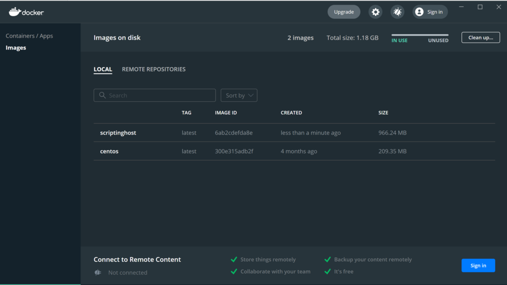
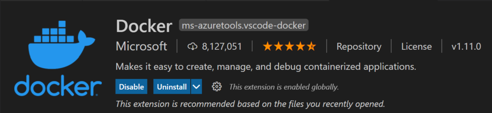
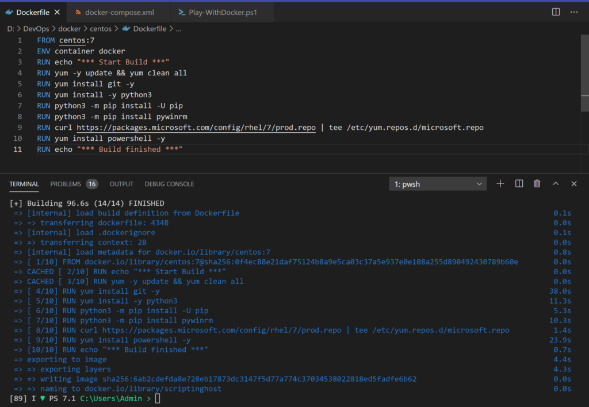

## Docker Desktop

Als erstes muss auf dem Computer Docker Desktop installiert werden. Docker Desktop kann von [www.docker.com](https://www.docker.com/products/docker-desktop) heruntergeladen und installiert werden. Für Windows muss das [Windows Subsystem for Linux (WSL 2)](https://docs.microsoft.com/en-us/windows/wsl/install-win10) vorgänig installiert und aktiviert werden.

[](/assets/wiki/DockerDesktop.png)## Visual Studio Code

In Visual Studio Code sollten die Extensions Docker for Visual Studio Code installiert werden, damit danach nur noch mit Visual Studio Code gearbeitet werden kann.

[](/assets/wiki/VSCodeExtenstions-1.png)## Image erstellen

Ich erstelle hier ein Image mit einem Linux CentOS und installiere Python3 und PowerShell.

### Create a Dockerfile

In Visual Studio Code ein neues File erstellen und als Dockerfile im gewünschten Pfad abspeichern. Ich erstelle pro Image einen Folder mit einem Dockerfile. Bitte ersetzt *usw* mit dem korrekten Linuxpfad.

```powershell
FROM centos:7
ENV container docker
RUN echo "*** Start Build ***"
RUN yum -y update && yum clean all
RUN yum install git -y
RUN yum install -y python3
RUN python3 -m pip install -U pip
RUN python3 -m pip install pywinrm
RUN curl https://packages.microsoft.com/config/rhel/7/prod.repo | tee /usw/yum.repos.d/microsoft.repo
RUN yum install powershell -y
RUN echo "*** Build finished ***"

```

Nun wird das Image auf Basis des Dockerfiles erstellt:

```powershell
docker build -f "D:\DevOps\docker\centos\Dockerfile" -t scriptinghost .

```

[](/assets/wiki/Docker-BuildImage.png)Mit folgendem Befehl listet man die Images auf:

```powershell
docker images -a

```

```powershell
REPOSITORY      TAG       IMAGE ID       CREATED             SIZE
scriptinghost   latest    6ab2cdefda8e   About an hour ago   966MB
centos          latest    300e315adb2f   3 months ago        209MB

```

## Start a container

Mit dem Befehl startet man einen Container mit dem Namen pycentos1 auf Basis des Images scriptinghost und vergibt ihm den Hostnamen pyhost. Anschliessend wird eine interaktive Session mit bash aufgebaut.

```powershell
docker run - -e TZ="Europe/Zurich" -hostname pyhost  --name pycentos1 -it scriptinghost /bin/bash

```

```powershell
[root@pyhost /]# hostname
pyhost
[root@pyhost /]# python3 --version
Python 3.6.8

```

Mit eingabe von pwsh ändern wir die Shell von bash zu PowerShell

```powershell
[root@pyhost /]# pwsh /nologo
PS /> $PSVersionTable

Name                           Value
----                           -----
PSVersion                      7.1.3
PSEdition                      Core
GitCommitId                    7.1.3
OS                             Linux 5.4.72-microsoft-standard-WSL2 #1 SMP Wed Oct 28 23:40:43 UTC 2020
Platform                       Unix
PSCompatibleVersions           {1.0, 2.0, 3.0, 4.0…}
PSRemotingProtocolVersion      2.3
SerializationVersion           1.1.0.1
WSManStackVersion              3.0

```

Nun kann wie gewohnt mit PowerShell auf dem CentOS gearbeitet werden.

```powershell
PS /usw/git> git clone https://github.com/tinuwalther/PsNetTools.git
Cloning into 'PsNetTools'...
remote: Enumerating objects: 26, done.
remote: Counting objects: 100% (26/26), done.
remote: Compressing objects: 100% (21/21), done.
remote: Total 1141 (delta 7), reused 14 (delta 5), pack-reused 1115
Receiving objects: 100% (1141/1141), 1.71 MiB | 0 bytes/s, done.
Resolving deltas: 100% (682/682), done.

```

```powershell
PS /usw/git/PsNetTools/PsNetTools/0.7.65> Import-Module ./PsNetTools.psd1
PS /usw/git/PsNetTools/PsNetTools/0.7.65> Test-PsNetDig sbb.ch

Succeeded   : True
InputString : sbb.ch
Destination : sbb.ch
IpV4Address : {194.150.245.142}
IpV6Address : {2a00:4bc0:ffff:ffff::c296:f58e}
TimeMs      : 47

```

