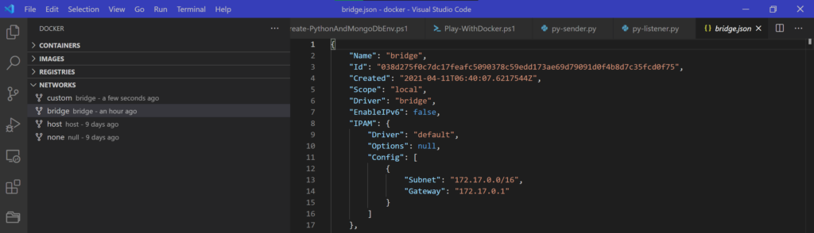
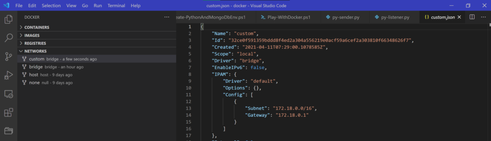
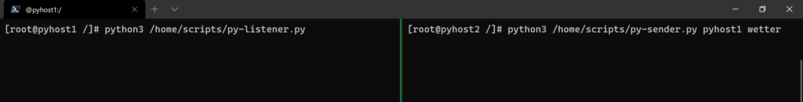
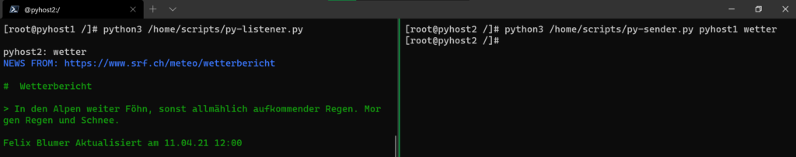
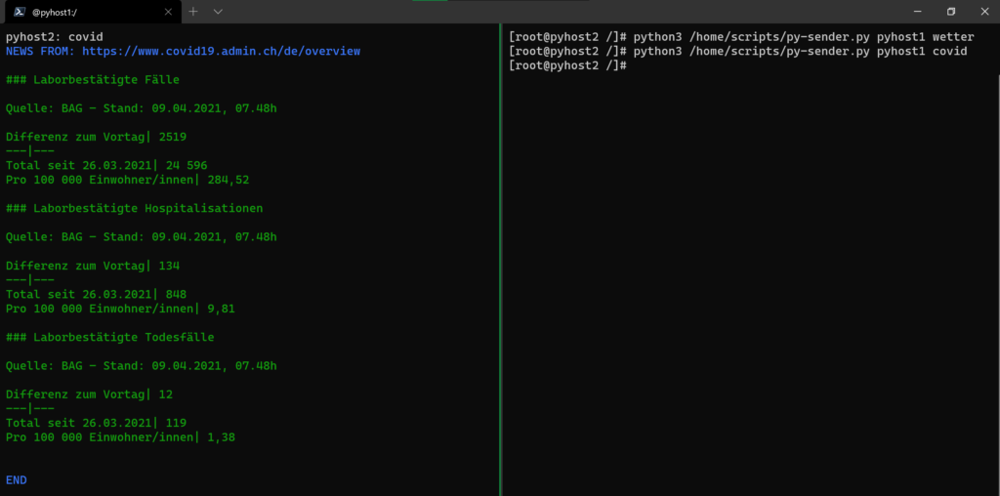

## Netzwerk mit Docker

Standardmässig werden Containers mit der default **bridge** von Docker konfiguriert.

## Default bridge

Wenn eine Session zwischen zwei Containern innerhalb der Default Bridge aufgebaut werden soll, funktioniert dies nur per IP Adresse und nicht per DNS. In den Containern könnte nun mit hosts-files gearbeitet werden, aber das ist eher ungünstig weil je nach Anzahl Containers die IP Adressen nicht mehr stimmen.

[](/assets/wiki/default-bridge.png)## User-defined bridges

*User-defined bridges provide automatic DNS resolution between containers.*

Damit das Netzwerk eines Containers geändert werden kann, muss dieser gestoppt und neu mit Angabe des Netzwerkes (--network) erstellt werden. Danach kann zwischen den Containern mit DNS gearbeitet werden.

[](/assets/wiki/custom-bridge.png)## Commands

### Auflisten der Netzwerke

```powershell
docker network ls

```

### Erstellen eines benutzerspezifischen Netzwerk

```powershell
docker network create custom

```

### Auflisten der Netzwerkekonfiguration

```powershell
docker network inspect custom

```

### Erstellen eines Containers mit benutzerspezifischem Netzwerk

```powershell
docker run  -e TZ="Europe/Zurich" -it --network custom --hostname pyhost1 --name pyhost1 -d pyhost:1.0.0
docker run  -e TZ="Europe/Zurich" -it --network custom --hostname pyhost2 --name pyhost2 -d pyhost:1.0.0

```

### Testen des Netzwerkes custom

Login auf Container pyhost1:

```powershell
[37] I ♥ PS 7.1 D:\docker > docker exec -it pyhost1 /bin/bash

```

Installieren des bind-utils packages, falls nslookup fehlt:

```bash
yum install bind-utils

```

Ausführen von nslookup:

```bash
[root@pyhost1 /]# nslookup pyhost2
Server:         127.0.0.11
Address:        127.0.0.11#53

Non-authoritative answer:
Name:   pyhost2
Address: 172.18.0.3

```

Ausführen von ping:

```bash
[root@pyhost1 /]# ping pyhost2
PING pyhost2 (172.18.0.3) 56(84) bytes of data.
64 bytes from pyhost2.custom (172.18.0.3): icmp_seq=1 ttl=64 time=1.51 ms

```

## Praktisches Beispiel

Nachdem mit den Commands `docker run -e TZ="Europe/Zurich" -it --network custom --hostname pyhost1 --name pyhost1 -d pyhost:1.0.0` und ` docker run -e TZ="Europe/Zurich" -it --network custom --hostname pyhost2 --name pyhost2 -d pyhost:1.0.0` zwei Python-Container erstellt haben, können wir ein Client-Server Programm laufen lassen. Ich habe auf meinem GitHub Profile [tinuwalther](https://github.com/tinuwalther/docker-example/tree/master/pyhost) den Code für den Listener (py-listener.py) und Sender (py-sender.py) in Python veröffentlicht mit dem das nachfolgende Beispiel durchgeführt werden kann.

### Login

Am Besten kann das Beispiel mit dem **Windows Terminal** angezeigt werden. Im linken Fenster bin ich auf dem **pyhost1** eingeloggt und habe den **Listener** gestartet und im rechten Fenster bin ich auf dem pyhost2 eingeloggt.

[](/assets/wiki/listener-sender.png)### Execute

Nun starte ich im rechten Fenster auf dem **pyhost2** den **Sender** indem ich die Message **wetter** an den **pyhost1** sende. Da ich jetzt das **custom** Netzwerk bei beiden Containern verwende, kann ich vom Sender aus den Hostnamen als Empfänger angeben anstelle der IP Adresse wenn die default bridge verwendet würde.

[](/assets/wiki/listener-sender-in-action.png)Im linken Fenster sehen wir nun, dass eine Message vom **pyhost2** mit dem Text **wetter** empfangen wurde und aufgrund dieses Textes die Meteo-Website von SRF aufgerufen und der Wetterbericht in Markdown heruntergeladen wurde. Mit diesem Python-Programm können noch die Wörter **srf** und **covid** verwendet werden um die einsprechenden Websites zu besuchen.

**ACHTUNG**  
Ich habe das Python-Programm angepasst.  
Neu kann der Listener mit `py-listener.py -s pyhost1 -p 8089 -c 5`  
und der Sender mit `py-sender.py -l pyhost1 -m wetter`gestartet werden.

[](/assets/wiki/listener-sender-in-action2.png)## References

Docker Documentation [docs.docker.oeynet.com](http://docs.docker.oeynet.com/engine/userguide/networking/), [docs.docker.com](https://docs.docker.com/network/)

