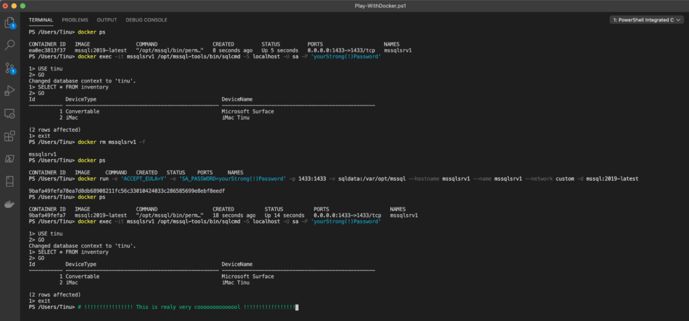
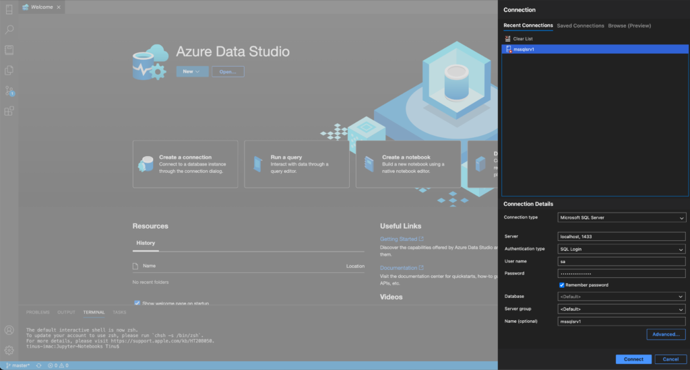
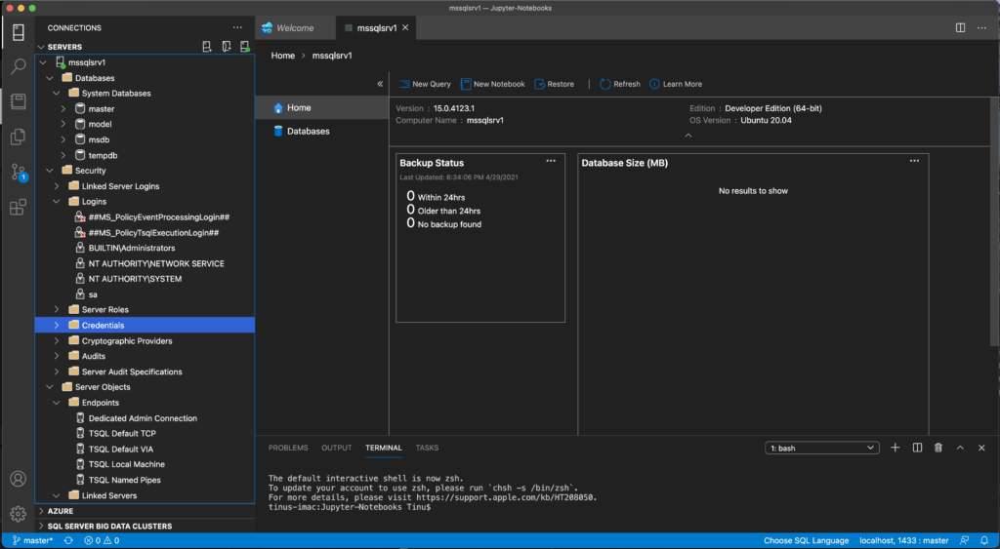

## Windows Container

Um Windows Container auf Docker zu nutzen, sind zusätzliche Vorbereitungen auf dem Host (Windows 10 oder Windows Server) auszuführen:

- Enable-WindowsOptionalFeature Microsoft-Hyper-V Containers
- Switch Docker Daemon to Windows container

Danach kann z. B. das Image Windows Server Code 2019 heruntergeladen werden.

### Vorbereitung mit PowerShell Code

Run with elevated privileges

```powershell
Enable-WindowsOptionalFeature -Online -FeatureName $("Microsoft-Hyper-V", "Containers") -All

```

```powershell
& $env:ProgramFiles\Docker\Docker\DockerCli.exe -SwitchDaemon .

```

Sobald Docker auf Windows Containers umgestellt ist, kann ein Windows Server Image heruntergeladen werden.

```powershell
docker pull mcr.microsoft.com/windows/servercore:ltsc2019

```

Ein Image von einem leeren Windows Server Core belegt mehr als 5GB!

| REPOSITORY | DESCRIPTION | SIZE |
|---|---|---|
| winsrvc | Windows Server Core 2019 | 5.27GB |

## Linux Container

Ein Microsoft SQL Server Image auf Linux belegt dagegen nur 1.5GB, also viel weniger als ein leeres Windows Server Core Image!

| REPOSITORY | DESCRIPTION | SIZE |
|---|---|---|
| alpine | Alpine | 5.61MB |
| centos8 | CentOS8 | 285MB |
| pyhost | CentOS8 mit Python3 | 473MB |
| mongo | MongoDB | 448MB |
| mssql | MSSQL 2019 | 1.49GB |

## Fazit

Wenn ich den Speicherplatzvergleich zwischen einem Windows Server Core- und all meinen Linux Images anschaue, bin ich mir (noch) nicht sicher warum ich einen Windows Container benötige. Falls ich einen MSSQL Server benötige, dann kann ich den als Linux Image herunterladen und mit Azure Data Studio nutzen.

## MSSQL Server on Linux

Wie oben schon beschrieben, ich kann ein Image von einem Microsoft SQL Server auf Linux von Docker Hub herunterladen und mit den entsprechenden Tools verwalten. Ich ziehe auf Mac OS Azure Data Studio vor.

### Image herunterladen

Ich lade mir das Image von MSSQL Server 2019 herunter und benenne es um.

```powershell
# <-- download image -->
docker pull mcr.microsoft.com/mssql/server:2019-latest
# <-- rename image -->
docker tag mcr.microsoft.com/mssql/server:2019-latest mssql:2019-latest
# <-- remove image -->
docker rmi mcr.microsoft.com/mssql/server:2019-latest

```

### Volume erstellen und mappen

Damit dem Container mssqlserv1 das Volume sqldata auf /var/opt/mssql gemappt werden kann, muss zuerst ein Volume in Docker erstellt werden. Damit sind die Daten im Volume und nicht im Container gespeichert und auch noch verfügbar, wenn der Container gelöscht wurde.

```
docker create volume sqldata
```

### Container erstellen

Mit den folgenden Befehlen erstelle ich mir einen Container, basierend auf meinem Image und mappe den TCP Port 1433 auf localhost:1433. Der Container bekommt den Namen mssqlsrv1, genau so lautet auch der Hostname.

#### Commands

```powershell
docker run `
-e TZ="Europe/Zurich" `
-e 'ACCEPT_EULA=Y'  `
-e 'SA_PASSWORD=yourStrong(!)Password' `
-p 8433:1433 `
-v sqldata:/var/opt/mssql `
--hostname mssqlsrv1 `
--name mssqlsrv1 `
--network custom `
-d mssql:2019-latest

```

#### Argumente

| Option | Description |
|---|---|
| -e | Set environment variables (TimeZone, ACCEPT\_EULA, SA\_PASSWORD) |
| -p | Port Mapping (localhost:container) |
| -d | Run container in background (detached) |
| -v | Volume Mapping |
| --name | Container Name |
| --hostname | Container host name |
| --network | Netzwerk Name |

Ich habe auf SQL Server eine Datenbank 'tinu' und eine Tabelle 'inventory' angelegt und diese mit zwei Datensätzen abgefüllt. Danach ein Backup der Datenbank 'tinu' angelegt.

### Container löschen und neu erstellen

Im Bild unten sehen wir, dass ein Container mssqlsrv1 läuft und ich mit sqlcmd auf die Datenbank 'tinu' gewechselt habe und dort die Tabelle 'inventory' abfrage. Danach lösche ich den Container mssqlsrv1 mit `docker rm mssqlsrv1 -f` und erstelle wieder einen neuen Container mssqlsrv1 und wechsle auf die Datenbank 'tinu' und frage die Tabelle 'inventory' erneut ab - die Daten sind alle noch da, weil sie nicht im Filesystem des Containers sondern im Volume von Docker gespeichert sind.

[](/assets/wiki/Bildschirmfoto-2021-04-30-um-17.39.11.png)### Azure Data Studio

Sobald der Container läuft, kann ich mich z.B. mit Azure Data Studio auf den MSSQL Server verbinden. Hier ist wichtig, dass man sich auf localhost, 1433 verbindet und nicht etwa auf den Hostnamen.

[](/assets/wiki/Bildschirmfoto-2021-04-29-um-18.49.10.png)Nachdem man sich auf den MSSQL Server verbunden hat, kann man den SQL Server wie gewohnt verwalten.

[](/assets/wiki/Bildschirmfoto-2021-04-29-um-18.52.21.png)#### Neue Datenbank anlegen

```
-- Create a new database called 'tinu'
-- Connect to the 'master' database to run this snippet
USE master
GO
-- Create the new database if it does not exist already
IF NOT EXISTS (
    SELECT [name]
        FROM sys.databases
        WHERE [name] = N'tinu'
)
CREATE DATABASE tinu
GO
```

#### Neue Tabelle anlegen

```
-- Create a new table called '[inventory]' in schema '[dbo]'
-- Drop the table if it already exists
USE tinu;
GO

IF OBJECT_ID('[dbo].[inventory]', 'U') IS NOT NULL
DROP TABLE [dbo].[inventory]
GO
-- Create the table in the specified schema
CREATE TABLE [dbo].[inventory]
(
    [ID] INT IDENTITY(1,1) NOT NULL PRIMARY KEY, -- Primary Key column
    --[ID] UNIQUEIDENTIFIER NOT NULL DEFAULT NEWSEQUENTIALID() PRIMARY KEY,
    [DeviceType] NVARCHAR(50) NOT NULL,
    [DeviceName] NVARCHAR(50) NOT NULL
    -- Specify more columns here
);
GO
```

#### Daten abfüllen

```
-- Insert rows into table 'inventory' in schema '[dbo]'
USE tinu;
GO

INSERT INTO [dbo].[inventory]
( -- Columns to insert data into
 [DeviceType], [DeviceName]
)
VALUES
( -- First row: values for the columns in the list above
 'Convertable', 'Microsoft Surface'
),
( -- Second row: values for the columns in the list above
 'iMac', 'iMac Tinu'
)
-- Add more rows here
GO
```

### Backup Datenbank

#### Backup erstellen

```
BACKUP DATABASE [tinu]
 TO  DISK = N'/var/opt/mssql/data/tinu-2021523-9-50-54.bak' 
 WITH NOFORMAT, 
 NOINIT, 
 NAME = N'tinu--2021-05-23T07:50:54', 
 NOSKIP, 
 REWIND, 
 NOUNLOAD,  
 STATS = 10

```

#### Backup vom Container zum Host kopieren

```
docker cp mssqlsrv1:/var/opt/mssql/data/tinu-2021523-9-40-39.bak D:\backup\tinu-2021523-9-50-54.bak
Get-Item D:\backup\tinu-2021523-9-50-54.bak

```

#### Backup vom Host zum Container kopieren

```
docker cp D:\backup\tinu-2021523-10-40-10.bak mssqlsrv1:/var/opt/mssql/data/tinu-2021523-10-40-10.bak
```

### Restore Datenbank

```
USE [master]
ALTER DATABASE [tinu] SET SINGLE_USER WITH ROLLBACK IMMEDIATE
BACKUP LOG [tinu] TO  DISK = N'/var/opt/mssql/data/tinu_LogBackup_2021-05-23_10-43-43.bak' 
WITH NOFORMAT, 
NOINIT,  
NAME = N'tinu_LogBackup_2021-05-23_10-43-43', 
NOSKIP, 
NOREWIND, 
NOUNLOAD,  
NORECOVERY,  
STATS = 5
RESTORE DATABASE [tinu] FROM  DISK = N'/var/opt/mssql/data/tinu-2021523-10-40-10.bak' 
WITH  FILE = 1,  
MOVE N'tinu' TO N'/var/opt/mssql/data/tinu.mdf',  
MOVE N'tinu_log' TO N'/var/opt/mssql/data/tinu_log.ldf',  
NOUNLOAD,  
REPLACE,  
STATS = 5
ALTER DATABASE [tinu] SET MULTI_USER
```

### Log prüfen

Mit dem Command `docker logs mssqlsrv1` kann das Logfile des gewählten Containers angezeigt werden. Hier ist auch ersichtlich, auf welchem OS MSSQL Server läuft und in welcher Edition.

```
SQL Server 2019 will run as non-root by default.
This container is running as user mssql.
...
2021-04-29 16:02:58.32 Server      Microsoft SQL Server 2019 (RTM-CU10) (KB5001090) - 15.0.4123.1 (X64) 
        Mar 22 2021 18:10:24 
        Copyright (C) 2019 Microsoft Corporation
        Developer Edition (64-bit) on Linux (Ubuntu 20.04.2 LTS) <X64>
2021-04-29 16:02:58.33 Server      UTC adjustment: 0:00
2021-04-29 16:02:58.33 Server      (c) Microsoft Corporation.
2021-04-29 16:02:58.33 Server      All rights reserved.
2021-04-29 16:02:58.33 Server      Server process ID is 340.
2021-04-29 16:02:58.33 Server      Logging SQL Server messages in file 
...
```

## References

[Windows and containers](https://docs.microsoft.com/en-us/virtualization/windowscontainers/about/), [Windows Images on Docker Hub](https://hub.docker.com/search?q=windows&type=image), [Microsoft SQL Server on Docker Hub](https://hub.docker.com/_/microsoft-mssql-server)

