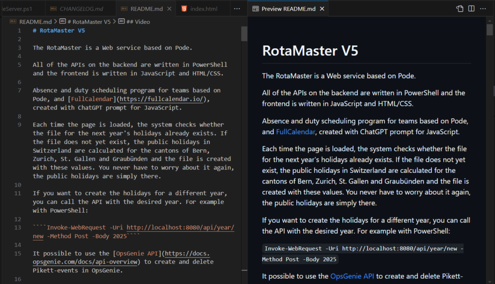
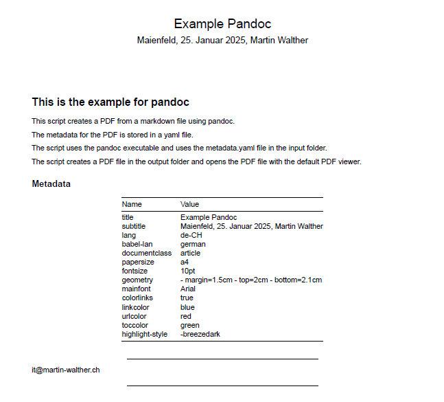

Ich nutze Visual Studio Code regelmässig um Markdown-Files zu bearbeiten. Im Visual Studio Code kann man einfach via Menü Preview ein schön formatiertes Dokument mit Links verwenden.

[](/assets/wiki/Markdown.png)Wie aber kann ich das Dokument für andere Personen als PDF-File zur Verfügung stellen?

## Pandoc

Um Markdown-Files als PDF zur Verfügung zu stellen, ist Pandoc ein hilfreiches Tool. Es ermöglicht die Konvertierung von Markdown in PDF mittels **LaTeX** und kann für **Linux**, **Mac** und **Windows** zur automatischen Erstellung von PDFs eingesetzt werden.

If you need to convert files from one markup format into another, pandoc is your swiss-army knife. Pandoc is free software, released under the GPL. Copyright 2006–2022 by [John MacFarlane](https://johnmacfarlane.net/).

### Pandoc on Mac OS

Auszug von [Installing pandoc](https://github.com/jgm/pandoc/blob/main/INSTALL.md) aus GitHub.

Install pandoc using Homebrew:

```bash
brew install pandoc

```

Homebrew can also install other software that integrates with Pandoc. For example, to install librsvg (its rsvg-convert covers formats without SVG support), Python (to use Pandoc filters), and BasicTeX (to typeset PDFs with LaTeX):

```bash
 brew install librsvg python homebrew/cask/basictex

```

By default, Pandoc creates PDFs using **LaTeX**. Because a full MacTeX installation uses four gigabytes of disk space, we recommend **BasicTeX** or **TinyTeX** and using the tlmgr tool to install additional packages as needed. If you receive errors warning of fonts not found:

```bash
tlmgr install collection-fontsrecommended

```

### Pandoc on Windows

Auszug von [Installing pandoc](https://github.com/jgm/pandoc/blob/main/INSTALL.md) aus GitHub.

Install pandoc using winget:

```powershell
winget install --source winget --exact --id JohnMacFarlane.Pandoc

```

By default, Pandoc creates PDFs using **LaTeX**. We recommend installing it via [MiKTeX](https://miktex.org/download).

## How to make a PDF

### Metadata

Ich erstelle ein Metadaten-File mit den gewünschten Einstellungen und speichere es als metadata.yaml ab.

```yaml
---
title: Example Pandoc
subtitle: Maienfeld, \today, Martin Walther
lang: de-CH
babel-lan: german
documentclass: article
papersize: a4
fontsize: 10pt
geometry:
  - margin=1.5cm
  - top=2cm
  - bottom=2.1cm
mainfont: Arial
colorlinks: true
linkcolor: blue
urlcolor: red
toccolor: green
highlight-style: breezedark
---

```

### Shell-Script

Auf Mac OS benötige ich ein Shell-Sript, falls PowerShell nicht installiert ist, um Pandoc parametrisiert aufzurufen.

```bash
#!/bin/bash
# command: bash ./create-pdf.sh Example
# inputfile="./input/$1.md"
# outputfile="./output/$1_$(date +"%Y%m%d").pdf"
# yamlfile="./input/$1.yaml"
# echo "Creating PDF from $inputfile with $yamlfile"

# pandoc $inputfile -o $outputfile \
 --pdf-engine=xelatex \
 --metadata-file=$yamlfile

# echo "PDF created: $outputfile"
# echo "Opening PDF with Preview"
# open -a Preview $outputfile

```

### PowerShell Script

Wenn PowerShell installiert ist, benötige ich ein PowerShell-Script, um Pandoc parametrisiert aufzurufen. Dies kann auf Windows, Mac und Linux benutzt werden:

```powershell
<#
.SYNOPSIS
    Create a PDF from a markdown file using pandoc
.DESCRIPTION
    This script creates a PDF from a markdown file using pandoc
    The metadata for the PDF is stored in a yaml file
    The script uses the pandoc executable and the metadata.yaml file in the input folder
    The script creates a PDF file in the output folder and opens the PDF file with the default PDF viewer
.PARAMETER fileName
    The name of the markdown file without the extension.
    It will look for a markdown and yaml file with the same name in the input folder
    and create a PDF file with the same name in the output folder
.EXAMPLE
    create-pdf.ps1 -fileName "example"
    This will create a PDF file from the example.md file in the input folder
#>
[CmdletBinding()]
param(
    [Parameter(
        Mandatory=$true, 
        Position=0, 
        HelpMessage="The name of the markdown file without the extension", 
        ValueFromPipeline=$true, 
        ValueFromPipelineByPropertyName=$true
    )]
    [string]$fileName
)

$inputFile  = Join-Path -Path $PSScriptRoot -ChildPath "input/$($fileName).md"
$outputFile = Join-Path -Path $PSScriptRoot -ChildPath "output/$($fileName)_$((Get-Date -f 'yyyyMMdd')).pdf"
$yamlFile   = Join-Path -Path $PSScriptRoot -ChildPath "input/$($fileName).yaml"

# Check on which OS we are running
if($IsWindows){
    Write-Host "Running on Windows" -ForegroundColor Cyan
}elseif($IsMacOS){
    Write-Host "Running on MacOS" -ForegroundColor Cyan
}elseif($IsLinux){
    Write-Host "Running on Linux" -ForegroundColor Cyan
}

if(Test-Path $outputfile){
    Write-Host "- PDF already exists, try to remove it"
    Remove-Item $outputfile -Force
}

Write-Host "- Creating PDF from $inputFile with $yamlFile"

if(!$IsWindows){
    & "/usr/local/bin/pandoc" $inputfile -o $outputfile --pdf-engine=xelatex --metadata-file=$yamlfile
    if(Test-Path $outputfile){
        Write-Host "- PDF created: $outputFile"
        Write-Host "- Opening PDF"
        if($IsMacOS){
            open -a Preview $outputFile
        } else {
            xdg-open $outputFile
        }
    }else{
        Write-Host "- PDF not created"
    }
}else{
    .\pandoc.exe $inputfile -o $outputfile --pdf-engine=xelatex --metadata-file=$yamlfile
    if(Test-Path $outputfile){
        Write-Host "- PDF created: $outputFile"
        Write-Host "- Opening PDF"
        Start-Process $outputFile
    }else{
        Write-Host "- PDF not created"
    }
}

```

### PDF-File

Das PDF-File wurde generiert. Die korrekte Formatierung muss je nach Markdown-Input etwas justiert werden, damit der gewünschte Output stimmt.

[](/assets/wiki/ExamplePDF.png)Ich möchte gerne die Tabelle anders gestalten können, z.B. links ausrichten und die Spaltengrösse andern. Auch die Linien vor und nach der Mailadresse sollen die gesamte Breite ausnutzen. Das sind meine offenen Punkt mit Pandoc.

## References

[Pandoc Website](https://pandoc.org/), [Pandoc on GitHub](https://github.com/jgm/pandoc)

