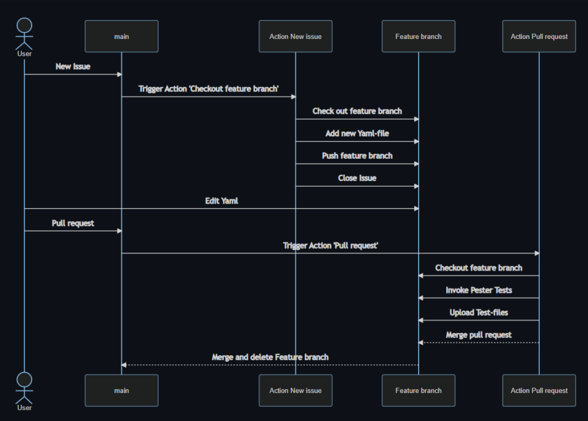
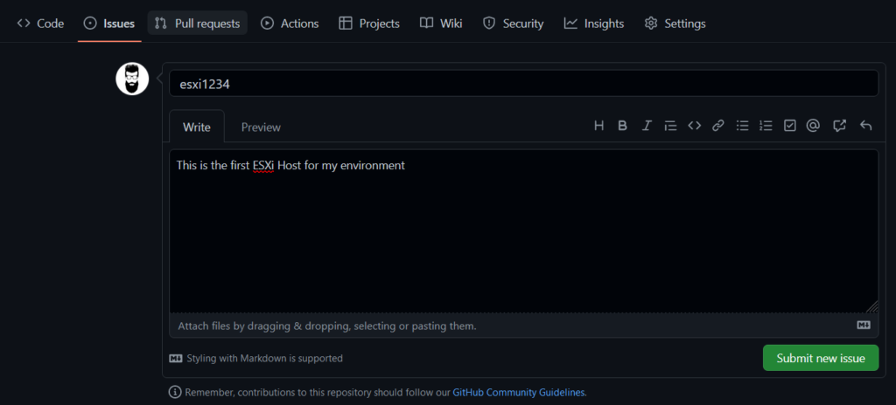
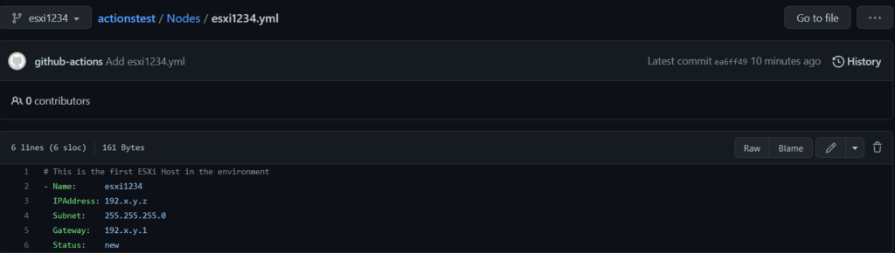
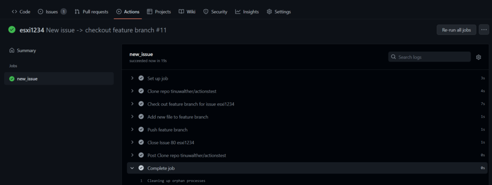
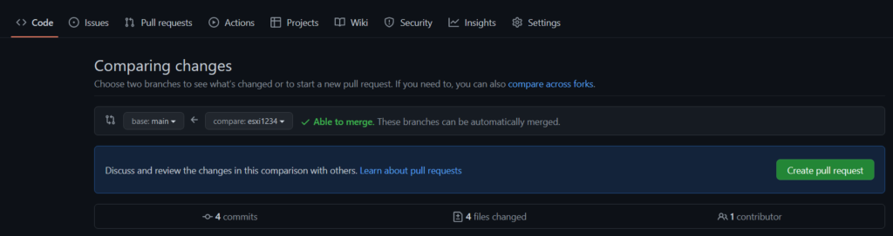
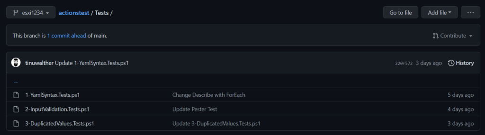

GitHub Actions sind (in GitLab Pipelines) Worklflows mit denen verschiedene Jobs und Steps abgearbeitet werden können. Als erstes wird ein Container mit dem gewünschten OS erstellt in dem der Workflow abgearbeitet wird. Ist dieser beendet, so wird der Container wieder gelöscht. Als OS steht Linux, Windows und Mac OS zur Verfügung.

## Die Idee

Ich hatte die Idee einen Workflow zu entwickeln, mit dem ich den Inhalt von Konfigurationsdateien prüfen und entsprechend weiterverarbeiten kann.

Die Konfigurationsdateien sollen die Konfiguration eines Servern enthalten wie z.B.:

```yaml
- Name:      example123
  IPAddress: 192.168.254.10
  Subnet:    255.255.255.0
  Gateway:   192.168.254.1
  Status:    new

```

Was soll denn von diesem Inhalt geprüft werden? Nun wenn ein neuer Server deployed werden soll, darf die IP Adresse und der Servername nicht schon in einer anderen Konfigurationsdatei bestehen.

Wenn alles korrekt ist, soll mit dem Mergen das Deployment auf den Server automatisch ausgeführt werden.

## Der Workflow

Wenn der User einen neuen Issue erfasst, soll automatisch ein neuer Feature Branch mit einer Beispielsdatei erstellt und der Issue geschlossen werden. Der Name des Issues muss der Name des neuen Servers sein.

In diesem Feature Branch wird gearbeitet. Hier kann die Konfigurationsdatei bearbeitet werden. Mit dem Erstellen eines Pull requests wird die Konfigurationsdatei geprüft und wenn alles korrekt ist werden die beiden Branches zusammengeführt und der Feature Branch wird gelöscht.

[](/assets/wiki/Workflow.png)## GitHub Actions

Damit ein Workflow erstellt werden kann muss im Repository das Verzeichnis `.github/workflows` erstellen werden. In diesem Verzeichnis werden die Workflows als Yaml-Files abgelegt. Ein Workflow enthält die Properties:

| Property | Erläuterungen |
|---|---|
| `name:` | Der Name des Workflows, wie er auf dem Tab **Actions** des GitHub-Repositorys angezeigt wird. |
| `on:` | Trigger `pull_request:` |
| `jobs:` | Jobs `runs-on: ubuntu-latest`. Jeder Job läuft in einem eigenen Runner. |
| `defaults:` | Defaults wie z.B. die Shell auf PowerShell einstellen `shell: pwsh` |
| `steps:` | `uses:` oder `run:` |


```powershell
name: New issue -> checkout feature branch
on:
  issues:
    types:
      - opened

jobs:
  new_issue:
    runs-on: ubuntu-latest
    defaults:
      run:
        shell: pwsh

    steps:
      - name: Dump GitHub context
        run: Write-Host '${{ toJSON(github) }}' -ForegroundColor Green
```


Weitere Informationen siehe [GitHub Actions Workflow Syntax](https://docs.github.com/en/actions/using-workflows/workflow-syntax-for-github-actions)

### Action New Issue

Ausgehend des main Branchs wird ein neuer Issue mit dem Namen eines Computers erfasst, der automatisch deployed werden soll. Der Inhalt des Kommentarfeldes wird als Kommentar ins Yaml-File übernommen. Submit klicken und die GitHub Action New Issue wird gestartet.

Der Workflow besteht aus den folgenden Steps:

#### Set variable

Der erste Step ist dafür zuständig, dass die Variablen für alle Steps erstellt und zugewiesen werden. Dazu muss dem Step eine id zugewiesen werden, damit über `step.<id>.outputs.<variable>` auf den Wert der Variable zugegriffen werden kann.

**Erstellen des Steps:**


```
- name: Set variable
  id: set-var
    run : echo "::set-output name=feature_branch::${{ github.event.issue.title }}"
```


**Zuweisung der Variable:**

In der ersten Zeile stelle ich sicher, dass der Titel des Issues übernommen und in Kleinbuchstaben geschrieben ist und keine Leerzeichen im Titel enthalten sind. Die zweite Zeile weist den Wert `$feature_branch` der Variable `feature_branch` zu.


```powershell
$feature_branch = $(( "${{ github.event.issue.title }}" ).ToLower()) -replace '\s', ''
echo "::set-output name=feature_branch::$feature_branch"
```


**Zugriff auf die Variable:**


```
${{ steps.set-var.outputs.feature_branch }}
```


**Output:**


```
Run $feature_branch = $(( "TEST 123" ).ToLower()) -replace '\s', ''
  $feature_branch = $(( "TEST 123" ).ToLower()) -replace '\s', ''
  echo "::set-output name=feature_branch::$feature_branch"
  Write-Host "New feature branch: $($feature_branch)"
  shell: /usr/bin/pwsh -command ". '{0}'"
New feature branch: test123
```

#### Clone Repository

In diesem Step wird eine Action aus dem Marketplace `actions/checkout@v3` eingesetzt um das Repository auf den Runner zu klonen.

**Output:**

```
Run actions/checkout@v3
Syncing repository: tinuwalther/actionstest
Getting Git version info
Temporarily overriding HOME='/home/runner/work/_temp/7ae7e732-c777-4137-bc9b-7449e1b5dd6c' before making global git config changes
Adding repository directory to the temporary git global config as a safe directory
/usr/bin/git config --global --add safe.directory /home/runner/work/actionstest/actionstest
Deleting the contents of '/home/runner/work/actionstest/actionstest'
Initializing the repository
Disabling automatic garbage collection
Setting up auth
Fetching the repository
Determining the checkout info
Checking out the ref
/usr/bin/git log -1 --format='%H'
'471bd46b81bd11c8f4e2dff6c837f5497f579011'

```

#### Checkout feature branch

**ACHTUNG:** der Name des Issues wird als Name für den *feature branch* sowie für die Beispielsdatei verwendet!

Mit dem Command `git checkout -b ${{ steps.set-var.outputs.feature_branch }}` wird ein neuer feature branch mit dem Namen des Issues erstellt.

**Output:**

```
Run Write-Host "Feature branch test123 created on tinuwalther/actionstest"
  Write-Host "Feature branch test123 created on tinuwalther/actionstest"
  git checkout -b test123
  git config user.name github-actions
  git config user.email github-actions@github.com
  shell: /usr/bin/pwsh -command ". '{0}'"
Feature branch test123 created on tinuwalther/actionstest
Switched to a new branch 'test123'
```

#### Add new file to feature branch

Für diesen Step habe ich ein PowerShell Script `New-BranchContent.ps1` geschrieben welches ich ausführe. Das Script erstellt die Beispielsdatei example.yml mit den Werten.

Die Yaml-Datei erhält den Namen des Issues, deshalb sollte der Issue wie der Server genannt werden.

**Output:**

```
Run $body_content = $( "" ) -replace "`r`n", ' '
  $body_content = $( "" ) -replace "`r`n", ' '
  if([String]::IsNullOrEmpty($body_content)){
    $CommitMessage = ./Bin/New-BranchContent.ps1 -BranchName test123 -verbose
  }else{
    $CommitMessage = ./Bin/New-BranchContent.ps1 -BranchName test123 -BodyContent $body_content
  }
  git add .
  git commit -m $CommitMessage
  shell: /usr/bin/pwsh -command ". '{0}'"
[test123 d167247] Add test123.yml
 1 file changed, 5 insertions(+)
 create mode 100644 Nodes/test123.yml

```

#### Push feature branch

Die neue Datei wird in den Feature Branch hochgeladen.

**Output:**

```
Run git push origin test123
  git push origin test123
  shell: /usr/bin/pwsh -command ". '{0}'"
remote: 
remote: Create a pull request for 'test123' on GitHub by visiting:        
remote:      https://github.com/tinuwalther/actionstest/pull/new/test123
remote: 
To https://github.com/tinuwalther/actionstest
 * [new branch]      test123 -> test123

```

#### Close Issue

Hier wird der Issue mit einem Workflow aus dem Marektplace `peter-evans/close-issue@v2` automatisch geschlossen.

**Output:**

```
Run peter-evans/close-issue@v2
  with:
    issue-number: 138
    comment: Auto-closing issue, branch test123 created successfully
    token: ***
    repository: tinuwalther/actionstest
Adding a comment before closing the issue
Closing the issue

```

#### Zusammenfassung

Den kompletten Workflow findet ihr [hier](https://github.com/tinuwalther/actionstest/blob/main/.github/workflows/new-issue.yml) in meinem Repository auf GitHub.

#### Video

Hier könnt ihr euch das Video zur Action ansehen. Erstellt auf Windows mit XBox Game Bar über den Shortcut Win + Alt + R.

<figure class="wp-block-video"><video controls="" src="/assets/wiki/Add-NewComputer.mp4"></video></figure>### Anpassungen am Node

Nun wird das Node-File so angepasst, dass es der effektiven Computer-Konfiguration entspricht.

```
- Name:      test123
  IPAddress: 192.1.2.3
  Subnet:    255.255.255.0
  Gateway:   192.1.2.1
  Status:    new

```

Anschliessend die Änderung committen und einen Pull Request erstellen.

### Action Pull Request

Wenn alle Anpassungen am Yaml-File gemacht sind, wird ein Pull Request vom Feature Branch zum main Branch erstellt.

Der Workflow besteht aus den folgenden Steps:

#### Set variable

Der erste Step ist dafür zuständig, dass die Variablen für alle Steps erstellt und zugewiesen werden. Dazu muss dem Step eine id zugewiesen werden, damit über `step.<id>.outputs.<variable>` auf den Wert der Variable zugegriffen werden kann.

**Erstellen des Steps:**


```
- name: Set variable
  id: set-var
    run : echo "::set-output name=feature_branch::${{ github.event.pull_request.title }}"
```


**Zuweisung der Variable:**

In der ersten Zeile stelle ich sicher, dass der Titel des Pull requests übernommen und in Kleinbuchstaben geschrieben ist und keine Leerzeichen im Namen enthalten sind. Die zweite Zeile weist den Wert `$feature_branch` der Variable `feature_branch` zu.


```
$feature_branch = $(( "${{ github.event.pull_request.title }}" ).ToLower()) -replace '\s', ''
echo "::set-output name=feature_branch::$feature_branch"
```


**Zugriff auf die Variable:**


```
${{ steps.set-var.outputs.feature_branch }}
```


**Output:**

```
Run $feature_branch = $(( "Test123" ).ToLower()) -replace '\s', ''
  $feature_branch = $(( "Test123" ).ToLower()) -replace '\s', ''
  echo "::set-output name=feature_branch::$feature_branch"
  Write-Host "New feature branch: $($feature_branch)"
  shell: /usr/bin/pwsh -command ". '{0}'"
New feature branch: test123
```

#### Clone Repository

In diesem Step wird eine Action aus dem Marketplace `actions/checkout@v3` eingesetzt um das Repository auf den Runner zu klonen.

**Output:**

```
Run actions/checkout@v3
  
Syncing repository: tinuwalther/actionstest
Getting Git version info
Temporarily overriding HOME='/home/runner/work/_temp/b70dbcb9-4aa9-4534-969f-5f38262efe56' before making global git config changes
Adding repository directory to the temporary git global config as a safe directory
/usr/bin/git config --global --add safe.directory /home/runner/work/actionstest/actionstest
Deleting the contents of '/home/runner/work/actionstest/actionstest'
Initializing the repository
Disabling automatic garbage collection
Setting up auth
Fetching the repository
Determining the checkout info
Checking out the ref
/usr/bin/git log -1 --format='%H'
'719deedc53d5a017e6bfb13faa1e65fa1bd8f1f0'
```

#### Checkout branch

**ACHTUNG:** der Name des Pull requests wird als Name für den *Feature Branch* verwendet!

Mit dem Command `git checkout -b ${{ github.event.pull_request.title }}` wird der feature branch mit dem Titel des Pull requests ausgechecked.

**Output:**

```
Run git checkout -b test123
  git checkout -b test123
  $currentbranch = git branch --show-current
  Write-Host "Current branch is $currentbranch"
  shell: /usr/bin/pwsh -command ". '{0}'"
  
Switched to a new branch 'test123'
Current branch is test123
```

#### Invoke Pester Tests

Die Pester Konfiguration `$config.Run.Throw = $true` einstellen, damit der Step den Fehler weitergibt und abbricht, dann beim nachfolgenden Upload Step `if: ${{ always() }}` damit dieser Step auch im Fehlerfall ausgeführt werden kann und die Pester-Reports Last-TestsReport.csv and Last-TestsReport.NUnitXml trotzdem hochgeladen werden.

```powershell
$config = [PesterConfiguration]::Default
$config.Run.Path           = $TestsPath
$config.Filter.Tag         = "Required"
$config.Output.Verbosity   = 'Normal'
$config.Run.PassThru       = $true
$config.Run.Throw          = $true
$NUnitReport = Invoke-Pester -Configuration $config
```

**Output:**

```
Run Write-Host "Install and import Modules"
Install and import Modules
Initialize path-variable
Run Pester Tests
Starting discovery in 3 files.
Discovery found 14 tests in 234ms.
Running tests.
[+] /home/runner/work/actionstest/actionstest/Tests/1-YamlSyntax.Tests.ps1 511ms (81ms|241ms)
[+] /home/runner/work/actionstest/actionstest/Tests/2-InputValidation.Tests.ps1 221ms (50ms|158ms)
[+] /home/runner/work/actionstest/actionstest/Tests/3-DuplicatedValues.Tests.ps1 112ms (33ms|65ms)
Tests completed in 880ms
Tests Passed: 14, Failed: 0, Skipped: 0 NotRun: 0
Create Last-TestsReport.NUnitXml
Create CSV-Report
Update README.md
```

#### Upload changes

Wenn die Pester Tests alle erfolgreich durchgeführt werden konnten, werden die Resultate als CSV- und NUnitXml-Files hochgeladen und im README.md in der Tabelle eine Zeile mit dem Summary ergänzt.

**Output:**

```
Run Write-Host "Upload results"
  
Upload results
Current branch is test123
[test123 b7365c0] Upload Last-TestsReport
 3 files changed, 39 insertions(+), 38 deletions(-)
To https://github.com/tinuwalther/actionstest
   719deed..b7365c0  test123 -> test123
```

#### Merge Feature Branch to main

Nach dem Hochladen der Resultate wird der Feature Branch in den main Branch zusammengeführt.

**Output:**

```
Run $feature_branch = "test123"
From https://github.com/tinuwalther/actionstest
 * [new branch]      main       -> origin/main
Switched to a new branch 'main'
branch 'main' set up to track 'origin/main'.
Already up to date.
Merge made by the 'ort' strategy.
 Nodes/test123.yml                 |  5 ++++
 README.md                         |  1 +
 Reports/Last-TestsReport.NUnitXml | 52 +++++++++++++++++++--------------------
 Reports/Last-TestsReport.csv      | 28 ++++++++++-----------
 4 files changed, 46 insertions(+), 40 deletions(-)
 create mode 100644 Nodes/test123.yml
To https://github.com/tinuwalther/actionstest
   0e2c1b3..339c59b  main -> main
```

#### Delete Feature Branch

Nach dem Zusammenführen in den main Branch wird der Feature Branch gelöscht. Von dieser Löschung sind die Branches main, test und deploy ausgeschlossen.

**Output:**

```
Run $feature_branch = "test123"
  $feature_branch = "test123"
  if(($feature_branch -match 'main') -or ($feature_branch -match '^test$') -or ($feature_branch -match 'deploy')){
    Write-Host "$feature_branch is excluded from Autodelete"
  }else{
    Write-Host "Remove $feature_branch"
    git push --delete origin $feature_branch
  }
  shell: /usr/bin/pwsh -command ". '{0}'"
Remove test123
To https://github.com/tinuwalther/actionstest
 - [deleted]         test123
```

#### Zusammenfassung

Den kompletten Workflow findet ihr [hier](https://github.com/tinuwalther/actionstest/blob/main/.github/workflows/on-pullrequest.yml) in meinem Repository auf GitHub.

#### Video

Hier könnt ihr euch das Video zur Action ansehen. Erstellt auf Windows mit XBox Game Bar über den Shortcut Win + Alt + R.

<figure class="wp-block-video"><video controls="" src="/assets/wiki/Merge-Main.mp4"></video></figure>### Trigger Deployment

Was jetzt noch fehlt ist das Deployment. Das könnte (aus zeitlichen Gründen) manuell auf einem Worker ausgeführt und das Logfile dann hochgeladen und mit dem main Branch zusammengeführt werden.

```
git clone https://github.com/tinuwalther/actionstest.git
git checkout deploy
...
# Test Computername/IPAddress/Active Directory/whatever
./Bin/Start-ComputerDeployment.ps1
# Wait for 25 Minutes until the deployment is finished
...
git add .
git commit -m "Upload results from deployed computer"
git push
...
git fetch --unshallow
git checkout main
git pull
git merge --no-ff deploy -m "Auto-merge deploy to main"
git push origin main
git push --delete origin deploy
```

## Pester Tests

Die Pester Tests werden im Verzeichnis Tests abgelegt.

### 1-YamlSyntax.Tests.ps1

Mit diesem Test wird die Yaml-Datei eingelesen und versucht mit `ConvertFrom-Yaml` in ein PSCustomObject umzuwandeln. Dabei darf kein Fehler entstehen.

```powershell
#Requires –Modules psyml

BeforeDiscovery {
    $RootFolder = $PSScriptRoot | Split-Path -Parent
    $NodeFolder = Join-Path -Path $RootFolder -ChildPath 'Nodes'
    $NodeFiles  = Get-ChildItem $NodeFolder
}

Describe "Validate Yaml Syntax from <_.Name>" -Tag 'Required' -ForEach $NodeFiles {
    It "[POS] Reading of <_.Name> should not throw" {
        { $_.Fullname | ConvertFrom-Yaml } | Should -Not -Throw
    }
}

```

### 2-InputValidation.Tests.ps1

Mit diesem Test werden die Werte im Yaml geprüft:

- Der Name muss mit Buchstaben bgeinnen und mit Zahlen enden
- Die IP Adresse und das Gateway muss einer IPv4-Adresse entsprechen
- Das Subnet muss einer Subnet Mask entsprechen.

### 3-DuplicatedValues.Tests.ps1

Hier werden die Werte aller Yaml-Files mit einander verglichen und nach Duplikaten gesucht. Dazu wird im Pester Test eine eigene Function eingesetzt, welche nach Duplikaten sucht.

```
BeforeAll {
	$RootFolder = $PSScriptRoot | Split-Path -Parent
	$NodeFolder = Join-Path -Path $RootFolder -ChildPath 'Nodes'

	function Get-DuplicatedValue {
		[CmdletBinding()]
		param(
			[Parameter(
				Mandatory=$true,
				ValueFromPipeline=$true,
				ValueFromPipelineByPropertyName=$true,
				Position = 0
			)]
			[String]$Filed
		)
		# Duplicated fields
		$Nodes = foreach($node in (Get-ChildItem $NodeFolder )){
			Get-Content -Path $node.FullName | ConvertFrom-Yaml
		}
		$ret = foreach($item in ($Nodes.$Filed | Group-Object)){
			if($item.count -gt 1){
				$item.Name
			}
		}
		return $ret
	}
}

```

Alle [Pester Tests](https://github.com/tinuwalther/actionstest/tree/main/Tests) können hier eingesehen werden.

## References

[GitHub Actions](https://docs.github.com/en/actions)

