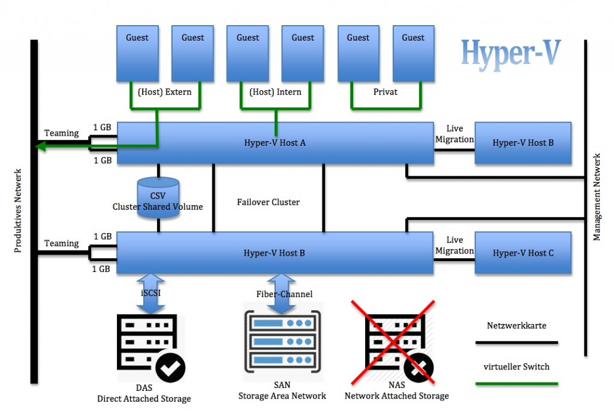

# Hyper-V-Virtualisierung

## Hardware

- IntelVT (Intel Virtualization Technology) oder AMD-V (AMD Virtualization)
- Data Execution Prevention (DEP) verfügbar und aktiviert → Intel-XD-Bit oder AMD-NX-Bit
- min. Windows Server 2012 mit 1.4 GHz-CPU mit einem Kern und 512 MB RAM (darauf läuft aber dann kein Guest mehr), die effektive Auslegung erfolgt aufgrund der geplanten Guests (Prozessoren und RAM) die auf dem Host laufen sollen
 

## Editionen

- bis zu 64 physische Prozessoren
- bis zu 4 TB RAM
 

### Beschränkungen bei Windows Server 2012 R2 Standard

- zwei Instanzen Windows Server
 

### Beschränkungen bei Windows Server 2012 R2 Datacenter

- unbegrenzte Anzahl Instanzen Windows Server
 
 \[caption id="attachment\_471" align="alignnone" width="625"\] Copyright (c) 2014 Martin Walther\[/caption\] 

## Storage

- Cluster Shared Volume (CSV)
- Direct Attached Storage (DAS)
- Storage Area Network (SAN)
- kein Network Attached Storage (NAS)
 

## Netzwerkkarten

- Produktives Netzwerk
- Management Netzwerk
- Failover Cluster
- Cluster Shared Volume
- Live Migration
- Windows-NIC Teaming
 

## Virtuelle Switches

### **Privat**

 Nur virtuelle Computer innerhalb des Hosts können miteinander kommunizieren. 

### **Intern**

 Virtuelle Computer innerhalb des Hosts untereinander und mit dem OS des Hosts können miteinander kommunizieren. 

### **Extern**

 Wie Intern, aber zusätzlich noch mit dem anderen am Host angeschlossenen Netzwerken.  