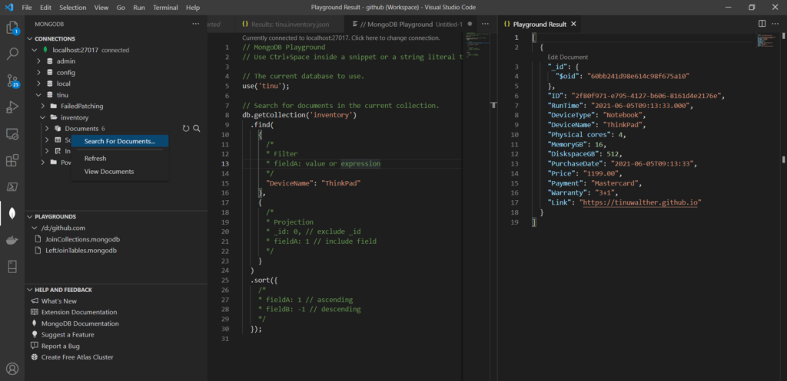
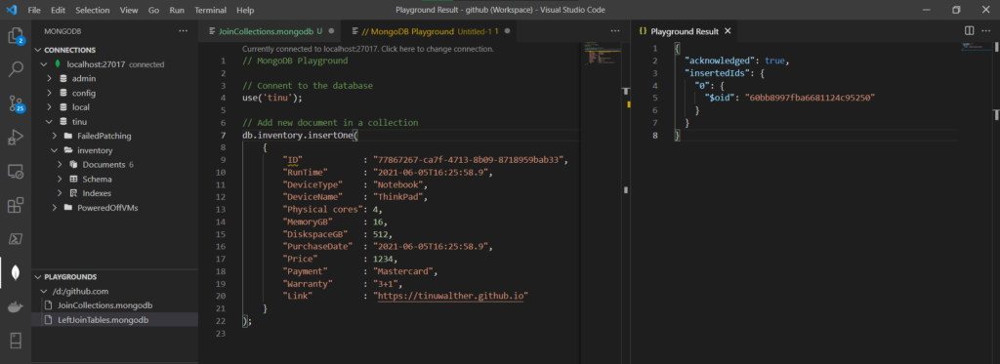

Mit Docker, Python und den [VS Code Extensions](/wiki/vs-code-datenbank-extensions/) für MongoDB wird es recht einfach sich in MongoDB einzuarbeiten. So richtig easy wird es dann, wenn man das PowerShell Module benutzt. Aber leider immer noch nicht so simple wie mit MSSQL Server.

## Docker

Mit Docker erstelle ich einen MongoDB Container auf Basis des offiziellen MongoDB Images von Docker Hub.

### Environment erstellen

Custom Netzwerk und die beiden Volumes für die MongoDB erstellen:

```
docker network create custom
docker volume create mongodata
docker volume create mongoconf
```

### Image und Container erstellen

Download the latest MongoDB Image.

```
docker pull mongo

```

Create a container. Wichtig ist hier die Zeitzone (-e TZ="Europe/Zurich") zu setzen, damit bei einem Insert des aktuellen Datum/Zeit der korrekte TimeStamp geschrieben wird.

```
docker run `
-e TZ="Europe/Zurich" `
-it -p 27017:27017  `
-v mongodata:/data/db `
-v mongoconf:/data/configdb  `
--name mongodb1  `
--hostname mongodb1  `
--network custom  `
-d mongo
```

## Connect MongoDB

Nachdem der Container gestartet ist, kann mit VSCode und den MongoDB Extensions auf die MongoDB zugegriffen werden, siehe [Extension für MongoDB](/wiki/vs-code-datenbank-extensions/#Extension_fuer_MongoDB).

## MongoDB Playground

Mit nachfolgenden Mongo Shell Befehlen kann eine Datenbank, eine Collection mit einem Document erstellt werden.

### Datenbank mit Collection erstellen

Die neue Datenbank/Collection wird bei MongoDB erst erstellt, wenn ein Document darin angelegt wird.

```
// MongoDB Playground

// Create the new database
use('tinu');

// Add document in a new collection
db.UserDB.insert({name: "Muster", firstname: "Hausi", age: 20});

```

### Search for document

Datenbank erweitern und via Collection auf die Documents browsen, Rechtsklick auf Documents, Search for Document, im MongoDB Playground den gewünschten Filter setzen und ausführen. Zum Editieren, im Playground Result auf Edit Document klicken, Anpassugen vornehmen und speichern.

[](/assets/wiki/MongoDB_SearchForDocument.png)### Insert document

MongoDB Playground Insert One Document.

[](/assets/wiki/MongoDB_InsertOneDocument.png)### Collections verbinden

Left Join von zwei Collections.

```
// MongoDB Playground

// Select the database to use.
use('JupyterNB');

// Join Table PoweredOffVMs with Table PatchingHistory
db.PoweredOffVMs.aggregate([
    // Join with PatchingHistory
    {
      $lookup:{
          from        : "PatchingHistory", // other table name
          localField  : "PSComputerName",  // name of PatchingHistory table field
          foreignField: "PSComputerName",  // name of PoweredOffVMs table field
          as          : "Patching_History" // alias for userinfo table
        }
   },
    // define which fields are you want to fetch
    // 1 = from PoweredOffVMs
    {   
        $project:{
            _id : 1,
            PSComputerName : 1,
            PowerState     : 1,
            PatchingStatus : "$Patching_History.Status",
            PatchingDate   : "$Patching_History.date",
        } 
    }
])
```

### Playground Resultat

Das Resultat einer MongoDB-Abfrage ist immer ein JSON-String:

```
[
  {
    "_id": {
      "$oid": "608e98c669c35e0cd06d4172"
    },
    "PSComputerName": "vsc0000925",
    "PowerState": "Off",
    "PatchingStatus": [
      "False"
    ],
    "PatchingDate": [
      "2021-05-09T09:00:00.000Z"
    ]
  },
  {
    "_id": {
      "$oid": "608e98c669c35e0cd06d4173"
    },
    "PSComputerName": "TIN87500803",
    "PowerState": "On",
    "PatchingStatus": [
      "True"
    ],
    "PatchingDate": [
      "2021-05-09T08:00:00.000Z"
    ]
  },
  {
    "_id": {
      "$oid": "608e98c669c35e0cd06d4175"
    },
    "PSComputerName": "xsc0000989",
    "PowerState": "Off",
    "PatchingStatus": [],
    "PatchingDate": []
  }
]

```

Das ist ja schön und gut, aber wie kann ich diese Daten automatisiert als File speichern und z.B. auf eine andere Datenbank importieren? Dafür setze ich Python oder PowerShell ein.

## Python code

Der Python code für MongoDB ist auf meinem GitHub Profile unter [PyMongoDB.py](https://github.com/tinuwalther/learningPython/blob/main/Classes/PyMongoDB.py) zu finden. Da sind Methoden darin enthalten um z.B. ein JSON-file zu importieren und exportieren u.v.m.

### Backup Collection as JSON

Auszug aus [PyMongoDB.py](https://github.com/tinuwalther/learningPython/blob/main/Classes/PyMongoDB.py)

```
import os, sys, json
from bson.json_util import dumps, loads

# Join the path to Downloads
if sys.platform == "linux" or sys.platform == "linux2":
    home_dir = os.environ['HOME']
elif sys.platform == "darwin":
    home_dir = os.environ['HOME']
elif sys.platform == "win32":
    home_dir  = os.environ['USERPROFILE']
downloads = os.path.join(home_dir,'Downloads')

connectionstring = "mongodb://localhost:27017" 
database         = 'tinu'
collection       = 'inventory'
json_file        = os.path.join(downloads,'tinu.inventory.json')

mongo_client = pymongo.MongoClient(connectionstring)
mongo_db     = mongo_client[database]
mongo_col    = mongo_db[collection]
cursor       = mongo_col.find()
docs         = list(cursor)

mongo_client.close()

# Converting to the JSON
json_data = dumps(docs) 

# Writing data to file data.json
with open(json_file, 'w') as write_file:
    write_file.write(json_data)
```

### Restore Collection from JSON

Auszug aus [PyMongoDB.py](https://github.com/tinuwalther/learningPython/blob/main/Classes/PyMongoDB.py)

```
import os, sys, json
from bson.json_util import dumps, loads

# Join the path to Downloads
if sys.platform == "linux" or sys.platform == "linux2":
    home_dir = os.environ['HOME']
elif sys.platform == "darwin":
    home_dir = os.environ['HOME']
elif sys.platform == "win32":
    home_dir  = os.environ['USERPROFILE']
downloads = os.path.join(home_dir,'Downloads')

connectionstring = "mongodb://localhost:27017" 
database         = 'tinu'
collection       = 'inventory'
json_file        = os.path.join(downloads,'tinu.inventory.json')

mongo_client = pymongo.MongoClient(connectionstring)
mongo_db     = mongo_client[database]
mongo_col    = mongo_db[collection]

with open(json_file, "r") as read_file:
    json_data = json.load(read_file)

# It is important to remove the _id field in order to import it into mongodb
for element in json_data:
    element.pop('_id', None)

try:
    if isinstance(json_data, list):
        mongo_col.insert_many(json_data)  
    else:
        mongo_col.insert_one(json_data)

except:
    sys.exit('file {}'.format(json_file))

mongo_client.close()
```

### List all documents

```
# <-- Print max 1000 documents --> #
def get_documents(connectionstring, database, collection):
    '''Connect to MongoDB and return data'''
    import pymongo
    mongo_client = pymongo.MongoClient(connectionstring)
    mongo_db     = mongo_client[database]
    mongo_col    = mongo_db[collection]
    mongo_client.close()
    return mongo_col.find()

import pandas as pd
table = []

result = get_documents(connectionstring, 'tinu', 'inventory')
for doc in result:
    thisdict = { 
        'ID'             : doc['ID'],
        'RunTime'        : doc['RunTime'],
        'DeviceType'     : doc['DeviceType'],
        'DeviceName'     : doc['DeviceName'],
        'Physical cores' : doc['Physical cores'],
        'MemoryGB'       : doc['MemoryGB'],
        'DiskspaceGB'    : doc['DiskspaceGB'],
        'PurchaseDate'   : doc['PurchaseDate'],
        'Price'          : doc['Price'],
        'Payment'        : doc['Payment'],
        'Warranty'       : doc['Warranty'],
        'Link'           : doc['Link'],
    }
    table.append(thisdict)

df = pd.DataFrame(table)
df.head(1000)
```

### Search for document

```
filter_set = {'ID' : '2f80f971-e795-4127-b606-8161d4e2176e'} 

def query_document(connectionstring, mongodatabase, collection, filterset):
    '''Connect to MongoDB and filter a document'''
    import pymongo
    mongo_client = pymongo.MongoClient(connectionstring)
    mongo_db     = mongo_client[mongodatabase]
    mongo_col    = mongo_db[collection]
    mongo_client.close()
    return mongo_col.find(filterset)

import pandas as pd
table = []

result = query_document(connectionstring, 'tinu', 'inventory', filter_set)
for doc in result:
    thisdict = { 
        'ID'             : doc['ID'],
        'RunTime'        : doc['RunTime'],
        'DeviceType'     : doc['DeviceType'],
        'DeviceName'     : doc['DeviceName'],
        'Physical cores' : doc['Physical cores'],
        'MemoryGB'       : doc['MemoryGB'],
        'DiskspaceGB'    : doc['DiskspaceGB'],
        'PurchaseDate'   : doc['PurchaseDate'],
        'Price'          : doc['Price'],
        'Payment'        : doc['Payment'],
        'Warranty'       : doc['Warranty'],
        'Link'           : doc['Link'],
    }
    table.append(thisdict)

df = pd.DataFrame(table)
df.head()
```

### Insert document

```
now  = datetime.now().strftime("%Y-%m-%dT%H:%M:%S")
guid = str(uuid.uuid4())

document_toimport = { 
    "ID"            : guid,
    "RunTime"       : now, 
    "DeviceType"    : "Notebook",
    "DeviceName"    : "ThinkPad",
    "Physical cores": 4,
    "MemoryGB"      : 16,
    "DiskspaceGB"   : 512,
    "PurchaseDate"  : now,
    "Price"         : 1234,
    "Payment"       : "Mastercard",
    "Warranty"      : "3+1",
    "Link"          : "https://tinuwalther.github.io"
}

def add_document(connectionstring, mongodatabase, collection, document):
    '''Connect to MongoDB and add a document'''
    import pymongo
    mongo_client = pymongo.MongoClient(connectionstring)
    mongo_db     = mongo_client[mongodatabase]
    mongo_col    = mongo_db[collection]
    mongo_col.insert_one(document)
    for doc in mongo_col.find():
        print(f'{doc["ID"]}\t{doc["RunTime"]}\t{doc["DeviceType"]}\t{doc["DeviceName"]}')

    mongo_client.close()

add_document(connectionstring, 'tinu', 'inventory', document_toimport)
```

### Update document

```
filter_set = {'ID' : '2f80f971-e795-4127-b606-8161d4e2176e'} 
update_set = {'$set' : {'Price' : '1199.00'}}

def update_document(connectionstring, mongodatabase, collection, filterset, updateset):
    '''Connect to MongoDB and update a document'''
    import pymongo
    mongo_client = pymongo.MongoClient(connectionstring)
    mongo_db     = mongo_client[mongodatabase]
    mongo_col    = mongo_db[collection]

    doc = mongo_col.find_one_and_update(filterset, updateset, upsert=True)
    print(doc)

    mongo_client.close()

update_document(connectionstring, 'tinu', 'inventory', filter_set, update_set)
```

### Remove document

```
document_toremove = {'DeviceName':'ThinkPad'}
def delete_all_documents(connectionstring, database, collection, query, output = False):
    """Connect to MongoDB and delete all documents"""
    import pymongo
    mongo_client = pymongo.MongoClient(connectionstring)
    mongo_db     = mongo_client[database]
    mongo_col    = mongo_db[collection]
    mongo_col.delete_many(query)
    
    if output:
        for doc in mongo_col.find():
            print(f'{doc["ID"]}\t{doc["RunTime"]}\t{doc["DeviceType"]}\t{doc["DeviceName"]}')

    mongo_client.close()

delete_all_documents(connectionstring, 'tinu', 'inventory', document_toremove, True)
```

## PowerShell Module

Mit den [MongoDB Cmdlets for PowerShell](https://github.com/nightroman/Mdbc) von Roman Kuzmin kommen wir weg von JSON-Strings hin zu PS objects.

### Connect to the MongoDB client

Als erstes muss wie immer eine Connection zur Datanbank und Tabelle/Collection erstellt werden:

```
Import-Module -Name Mdbc
$DatabaseName   = ''
$CollectionName = ''
$credentials    = ''
$cluster        = ''
$mongo_client   = Connect-Mdbc "mongodb+srv://$($credentials)@$($cluster)" #or mongodb://localhost
$mongo_db       = Get-MdbcDatabase -Name $DatabaseName
$mongo_col      = Get-MdbcCollection -Database $mongo_db -Name $CollectionName

```

### List all Databases

```
Get-MdbcDatabase -Client $mongo_client
```

### List all Collections

```
Get-MdbcCollection -Database $mongo_db | Select Collection*,Database
```

### Create Database and Collection

Eine Datenbank und Collection wird erst beim Anlegen eines Documents erstellt.

### Create documents

```
$document = @{
    PSComputerName = 'TIN87500806.child.domain.com'
    PowerState     = 'Off'
} 
Add-MdbcData -Collection $mongo_col -InputObject $document
```

### Search for Document

```
$filter_json = @{PSComputerName = 'TIN87500802.child.domain.com'} 
Get-MdbcData -Collection $mongo_col -Filter $filter_json

```

### Update Document

```
$filter_json = @{PSComputerName = 'TIN87500802.child.domain.com'} 
$update_json = @{'$set' = @{LastPatchStatus = 'Success'}}
Update-MdbcData -Collection $mongo_col -Filter filter_json -Update $update_json
```

### Get Documents as PS object

```
Get-MdbcData -Collection $mongo_col -As PS
```

#### PS object der Documents

```
_id                      PSComputerName               PowerState
---                      --------------               ----------
6098caf933ed74669d20f74d vsc0000925.child.domain.com  Off
6098caf933ed74669d20f74e TIN87500803.child.domain.com On
6098caf933ed74669d20f74f xsc0000983.child.domain.com  Off
```

### Backup Collection to JSON

Backup der Collection als JSON-File erstellen (ein bestehendes File wird überschrieben):

```
$file2export = 'C:\Users\...\Downloads\mongodb1_db-collection.json'
$Document = Get-MdbcData -Collection $mongo_col -As PS
$Document | ConvertTo-Json -Depth 1 | Out-File -FilePath $file2export -Encoding utf8 -Force
Get-Item $file2export
```

### Restore Collection from JSON

Restore der Collection aus einem JSON-File durchführen:

```
$file2import = 'C:\Users\...\Downloads\mongodb1_db-collection.json'
if(Test-Path $file2import){
    $Document = Get-Content $file2import | ConvertFrom-Json
    foreach($item in $Document){
        Add-MdbcData -Collection $mongo_col -InputObject $item
    }
}else{
    Write-Warning "$($file2import) not found"
}
```

### Join collection and get result as PS object

```
$stage_lookup = @{
    '$lookup' = @{
        from         = 'PoweredOffVMs'
        localField   = 'PSComputerName'
        foreignField = 'PSComputerName'
        as           = 'temp_collection'
    }
}

$stage_unwind = @{
    '$unwind' = '$temp_collection'
}

$stage_project = @{
    '$project' = @{
        _id                  = 1
        PSComputerName       = 1
        PowerState           = '$temp_collection.PowerState'
        LastPatchRun         = 1
        LastPatchStatus      = 1
        UpdateServerStatus   = 1
        CcmExecVersion       = 1
        CCMCimInstanceStatus = 1
    } 
}

$pipeline = @(
    $stage_lookup,
    $stage_project
)
Invoke-MdbcAggregate -Collection $mongo_col -Pipeline $pipeline -As PS | Format-Table
```

#### PS object des Joins

```
PSComputerName               LastPatchRun        UpdateServerStatus CcmExecVersion CCMCimInstanceStatus PowerState
--------------               ------------        ------------------ -------------- -------------------- ----------
TIN87500803.child.domain.com 2021.03.03 05:00:33 OK                 5.00.8968.1000 Success              {On}
vsc0000925.child.domain.com                      OK                 5.00.8968.1000 Success              {Off}
xsc0000930.child.domain.com  2021.01.22 01:34:00 OK                 5.00.8968.1000 Success              {}
xsc0000585.child.domain.com  2021.01.03 03:34:34 OK                 5.00.8968.1000 Success              {}
xsc0000983.child.domain.com                      OK                 5.00.8968.1000 Success              {Off}
TIN87500802.child.domain.com 2021.02.21 05:15:00 OK                 5.00.8968.1000 Success              {On}
```

## References

[MongoDB Cmdlets for PowerShell](https://github.com/nightroman/Mdbc), [PyMongoDB.py](https://github.com/tinuwalther/learningPython/blob/main/Classes/PyMongoDB.py)

