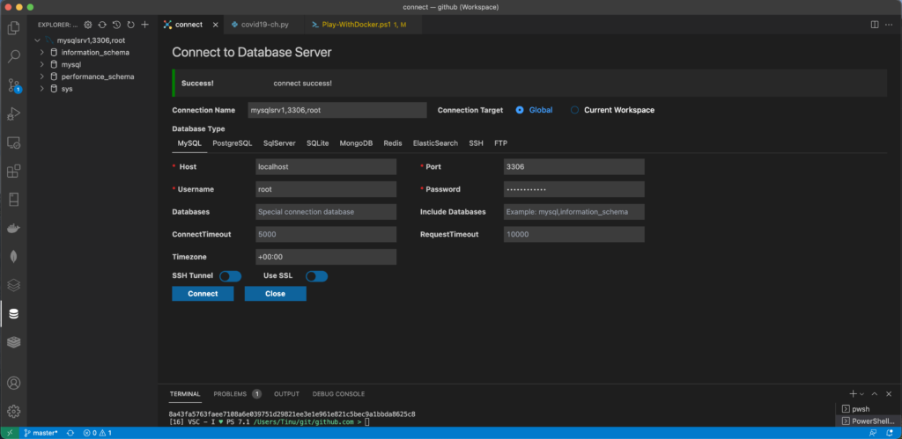
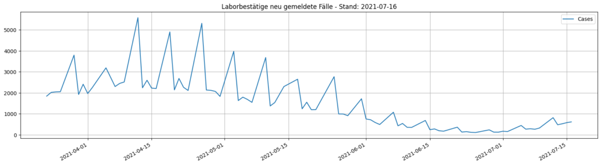
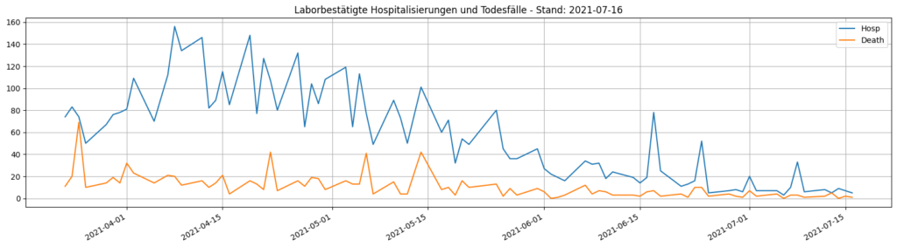

Auf [pythonanywhere.com](https://www.pythonanywhere.com/) kann mit dem **kostenlosen** **Beginner Account** ein Python-Script mit einem Scheduler einmal täglich ausgeführt werden. Dieses Script kann z. B. Daten in eine MySQL DB auf [pythonanywhere.com](https://www.pythonanywhere.com/) speichern. Will man die Daten auf eine extere Datenbank (z. B. Atlas MongoDB) auslagern muss ein **kostenpflichtiger** **Account** gelöst werden.

In diesem Beitrag erstelle ich eine Test DB auf Docker mit MySQL, damit ich mein Python-Script lokal testen kann bevor ich es auf [pythonanywhere.com](https://www.pythonanywhere.com/) einsetze.

## Docker

Mit Docker erstelle ich einen MySQL Container auf Basis des offiziellen Images von Docker Hub.

### Environment erstellen

Custom Netzwerk und das Volume für den MySQL Server erstellen:

```
docker network create custom
docker volume create mysqldata

```

### Image und Container erstellen

MySQL Image von [Docker Hub](https://hub.docker.com/_/mysql/) herunterladen:

```
docker pull mysql:latest

```

Container erstellen. Wichtig ist hier die Zeitzone (-e TZ="Europe/Zurich") zu setzen, damit bei einem Insert des aktuellen Datum/Zeit der korrekte TimeStamp geschrieben wird.

```
docker run -e TZ="Europe/Zurich" `
 -e 'MYSQL_ROOT_PASSWORD=my-secret-pw' `
 -p 3306:3306 `
 -v mysqldata:/var/lib/mysql `
 --hostname mysqlsrv1 `
 --name mysqlsrv1 `
 --network custom `
 -d mysql:latest

```

## Connect to MysqlDB

Nachdem der Container gestartet (`docker start mysqlsrv1`) ist, kann mit VSCode und den MySQL Extensions auf die MysqlDB zugegriffen werden, siehe [Extension für MySQL](https://marketplace.visualstudio.com/items?itemName=cweijan.vscode-mysql-client2).

[](/assets/wiki/MySQLConnection.png)Mit diesen Extensions kann eine neue Datenbank erstellt werden, Daten aus einem SQL-File importiert und auch exportiert werden.

## Python code

### Import JSON

Importiert ein JSON-file in die angegebene Tabelle. Wenn die Tabelle existiert, wird sie zuerst gelöscht. Folgende Functions stehen zur Verfügung: validat\_string(), get\_table(), drop\_table(), create\_table(), insert\_into() und import\_json().


```
import pymysql, os, json, sys, getpass

def validate_string(val):
    '''Do validation and checks before insert'''
    if val != None:
        if type(val) is int:
            return str(val).encode('utf-8')
        else:
            return val

def get_table(sqlconnection, table):
    '''Test table exists'''
    sql = "SHOW TABLES LIKE '%s' "% ('%'+str(table)+'%')
    try:
        cursor = sqlconnection.cursor()
        cursor.execute(sql)
        result = cursor.fetchone()
        print('[INFO]\t{0}():\tTable {1} = {2}'.format(sys._getframe().f_code.co_name, table, result[0]))
    except Exception as e:
        print('[WARN]\t{0}():\t{1}'.format(sys._getframe().f_code.co_name, e))
        result = False

    return result

def drop_table(sqlconnection, table):
    '''Dropping table if already exists'''
    sql = 'DROP TABLE IF EXISTS ' + table
    try:
        cursor = sqlconnection.cursor()
        cursor.execute(sql)
        print('[INFO]\t{0}():\tTable {1} dropped'.format(sys._getframe().f_code.co_name, table))
        return True
    except Exception as e:
        print('[WARN]\t{0}():\t{1}'.format(sys._getframe().f_code.co_name, e))
        return False

def create_table(sqlconnection, table, tabledefinition):
    '''Creating table'''
    sql = "CREATE TABLE " + table + "(" + tabledefinition + ")"
    try:
        cursor = sqlconnection.cursor()
        cursor.execute(sql)
        print('[INFO]\t{0}():\tTable {1} created'.format(sys._getframe().f_code.co_name, table))
        return True
    except Exception as e:
        print('[WARN]\t{0}():\t{1}'.format(sys._getframe().f_code.co_name, e))
        return False

def insert_into(sqlconnection, table, date, cases, hosp, death, output = False):
    '''Insert one record'''
    errorcount = 0
    try:
        cursor = sqlconnection.cursor()
        cursor.execute(
            "INSERT INTO " + table + " (date, cases, hosp, death) VALUES (%s,%s,%s,%s)", (date, cases, hosp, death)
        )
        sqlconnection.commit()
        if output:
            print('[INFO]\t{0}():\tRecord inserted into table {1}'.format(sys._getframe().f_code.co_name, table))
        return True
    except Exception as e:
        print('[WARN]\t{0}():\t{1}'.format(sys._getframe().f_code.co_name, e))
        errorcount + 1
        return False

def import_json(json_file, sqlconnection, table, field1, field2, field3, field4, droptable = False):
    '''Import data from JSON-file'''
    check_path = os.path.exists(json_file)
    if(check_path == True):

        # Read JSON file
        json_data = open(json_file).read()
        json_obj  = json.loads(json_data)

        if droptable:
            if drop_table(sqlconnection, table):
                create_table(sqlconnection, table, 'date VARCHAR(10) NOT NULL, cases INT, hosp INT, death INT')

        # parse json data to SQL insert
        errorcount   = 0
        successcount = 0
        for i, item in enumerate(json_obj):
            date  = validate_string(item.get(field1, None))
            cases = int(validate_string(item.get(field2, None)))
            hosp  = int(validate_string(item.get(field3, None)))
            death = int(validate_string(item.get(field4, None)))

            try:
                result = insert_into(sqlconnection, mytable, date, cases, hosp, death)
                if result:
                    successcount = successcount + 1
                else:
                    errorcount   = errorcount + 1
            except Exception as e:
                print('[WARN]\t{0}():\t{1}'.format(sys._getframe().f_code.co_name, e))
                errorcount + 1

        print('[INFO]\t{0}():\tInserted {1} records with {2} errors'.format(sys._getframe().f_code.co_name, successcount ,errorcount))

if __name__ =="__main__":
        
    # Join the path to Downloads
    if sys.platform == "linux" or sys.platform == "linux2":
        home_dir = os.environ['HOME']
    elif sys.platform == "darwin":
        home_dir = os.environ['HOME']
    elif sys.platform == "win32":
        home_dir  = os.environ['USERPROFILE']
    downloads = os.path.join(home_dir,'Downloads')

    json_file = os.path.join(downloads, 'MongoDB.Atlas.Covid19.json')

    # Initiate variables
    sqlhost   = 'localhost'
    sqluser   = 'root'
    sqlusrpw  = getpass.getpass("Enter the password:")
    mydb      = 'tinu'
    mytable   = 'covid19'
    droptable = True

    # Connect to MySQL
    sqlconnection = pymysql.connect(host = sqlhost, user = sqluser, password = sqlusrpw, db = mydb)

    # Import JSON file
    if get_table(sqlconnection, mytable):
        pass
    else:
        create_table(sqlconnection, mytable, 'date VARCHAR(10) NOT NULL, cases INT, hosp INT, death INT')

    # Import from Atlas-MongoDB
    import_json(json_file, sqlconnection, mytable, field1="Datum", field2="Neue Fälle", field3="Hospitalisationen", field4="Todesfälle", droptable = True)

    # Import from Pythonanywhere-MysqlDB
    import_json(json_file, sqlconnection, mytable, field1="Date", field2="Cases", field3="Hosp", field4="Death", droptable = True)

    sqlconnection.close()
```

### Export JSON

Exportiert die angegebene Tabelle in ein JSON-file. Folgende Functions stehen zur Verfügung: get\_rows() und export\_json().


```
import pymysql, sys, os, json, getpass
from bson.json_util import dumps

def get_rows(sqlconnection, table, output = False):
    '''Get all rows from table'''
    sql = "SELECT * FROM %s"% (str(table))
    try:
        cursor = sqlconnection.cursor()
        cursor.execute(sql)
        result = cursor.fetchall()
        if output:
            print('[INFO]\t{0}():\tTable {1} = {2}'.format(sys._getframe().f_code.co_name, table, result[0]))
    except Exception as e:
        print('[WARN]\t{0}():\t{1}'.format(sys._getframe().f_code.co_name, e))

    return result

def export_json(json_file, sqlconnection, table, output = False):
    '''Export as JSON'''
    sqldata = get_rows(sqlconnection, table, output = False)
    if sqldata:
        try:
            result_of_history = []
            for row in sqldata:
                thisdict = {
                    'Date'   : row[0],
                    'Cases'  : row[1],
                    'Hosp'   : row[2],
                    'Death'  : row[3],
                }
                result_of_history.append(thisdict)

            # Converting to the JSON
            json_data = dumps(result_of_history)

            # Writing data to file data.json
            with open(json_file, "w") as write_file:
                write_file.write(json_data)

            if os.path.exists(json_file):
                if output:
                    print("[INFO]\t{0}():\tFile saved as {1}".format(sys._getframe().f_code.co_name, json_file))
            else:
                if output:
                    print("[INFO]\t{0}():\tCould not save file as {1}".format(sys._getframe().f_code.co_name, json_file))

            return True

        except Exception as e:
            print("[WARN]\t{0}():\t{1}".format(sys._getframe().f_code.co_name, e))
            return False

if __name__ =="__main__":

    # Join the path to Downloads
    if sys.platform == "linux" or sys.platform == "linux2":
        home_dir = os.environ['HOME']
    elif sys.platform == "darwin":
        home_dir = os.environ['HOME']
    elif sys.platform == "win32":
        home_dir  = os.environ['USERPROFILE']
    downloads = os.path.join(home_dir,'Downloads')

    # Initiate variables
    sqlhost   = 'localhost'
    sqluser   = 'root'
    sqlusrpw  = getpass.getpass(prompt = 'Enter the password:')
    mydb      = 'tinu'
    mytable   = 'covid19'

    # Open database connection
    sqlconnection = pymysql.connect(host = sqlhost, user = sqluser, password = sqlusrpw, db = mydb)

   json_file = os.path.join(downloads, 'MysqlDB.tinu.covid19.json')
   result = export_json(json_file, sqlconnection, mytable, output = True)
```

### Insert one record

Einen einzelnen Record kann mit folgendem Code in die Tabelle geschrieben werden. Folgende Functions stehen zur Verfügung: insert\_into().


```
import pymysql, os, json, sys, getpass

def insert_into(sqlconnection, table, date, cases, hosp, death, output = False):
    '''Insert one record'''
    errorcount = 0
    try:
        cursor = sqlconnection.cursor()
        cursor.execute(
            "INSERT INTO " + table + " (date, cases, hosp, death) VALUES (%s,%s,%s,%s)", (date, cases, hosp, death)
        )
        sqlconnection.commit()
        if output:
            print('[INFO]\t{0}():\tRecord inserted into table {1}'.format(sys._getframe().f_code.co_name, table))
        return True
    except Exception as e:
        print('[WARN]\t{0}():\t{1}'.format(sys._getframe().f_code.co_name, e))
        errorcount + 1
        return False

if __name__ =="__main__":   

    # Initiate variables
    sqlhost   = 'localhost'
    sqluser   = 'root'
    sqlusrpw  = getpass.getpass("Enter the password:")
    mydb      = 'tinu'
    mytable   = 'covid19'

    # Connect to MySQL
    sqlconnection = pymysql.connect(host = sqlhost, user = sqluser, password =                 sqlusrpw, db = mydb)

    # Insert one record
    insert_into(sqlconnection, mytable, '17.07.2021', 666, 3, 0, output = True)

    sqlconnection.close()
```

### Read all rows

Die Tabelle auslesen und in ein Pandas DataFrame speichern und weiterverarbeiten als Charts. Die Charts werden im Downloads Folder als PNG-Files abgespeichert. Folgende Functions stehen zur Verfügung: save\_linechart() und save\_linechart().


```
import pymysql, os, json, sys, getpass, re
import pandas as pd, matplotlib.pyplot as plt
from datetime import datetime

def get_rows(sqlconnection, table, output = False):
    '''Get all rows from table'''
    sql = "SELECT * FROM %s"% (str(table))
    try:
        cursor = sqlconnection.cursor()
        cursor.execute(sql)
        result = cursor.fetchall()
        if output:
            print('[INFO]\t{0}():\tTable {1} = {2}'.format(sys._getframe().f_code.co_name, table, result[0]))
    except Exception as e:
        print('[WARN]\t{0}():\t{1}'.format(sys._getframe().f_code.co_name, e))

    return result

def save_linechart(data, x, y, title, path):
    '''Create chart and save it to downloads'''
    try:
        chart = data.plot.line(
            x       = x, 
            xlabel  = "", 
            ylabel  = "", 
            y       = y, 
            title   = title, 
            grid    = True, 
            legend  = True, 
            figsize = (20,5)
        )
        ### Save chart as png-file
        fig = chart.get_figure()
        fig.savefig(f'{path}', facecolor='w', bbox_inches='tight')
        if os.path.exists(path):
            print('[INFO]\t{0}():\tChart saved as {1}'.format(sys._getframe().f_code.co_name, path))
        else:
            print('[INFO]\t{0}():\tCould not save chart as {1}'.format(sys._getframe().f_code.co_name, path))
    except Exception as e:
        print('[WARN]\t{0}():\t{1}'.format(sys._getframe().f_code.co_name, e))

if __name__ =="__main__":  
  
    # Join the path to Downloads
    if sys.platform == "linux" or sys.platform == "linux2":
        home_dir = os.environ['HOME']
    elif sys.platform == "darwin":
        home_dir = os.environ['HOME']
    elif sys.platform == "win32":
        home_dir  = os.environ['USERPROFILE']
    downloads = os.path.join(home_dir,'Downloads')

    # Initiate variables
    sqlhost   = 'localhost'
    sqluser   = 'root'
    sqlusrpw  = getpass.getpass("Enter the password:")
    mydb      = 'tinu'
    mytable   = 'covid19'

    # Connect to MySQL
    sqlconnection = pymysql.connect(host = sqlhost, user = sqluser, password = sqlusrpw, db = mydb)

    # Get mysql-table and convert to dictionary
    covid_data = get_rows(sqlconnection, mytable)
    sqlconnection.close()

    result_of_history = []
    for row in covid_data:
        thisdict = {
            'Date'   : datetime.strptime(row[0], '%d.%m.%Y'),
            'Cases'  : row[1],
            'Hosp'   : row[2],
            'Death'  : row[3],
        }
        result_of_history.append(thisdict)

    ## Create a data frame set and print out as table
    df = pd.DataFrame(result_of_history)
    print(df)

    count_of_datum = df.Date.count()
    first_value    = str(re.findall(r'\d{4}\-\d{2}\-\d{2}', str(df.Date.values[0]))[0])
    last_value     = str(re.findall(r'\d{4}\-\d{2}\-\d{2}', str(df.Date.values[count_of_datum -1]))[0])

    ## Print data frame set as line chart
    save_linechart(df, 'Date', ['Cases'], f"Laborbestätige neu gemeldete Fälle - Stand: {last_value}", os.path.join(downloads,'covid-dayli-newcases.png'))
    save_linechart(df, 'Date', ['Hosp','Death'], f"Laborbestätige Hospitalisierungen und Todesfälle - Stand: {last_value}", os.path.join(downloads,'covid-dayli-host-dead.png'))
```

#### Grafiken vom 16.07.2021

[](/assets/wiki/covid-dayli-newcases.png)<figcaption><code>covid&#45;dayli&#45;newcases&#46;png</code></figcaption>[](/assets/wiki/covid-dayli-host-dead.png)<figcaption><code>covid&#45;dayli&#45;host&#45;dead&#46;png</code></figcaption>## PythonAnywhere

Auf PythonAnywhere musste ich das Modul MySQLdb einsetzen. Die aktuellen Charts werden mit oben aufgeführtem Code auf [tinuwalther.pythonanywhere.com](https://tinuwalther.pythonanywhere.com/) täglich aufbereitet und können eingesehen werden.

## Git-Project

Das vollständige Covid19-Projekt steht auf meinen [GitHub Profile](https://github.com/tinuwalther/Covid19CH) zur freien Verfügung.

## References

[Python MySQL](https://www.w3schools.com/python/python_mysql_getstarted.asp), [Python - MySQL Database Access](https://www.tutorialspoint.com/python/python_database_access.htm)

