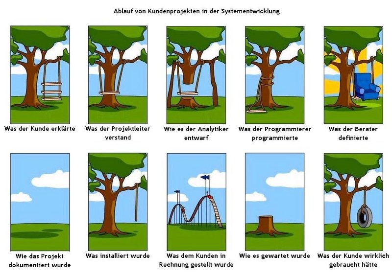

Ein Projekt ist ein zeitlich begrenztes Unternehmen, das unternommen wird, um ein einmaliges Produkt, eine Dienstleistung oder ein Ergebnis zu erzeugen. Nach dem Projekt kommt der Betrieb in der IT und hier ist der [Lifecycle](/wiki/lifecycel/) wiederum ein wichtiges Thema.

## Planung

Das Wichtigste an einem Projekt ist dessen Planung. Dafür gibt es viele verschiedene Vorgehensmodelle, welche z.T. mit Software unterstüzt werden. Meine Erfahrungen haben gezeigt, dass ein einfaches Excelsheet als Gantt-Diagramm seinen Zweck sehr gut erfüllt. Mit Tools wie Jira, Visual Studio Online, u.ä. kann sogar webbasiert auf Basis von [Scrum ](/wiki/scrum/)geplant werden. 

## Dokumentation

Nach der Planung folgen Dokumentationen und Zeichnungen, welche unabdingbar sind. Ist- und Soll-Zustand sind zu erheben und dokumentieren, sowie der Weg vom Ist- zum Sollzustand. 

## Übergabe an den Betrieb

Übergabe an den Betrieb und **Schulung** der Mitarbeiter gehen häufig vergessen. Das darf bitte nicht vorkommen. 

## Abnahme

Das Projekt wird mit einem Abnahmeprotokoll vom Kunden unterzeichnet und gilt somit als abgenommen. 

## Abschluss

Am Schluss folgt immer eine Lessons Learned wo die folgenden Punkte erläutert werden: 

- Wie war die Ausgangslage?
- Was waren die erste Erkenntnisse aus der Ausgangslage?
- Was kann beim nächsten Projekt besser gemacht werden?
- Persönliches Fazit

... und wenn alles nichts nützt, gibt es hier ganz bestimmt eine plausible [Erklärung ](http://www.scheissprojekt.de)dafür.