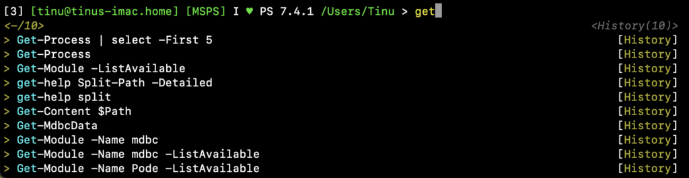
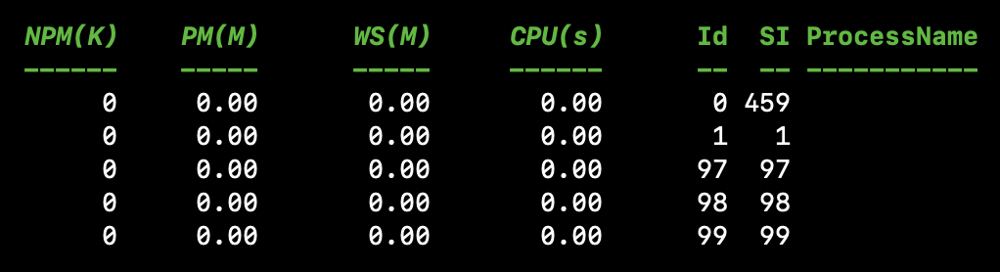
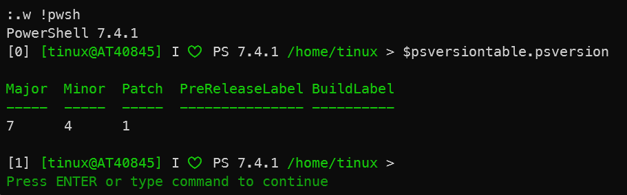
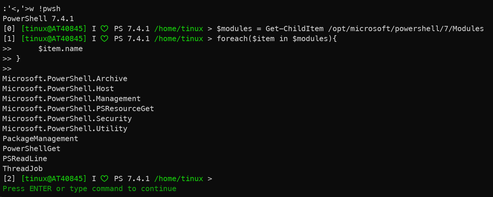
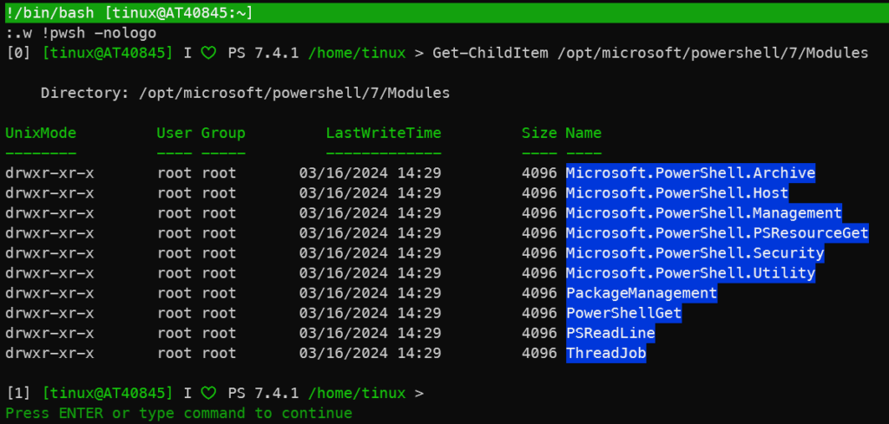

Die [PSConfEU 2023](https://www.youtube.com/playlist?list=PLDCEho7foSopknKI3VEqjdVpssJa41qs3) hatte im schönen Prag in Tschechien stattgefunden. Ich konnte wieder viel von meinen weltweiten Community Members und ihren Tools und Techniken und ihrem Mindset lernen.

## Allgemein

Bei Demos mit Visual Studio Code ist es besser auf den light Mode zu wechseln, damit der Code im ganzen Raum besser lesbar wird.

PSReadLine in der Version 2.2.6 bietet eine bessere History und kann auf ListView umgestellt werden.

[](/assets/wiki/PSReadLine.png)

```
Set-PSReadLineOption -PredictionViewStyle ListView
```

PSStyle formatiert die Ausgabe farblich (Kopfzeilen werden grün und Inhalte weiss formatiert).

Jeff Hicks hat eine Session [PowerShell with Style](https://github.com/jdhitsolutions/PowerShell-with-Style) bei der PSUG Rhein Neckar darüber gehalten.

[](/assets/wiki/PSStyle.png)## PowerShell TUIs

<figure class="wp-block-embed is-type-video is-provider-youtube wp-block-embed-youtube wp-embed-aspect-16-9 wp-has-aspect-ratio"><div class="wp-block-embed__wrapper">https://www.youtube.com/watch?v=FOuw3mSZFnU&amp;list=PLDCEho7foSopknKI3VEqjdVpssJa41qs3&amp;index=74 </div></figure>

```
Install-Module -Name Microsoft.PowerShell.ConsoleGuiTools

Get-Command -Module Microsoft.PowerShell.ConsoleGuiTools | Select -ExpandProperty Name

Out-ConsoleGridView
Show-ObjectTree
```

**Terminal.Gui.dll** und **NStack.dll** aus dem Nuget Package Terminal.Gui werden benötigt um Terminal GUIs mit mehr Möglichkeiten als die aus den ConsoleGuiTools von Microsoft zu benutzen. Die Assemblies sind unter anderem im Project PSWorkItem von Jeff Hicks abgelegt:

```
https://github.com/jdhitsolutions/PSWorkItem/tree/main/assemblies
```

## DevOps &amp; From PowerCLI to REST API

<figure class="wp-block-embed is-type-video is-provider-youtube wp-block-embed-youtube wp-embed-aspect-16-9 wp-has-aspect-ratio"><div class="wp-block-embed__wrapper">https://www.youtube.com/watch?v=0UFc2ledw80&amp;list=PLDCEho7foSopknKI3VEqjdVpssJa41qs3&amp;index=60 </div></figure>PowerShell, Git, VM Templates mit Packer automatisieren, Terrafrom, Ansible, API benutzen.

### Terraform

Installation Terraform: <https://developer.hashicorp.com/terraform/install>

Mac via brew:

```
brew tap hashicorp/tap<br></br>brew install hashicorp/tap/terraform
```

Windows mit Chocolatey:

```
choco install -y terraform
```

Einführung in Terraform siehe <https://developer.hashicorp.com/terraform/tutorials/aws-get-started/install-cli>

<figure class="wp-block-embed is-type-video is-provider-youtube wp-block-embed-youtube wp-embed-aspect-16-9 wp-has-aspect-ratio"><div class="wp-block-embed__wrapper">https://www.youtube.com/watch?v=x12bK0gwaPM&amp;list=PLDCEho7foSopknKI3VEqjdVpssJa41qs3&amp;index=61 </div></figure>So schnell wie möglich MVP - Minimum Viable Product ausliefern, statt warten bis alles perfekt fertig ist.

SOAP vs. REST API, SOAP ist die alte Schnittstelle basierend auf XML und ist langsam, REST API ist die neuere Schnittstelle und um ein Vielfaches schneller als SOAP.

### PowerCLI

```
#Overhead
$oVMHost = Get-VMHost
Show-Object $oVMHost

#Fast
$fVMHost = Get-View -ViewType HostSystem
Show-Object $fVMHost
```

**Show-Object** aus dem PSModule PowerShellCookbook von Lee Holmes bietet eine grafische Oberfläche, mit der ein Objekt erkundet und navigiert werden kann.

### Cis Server

Cis Service ist ähnlich wie REST API.

```
$CISServer = 'vcenter.server.local'
$CISCredential = Get-Credential
Connect-CisServer -Server $CISServer -Credential $CISCredential

$tagService = Get-CisService -Name 'com.vmware.cis.tagging.tag'
$vmService  = Get-CisService -Name 'com.vmware.vcenter.VM'
```

## Windows Docker Container

<figure class="wp-block-embed is-type-video is-provider-youtube wp-block-embed-youtube wp-embed-aspect-16-9 wp-has-aspect-ratio"><div class="wp-block-embed__wrapper">https://www.youtube.com/watch?v=wg8WMukzwxk&amp;list=PLDCEho7foSopknKI3VEqjdVpssJa41qs3&amp;index=47 </div></figure>## Windows Terminal

<figure class="wp-block-embed is-type-video is-provider-youtube wp-block-embed-youtube wp-embed-aspect-16-9 wp-has-aspect-ratio"><div class="wp-block-embed__wrapper">https://www.youtube.com/watch?v=AO-5oxB7e_c&amp;list=PLDCEho7foSopknKI3VEqjdVpssJa41qs3&amp;index=49 </div></figure>Will man ein Terminal als Admin im gleichen Fenster als neuen Tab starten, muss zuerst gsudo installiert werden.

```
choco install gsudo -y
```

Danach kann man ein Profile PowerShell (Admin) erstellen und konfigurieren.

Befehlszeile: gsudo pwsh -nologo

## PowerShell in Vim

[Andrew Pruski - dbafromthecold on github.com](https://github.com/dbafromthecold/powershellvim)

<figure class="wp-block-embed is-type-video is-provider-youtube wp-block-embed-youtube wp-embed-aspect-16-9 wp-has-aspect-ratio"><div class="wp-block-embed__wrapper">https://www.youtube.com/watch?v=ByRMg3V69Yg&amp;list=PLDCEho7foSopknKI3VEqjdVpssJa41qs3&amp;index=32 </div></figure>### Ausführen einer einzelnen Zeile

```
write vim + i $psversiontable.psversion
press esc
write :.w !pwsh
```

[](/assets/wiki/run-single-command.png)### Ausführen von mehreren Zeilen

```
write vim, i
$modules = Get-ChildItem /opt/microsoft/powershell/7/Modules
foreach($item in $modules){
    $item.name
}
<empty line>
press esc, v, 4x Tab
press :
'<,'>
write w !pwsh
```

[](/assets/wiki/run-multiline-command-1.png)### Vim und Terminal gleichzeitig anzeigen

```
write vim, i + Get-ChildItem /opt/microsoft/powershell/7/Modules
press esc
write :below term
press Ctrl + w
press Arrow up
write :.w !pwsh -nologo
```

[](/assets/wiki/below-term.png)

```
exit
```

### NERDTree installieren

[Anleitung auf github.com](https://github.com/preservim/nerdtree)

```
git clone https://github.com/preservim/nerdtree.git ~/.vim/pack/vendor/start/nerdtree
vim -u NONE -c "helptags ~/.vim/pack/vendor/start/nerdtree/doc" -c q
vim
```

### Vim anpassen mit vimrc

```
touch ~/.vimrc

"vim generic settings
set number
set nowrap

"set default shell
set shell=pwsh\ -nologo
set filetype=ps1

set ruler
set smartindent "automatically set indents when writing code
set tabstop=4  "set number of spaces a tab is
set shiftwidth=4 "set number of spaces an indent is
set expandtab "tabs become spaces

"remove text from NERDTree UI
let NERDTreeMinimalUI=1

"fix issues with colors in windows terminal
set termguicolors

"syntax highlighting on
syntax on

"highlight line cursor is on
set cursorline

set nocompatible

filetype on
filetype plugin on
filetype indent on

colorscheme blue

"set aliases
cnoreabbrev powershell powershell -executionpolicy unrestricted -nologo
cabbrev bterm below term
cabbrev ntree NERDTree

"open terminal and NERDTree on start up and in new tabs
autocmd VimEnter * :below terminal
autocmd VimEnter * :NERDTree

"shortcut to execute commands in terminal
noremap <C-;> Y<C-W>j<C-W>"0<C-W>k

"shortcut for scrolling in terminal (i to exit)
tnoremap <C-b> <C-\><C-n>

"shortcut for switching between code and terminal
noremap <C-/> <C-w>j
tnoremap <C-/> <C-w>k

"shortcut mapping ctrl+right to open new editor
noremap <C-Right> :vsplit new.ps1<CR>
```