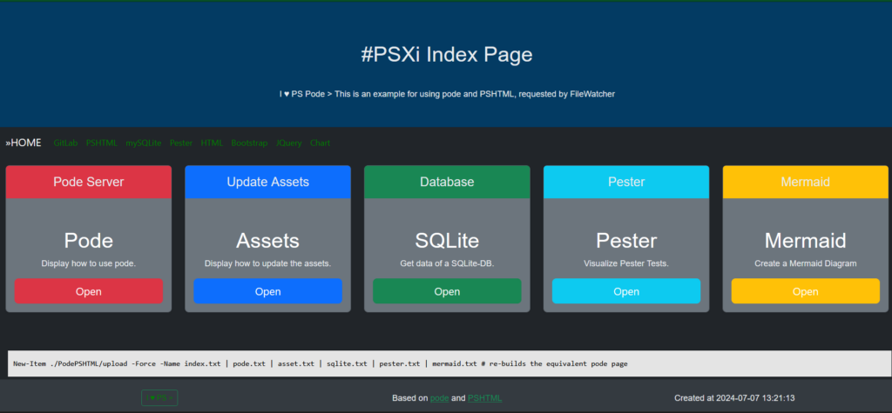

# - DRAFT -

Die [PSConfEU 2024](https://psconf.eu/recordings/videos-2024/) wurde in Belgien in [Antwerpen ](https://de.wikipedia.org/wiki/Antwerpen)durchgeführt. Ich habe wie immer wieder sehr viele meiner Freunde aus der PowerShell Community getroffen und auch neue Bekanntschaften gemacht.

[](/assets/wiki/Antwerp-1-scaled.jpg)## Allgemein

4 Tage prallgefüllt mit 70 Sessions! Es haben immer 4 Sessions gleichzeigt in verschiedenen Räumen stattgefunden. Da wird es schwierig sich für die eine Session zu entscheiden. Ich stelle euch hier ein paar der Sessions vor, welche ich interessant finde. Die gesamte Liste an Videos findet ihr [hier](https://www.youtube.com/playlist?list=PLDCEho7foSor3zw2nZVi4AR100bRr6Ehs).

## Execute Notebooks everywhere

David Sass on [Mastodon](https://techhub.social/@sassdawe@infosec.exchange)

In dieser Session geht es um Polyglot Notebooks in Visual Studio Code, Dev Containers, Git Pipelines …

<figure class="wp-block-embed is-type-video is-provider-youtube wp-block-embed-youtube wp-embed-aspect-16-9 wp-has-aspect-ratio"><div class="wp-block-embed__wrapper">https://www.youtube.com/watch?v=RNQto14mH9s </div></figure>## InnerSourcing a central automation platform

Jelle de Graaf on [LinkedIn](https://www.linkedin.com/in/jelledegraaf/)

In dieser Session geht es um die Zusammenarbeiten im Team mit Azure DevOps (Jira), GitLab/GitHub, Pester…

**Contribute:** Have an Idea - Create Work Item - Write Code - Create Tests - Add to Production

<figure class="wp-block-embed is-type-video is-provider-youtube wp-block-embed-youtube wp-embed-aspect-16-9 wp-has-aspect-ratio"><div class="wp-block-embed__wrapper">https://www.youtube.com/watch?v=6wPsegfgIk8 </div></figure>## Deploy your code to internal customers

Jelle de Graaf on [LinkedIn](https://www.linkedin.com/in/jelledegraaf/)

In dieser Session geht es um die Verteilug von Code/Applications in verschiedene Destinations mit Azure DevOps **Pipelines**, GitLab …

<figure class="wp-block-embed is-type-video is-provider-youtube wp-block-embed-youtube wp-embed-aspect-16-9 wp-has-aspect-ratio"><div class="wp-block-embed__wrapper">https://www.youtube.com/watch?v=S2y3FT4mZSM </div></figure>## Create beautiful reports with PSHTML

Jess Pomfret on [LinkedIn](https://www.linkedin.com/in/jpomfret)

Jess zeigt wie mit PSHTML formatierte Berichte und Webseiten mit PowerShell erstellt werden können.

<figure class="wp-block-embed is-type-video is-provider-youtube wp-block-embed-youtube wp-embed-aspect-16-9 wp-has-aspect-ratio"><div class="wp-block-embed__wrapper">https://www.youtube.com/watch?v=Fc5jG-dFLW0 </div></figure>PSHTML setze ich schon lange in meinen diversen GitHub-Projekten ein.

Diese Session hat mich wieder inspiriert, ein GitHub-Projekt mit **pode** und **PSHTML** zu erstellen. Im [PodePSHTML](https://github.com/tinuwalther/PodePSHTML) setze ich pode als **Web Service** ein, welcher mit HTTP-Endpoints und **API-Endpoints** Webseiten mit PSHTML erstellt oder aktualisiert. Als Beispiele verwende ich eine lokale **SQLite** Datenbank und **Pester** Tests um ein paar der Möglichkeiten aufzuzeigen. Ein **Mermaid** Diagramm darf natürlich auch nicht fehlen.

Das Projekt kann auch als Docker Image heruntergeladen und als Linux Container gestartet werden:

`docker pull tinuwalther/pode:latest`

`docker run -e TZ="Europe/Zurich" --hostname pshtml --name podepshtml -p 8080:8080 -d tinuwalther/pode`

[](/assets/wiki/PodePSHTML.png)## PowerShell Development with Dev Containers

Jess Pomfret on [LinkedIn](https://www.linkedin.com/in/jpomfret), Rob Sewell on [LinkedIn](https://x.com/jpomfret)

Jess und Rob zeigen wie mit Dev Containers und GitHub Codespaces die ideale Umgebung für die Erstellung von PowerShell-Scripts/Modules erstellt und benutzt werden können.

<figure class="wp-block-embed is-type-video is-provider-youtube wp-block-embed-youtube wp-embed-aspect-16-9 wp-has-aspect-ratio"><div class="wp-block-embed__wrapper">https://www.youtube.com/watch?v=0TggFWLquKA </div></figure>## Quick Wins with the PSFramework

Fred Weinmann on [X](https://x.com/FredWeinmann)

Fred zeigt uns in dieser Session ein paar seiner Commandlets aus seinem Module **PSFramework**. PSFramework ist bakannt für seine Logging-Möglichkeiten, aber da sind noch so viele weitere Commandlets im Module vorhanden. Mich hat z.B. **ConvertFrom-PSFArray** und **New-PSFSupportPackage** überzeugt.

<figure class="wp-block-embed is-type-video is-provider-youtube wp-block-embed-youtube wp-embed-aspect-16-9 wp-has-aspect-ratio"><div class="wp-block-embed__wrapper">https://www.youtube.com/watch?v=xD3Hh-jNOg4&amp;pp=ygUfUXVpY2sgV2lucyB3aXRoIHRoZSBQU0ZyYW1ld29yaw%3D%3D </div></figure>### PSFArray

Mit ConvertFrom-PSFArray wird ein System.Object\[\] in einen String mit entsprechendem Trennzeichen umgewandelt.

```powershell
$ItsMe= [PSCustomObject]@{
    Name  = 'Tinu'
    Hobby = 'Rennrad', 'MTB', 'PowerShell', 'Reisen'
}

```

Hobby ist vom Type System.Array Object\[\]

```powershell
$ItsMe

Name Hobby
---- -----
Tinu {Rennrad, MTB, PowerShell, Reisen}

```


```
$ItsMe | ConvertTo-CSV

"Name","Hobby"
"Tinu","System.Object[]"

```

Mit ConvertFrom-PSFArray wird das Array in einen String mit dem default Trennzeichen ‘,’ umgewandelt.

```
$ItsMe | ConvertFrom-PSFArray | ConvertTo-CSV -Delimiter ';'

"Name";"Hobby"
"Tinu";"Rennrad,MTB,PowerShell,Reisen"

```

### PSFSupportPackage

Mit New-PSFSupportPackage werden die Memory Daten von PowerShell gesammelt und als ZIP-File abgelegt. Damit ist es nicht mehr notwendig, einen PrintScreen von einem Fehler zum machen und an den Entwickler zu senden, sondern man sendet das ZIP-File.

```
New-PSFSupportPackage -Path C:\temp

[14:05:59][New-PSFSupportPackage] Gathering information...
Will write the final output to: C:\temp\powershell_support_pack_2024_07_24-14_05_59.zip

Be aware that this package contains a lot of information including your input history in the console.
Please make sure no sensitive data (such as passwords) can be caught this way.

Ideally start a new console, perform the minimal steps required to reproduce the issue, then run this command.
This will make it easier for us to troubleshoot and you won't be sending us the keys to your castle.

[14:05:59][New-PSFSupportPackage] Collecting PSFramework logged messages (Get-PSFMessage)
[14:05:59][New-PSFSupportPackage] Collecting PSFramework logged errors (Get-PSFMessage -Errors)
[14:05:59][New-PSFSupportPackage] Trying to collect copy of console buffer (what you can see on your console)
[14:05:59][New-PSFSupportPackage] Collecting Operating System information (Win32_OperatingSystem)
[14:05:59][New-PSFSupportPackage] Collecting CPU information (Win32_Processor)
[14:06:01][New-PSFSupportPackage] Collecting Ram information (Win32_PhysicalMemory)
[14:06:01][New-PSFSupportPackage] Collecting PowerShell & .NET Version ($PSVersionTable)
[14:06:01][New-PSFSupportPackage] Collecting Input history (Get-History)
[14:06:01][New-PSFSupportPackage] Collecting list of loaded modules (Get-Module)
[14:06:01][New-PSFSupportPackage] Collecting list of loaded assemblies (Name, Version, and Location)
[14:06:01][New-PSFSupportPackage] Adding content of $Error

```

Das ZIP-File hat den Namen powershell\_support\_pack\_&lt;timestamp&gt;.zip, wir entpacken das Archiv und sehen das File als cliDat (PSF CliXML).

```
Expand-Archive -Path C:\temp\powershell_support_pack_2024_07_24-14_05_59.zip -PassThru

Mode                 LastWriteTime         Length Name
----                 -------------         ------ ----
-a---          24.07.2024    14:06         196688 powershell_support_pack_2024_07_24-14_05_59.cliDat

```

Daten aus dem XML einlesen.

```
$File = '.\powershell_support_pack_2024_07_24-14_05_59\powershell_support_pack_2024_07_24-14_05_59.cliDat'
$Data = Import-PSFClixml -Path $File

```

$Data enthält Daten zu:

- OperatingSystem
- ConsoleBuffer
- Messages
- PSErrors
- Modules
- Errors
- History
- PSVersion
- Assemblies
- CPU
- Ram

## Secure Code Design Practices

Fred Weinmann on [X](https://x.com/FredWeinmann)

In dieser Session werden Code-Design-Praktiken aus der Perspektive eines Cloud-Solution Architects untersucht. Export CLI XML, PowerShell’s Secret Management, Azure Key Vault, Code Signing, Constrained language mode, Just Enough Administration sind Themen auf die Fred in dieser Session eingeht.

<figure class="wp-block-embed is-type-video is-provider-youtube wp-block-embed-youtube wp-embed-aspect-16-9 wp-has-aspect-ratio"><div class="wp-block-embed__wrapper">https://www.youtube.com/watch?v=4xDKgKrfAMQ </div></figure>Export CLI XML [Stores credentials securely for use by the specified account](https://github.com/FriedrichWeinmann/FredSnippets/blob/master/functions/general), Script Save-Credential.ps1.

```
$cred = Get-Credential
$ComputerArray = @('DC1','DC2','DC3')
$TargetPath    = "C:\ProgramData\PowerShell\Tasks\tesk1_credential.clixml"
Save-Credential -ComputerName $ComputerArray -TargetCredential $cred -Path $TargetPath

```

Saves the credentials stored in $cred on the computers DC1, DC2, DC3 for use by the SYSTEM account

## Everything about code signing and how not to use it

Raimund Andrée on [X](https://x.com/raimundandree)

In dieser Session geht es um Code Signing-Praktiken und Do’s und Don’ts beim Code Signing.

<figure class="wp-block-embed is-type-video is-provider-youtube wp-block-embed-youtube wp-embed-aspect-16-9 wp-has-aspect-ratio"><div class="wp-block-embed__wrapper">https://www.youtube.com/watch?v=1q-4z_KA2R4&amp;t=5s </div></figure>## SSH and PowerShell

Ben Reader on [X](https://x.com/powers_hell)

SSH ist im Windows Server 2025 installiert, aber deaktiviert. Die Windows Firewall blockiert den SSH-Port per default. Configuring PowerShell as the default shell for both Windows and Linux, and enabling secure passwordless access using public-private key pairs.

<figure class="wp-block-embed is-type-video is-provider-youtube wp-block-embed-youtube wp-embed-aspect-16-9 wp-has-aspect-ratio"><div class="wp-block-embed__wrapper">https://www.youtube.com/watch?v=GWvOS3k-8hM&amp;t=1s </div></figure>