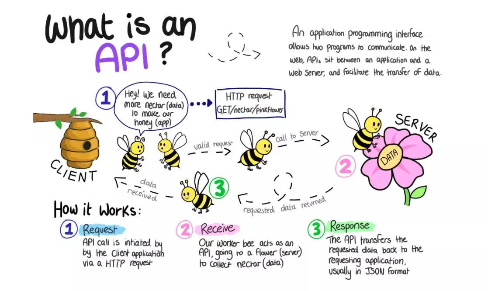

In diesem Beispiel zeige ich euch, wie man mit PowerShell ein RestAPI schreibt. Doch was ist eigentlich ein API? Das folgende Bild zeigt dies mit den Bienen recht einfach auf.



Von einem Client werden über HTTP(S) Daten von einem Server angefordert. Der Server verarbeitet die Anfrage und sendet die Daten über HTTP(S) an den Client zurück. Der einzige Port der offen sin muss, ist der TCP Port 80 bzw. 443.

Da nun alle wissen, was ein (Bienen)-API ist, folgt der Teil mit einem PowerShell API.

## Was braucht es alles

Einen Computer mit installiertem PowerShell 7, Docker Desktop und KeePass. Dazu die folgenden PowerShell Module:

- Pode (als Backend)
- Microsoft.PowerShell.SecretManagement (für die User-/Tokenverwaltung)
- SecretManagement.KeePass (für die User-/Tokenverwaltung)

### KeePass einrichten

Öffne KeePass und erstelle eine neue Datenbank mit dem Namen PSOctomes.kdbx. Erstelle darin einen User mit einem Passwort, welches als Bearer Token für den API Zugriff verwendet werden soll. Passe den Pfad zum PSOctomes.kdbx im unten stehenden Code an und starte das Script.

```powershell
Register-SecretVault -Name "PSOctomes" -ModuleName "SecretManagement.Keepass" -VaultParameters @{
    Path = "$($env:USERPROFILE)\OneDrive\Do*ument*\PSOctomes.kdbx"
    UseMasterPassword = $true
}
Get-SecretInfo -Vault PSOctomes -Name Discord_Token | Select-Object -ExpandProperty Metadata

```

## Pode Server

Nun erstellen wir das Backend, den Pode Server der als API konfiguriert wird. Dazu erstelle zuerst die folgende Verzeichnisstruktur:

```
D:\PSAUTOMIC
├───bin
│   └───logs
├───data
│   ├───almalinux
│   └───ubuntu
├───img
└───queue

```

Im Verzeichnis bin, erstelle das Script mit dem Namen **Start-PSAutoMic.ps1** welches das API (Pode Server) beschreibt.

### KeePass Helper

Als erstes benötigen wir eine Helper-Function für den Zugriff auf das KeePass:

```powershell
function Get-MWASecretsFromVault{
    [CmdletBinding()]
    param(
        [Parameter(Mandatory=$true)]
        [String]$Vault
    )

    if(-not(Test-SecretVault -Name $Vault)){
        Unlock-SecretVault -Name $Vault
    }
    
    $SecretInfo = Get-SecretInfo -Vault $Vault -WarningAction SilentlyContinue
    $ret = $SecretInfo | ForEach-Object {
        [PSCustomObject]@{
            Name = $_.Name
        }
    }
    return $ret
}

```

### Bearer Authtication

Dann brauchen wir einen Function für die Bearer Authtication. Diese Function greift auf die KeePass Helper-Function zu:

```powershell
function Invoke-BearerAuthtication{
    [CmdletBinding()]
    param()
    # https://github.com/Badgerati/Pode/blob/develop/examples/web-auth-bearer.ps1
    New-PodeAuthScheme -Bearer -Scope write | Add-PodeAuth -Name 'Validate' -Sessionless -ScriptBlock {
        param($Token)

        #region secret from KeePass
        $SecretVault    = 'PSOctomes'
        $SecretObject   = (Get-MWASecretsFromVault -Vault $SecretVault).Where({$_.Name -match 'PSAutoMic'})
        $Secret         = Get-Secret -Vault $SecretVault -Name $SecretObject.Name -ErrorAction Stop
        $PSAutoMicToken = [System.Net.NetworkCredential]::new($Secret.UserName, $Secret.Password).Password
        #endregion

        #region here you'd check a real user storage, this is just for example
        if ($Token -ieq $PSAutoMicToken){
            return @{
                User = @{
                    ID   = $Secret.Name
                    Name = $Secret.UserName
                    Type = 'Service'
                }
                Scope = 'write'
            }
        }else{
           throw "Token not valid: $($Token)"
           return $null
        }
        #endregion
    }
}

```

### Queue

Damit die Anforderungen asynchron ausgeführt werden können, erstellen wir einen FileWatcher als Queue. Die Logik innerhalb der Queue startet pro erstelltes File eine PowerShell mit dem Pfad zum File.

```powershell
function New-AssetToQueue{
    [CmdletBinding()]
    param()

    Add-PodeFileWatcher -EventName Created -Path $($($PSScriptRoot) -replace 'bin','queue') -ScriptBlock {
        # the Type will be set to "Created"
        "[$(Get-Date -f 'yyyy-MM-dd HH:mm:ss.fff')] [$($FileEvent.Type)] $($FileEvent.Name)" | Out-Default
        $InstallArgs = @{}
        $InstallArgs.FilePath     = "pwsh.exe"
        $InstallArgs.ArgumentList = @()
        $InstallArgs.ArgumentList += "-file $(Join-Path $PSScriptRoot -ChildPath "Build-Container.ps1") $($FileEvent.FullPath)"
        Start-Process @InstallArgs
    }
}

```

Sobald die Verarbeitung des Files erledigt ist, kann das File in der Queue gelöscht werden. Dies wird mit einem FileWatcher ausgeführt der auf den Event 'deleted' reagiert.

```powershell
function Remove-AssetFromQueue{
    [CmdletBinding()]
    param()

    Add-PodeFileWatcher -EventName Deleted -Path $($($PSScriptRoot) -replace 'bin','queue') -ScriptBlock {
        # the Type will be set to "Deleted"
        "[$(Get-Date -f 'yyyy-MM-dd HH:mm:ss.fff')] [$($FileEvent.Type)] $($FileEvent.Name)" | Out-Default
    }
}

```

### API Endpoint

Damit die Anfrage an den Server gesendet werden kann und dieser die Anfrage auch verarbeitet, benötigen wir einen Endpoint. Der Endpoint enthält Logik um ein Almalinux oder Ubuntu zu verarbeiten.

```powershell
function Add-PodeApiEndpoint{
    [CmdletBinding()]
    param()
    
    Add-PodeRoute -Method Post -Path '/api/v1/docker' -Authentication 'Validate' -ContentType 'application/json' -ScriptBlock {
        # route logic
        $continue = $false
        $body = [PSCustomObject]$WebEvent.Data #| ConvertFrom-Json
        switch ($body.Os){
            'almalinux' { $continue = $true  }
            'ubuntu'    { $continue = $true  }
            default     { $continue = $false }
        }

        if($continue){
            $data = [PSCustomObject]@{
                TimeStamp = Get-Date -f 'yyyy-MM-dd HH:mm:ss.fff'
                Uuid      = (New-Guid | Select-Object -ExpandProperty Guid)
                Source    = $env:COMPUTERNAME
                Agent     = $WebEvent.Request.UserAgent
                Data      = $WebEvent.Data
            }
            # Out to the queue
            $queue = $($($PSScriptRoot) -replace 'bin','queue')
            $data | ConvertTo-Json | Out-File -FilePath $(Join-Path $queue -ChildPath "$($data.Uuid).json") -Encoding utf8
    
            # Rest response
            Write-PodeJsonResponse -Value (@{Uuid = $($data.Uuid)} | ConvertTo-Json)
        }else{
            Write-PodeJsonResponse -Value (@{Uuid = "$($body.Os) not implemented yet"} | ConvertTo-Json)
        }
    }
}

```

### Start Rest API

Nun haben wir alle notwendigen Functions geschrieben und müssen noch dafür sorgen, dass der Pode Server die API auch zur Verfügung stellt.

```powershell
Start-PodeServer -Thread 2 {

    Write-Host "Running Pode server on $($PSScriptRoot)" -ForegroundColor Cyan
    Write-Host "Press Ctrl. + C to terminate the Pode server" -ForegroundColor Yellow

    # create the endpoint
    Add-PodeEndpoint -Address localhost -Port 8080 -Protocol Http
    
    # set the logging
    New-PodeLoggingMethod -File -Name 'requests' -MaxDays 3 | Enable-PodeRequestLogging
    New-PodeLoggingMethod -File -Name 'errors' -MaxDays 3   | Enable-PodeErrorLogging

    # Here our sessions will last for 2 minutes, and will be extended on each request
    Enable-PodeSessionMiddleware -Duration 120 -Extend -UseHeaders

    # setup bearer auth
    Invoke-BearerAuthtication

    # add a file watcher to create requests from the queue
    New-AssetToQueue

    # add a file watcher to remove files from the queue
    Remove-AssetFromQueue

    # set the api route and logic
    Add-PodeApiEndpoint
}

```

## Logik

Mit der Logik werden Image und Container für Docker Desktop erstellt oder gelöscht. Dies wird in einem separaten Script durchgeführt. Leider kann ich hier den Code nicht vollständig aufzeigen, deshalb verzichte ich auf Fragmente davon. Das Script kann in meinem GitHub-Profile, [Build-Container](https://github.com/tinuwalther/PSAutoMic/blob/main/bin/Build-Container.ps1) abgerufen werden.

## Watch the video on YouTube

[](https://youtu.be/0CRH4Nsnyyw)

## Zu Guter Letzt

Das ganze Project mit dem Code könnt ihr natürlich von meinem GitHub-Profile, [PSAutoMic](https://github.com/tinuwalther/PSAutoMic.git) herunterladen.

Lasst mich wissen, was ihr für Erfahrungen mit RestAPI mit PowerShell gemacht habt.

Gruess Tinu
