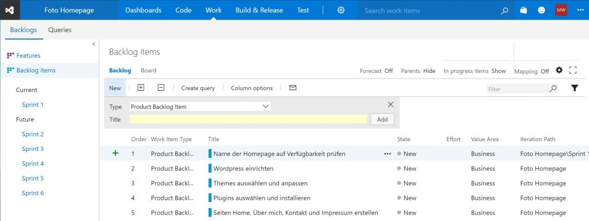
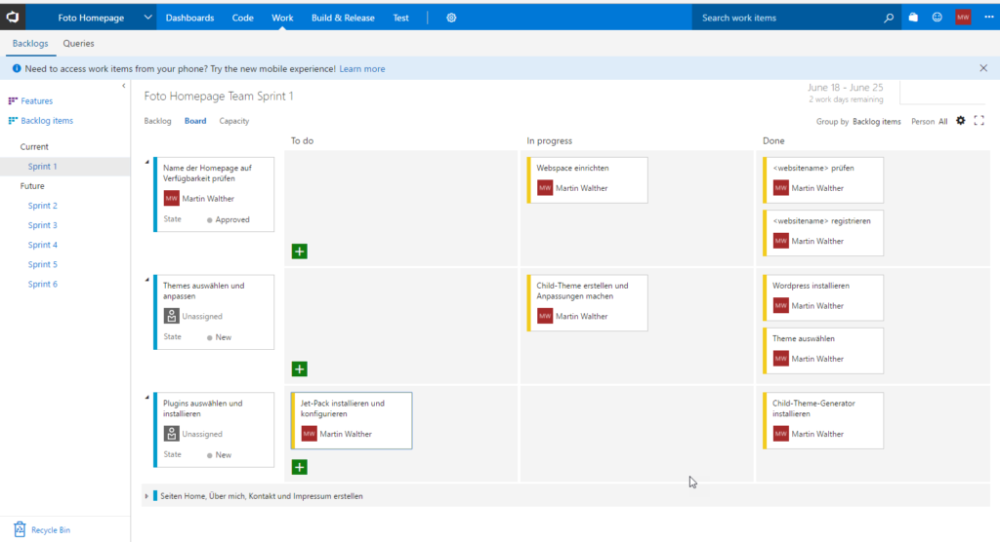

...Scrum macht die relative Wirksamkeit Ihres Produktmanagements und Entwicklungsvorgehens sichtbar, so dass Sie sich verbessern können... **Wir wollen also aufzeigen, wo wir uns verbessern können.**

## Agile

Agile heisst das Zauberwort, doch das muss zuerst etabliert und auch gelebt werden. Was bedeutet Agile denn überhaupt? 

- kurze Planungsphasen
- zügige und überprüfbare Teilergebnisse
- dauerhafte Priorisierung und Optimierung
- sofortiges Reagieren auf Veränderungen und Marktbedürfnisse
- hohe Transparenz zu den Aktivitäten und Ergebnissen
- grösstmögliche Kunden- und Wertorientierung
- Einbindung von Teams und Mitarbeitenden

## Produkt

Ein Produkt soll entwickelt, vermarktet und kontinuierlich verbessert werden. 

### Produkt entwickeln

Beim Entwickeln eines Produktes kann zu Beginn nicht an alles gedacht werden oder es wird nicht das umgesetzt, was gefordert war. 

### Produkt vermarkten

Die Vermaktung ist innerhalb einer Firma problematisch wenn davon ausgegangen wird, dass sich die Shareholder automatisch beim Produktentwickler melden und sich ihre Informationen abholen - sehr einfach, aber nicht praxistauglich. 

### Produkt verbessern

Kontiunierlicher Prozess, kein Produkt wird fertig auf den Markt gebracht sondern muss immer wieder an die neuen Anforderungen angepasst werden. Das iPhone oder jedes andere Smart Phone wird auch immer noch weiter entwickelt oder eben verbessert. 

## Projektplanung mit Scrum

### Backlog

- Epic -&gt; Beschreibung des Ziels 
    - Story oder Backlog Item -&gt; Beschreibung des Issues
    - Story oder Backlog Item -&gt; Beschreibung des Issues
    - Story oder Backlog Item -&gt; Beschreibung des Issues
    - Sprint -&gt; Planung der User Stories

### Sprint Planung

Im **Sprint Planning** wird die Arbeit für den kommenden Sprint geplant. Dieser Plan entsteht durch die gemeinschaftliche Arbeit des gesamten Scrum Teams. Wir haben uns für eine Time Box von zwei Wochen pro **Sprint Review** entschieden. Das **Daily Scrum** ist eine Time Box von 15 Minuten, innerhalb derer das Entwicklungsteam seine Aktivitäten synchronisiert und an der Planung für die nächsten 24 Stunden arbeitet. Am Ende eines Sprints wird ein **Sprint Review** abgehalten, um das \[Produkt-\]Inkrement zu überprüfen und das Product Backlog anzupassen. 

- Der Product Owner erklärt, welche Product Backlog-Einträge "Done" sind, und welche nicht
- Das Team stellt dar, was während des Sprints gut lief, welche Probleme aufgetaucht sind, und wie es diese Probleme gelöst hat.
- Das Team führt die "Done"- Arbeiten vor, und beantwortet Fragen zu dem Inkrement.
- Der Product Owner stellt den aktuellen Stand des Product Backlogs dar. Er gibt bei Bedarf eine aktualisierte Vorhersage eines Fertigstellungstermins, auf der Basis des Entwicklungsfortschritts.
- Alle Teilnehmer erarbeiten gemeinsam, was als nächstes zu tun ist, so dass das Sprint Review wertvollen Input für die kommenden Sprint Plannings liefert.
- Es erfolgt eine Begutachtung, ob sich durch die Marktsituation oder den möglichen Produkteinsatz neue Erkenntnisse über die wertvollsten nächsten Schritte ergeben haben.
- Anschliessend werden Zeitplan, Budget, die potentiellen Eigenschaften sowie die Markterwartungen für das nächste zu erwartende Produkt-Release überprüft.

Das Ergebnis des Sprint Reviews ist ein überarbeitetes Product Backlog, das die möglichen Product Backlog-Einträge für den kommenden Sprint enthält. Das Product Backlog kann auch umfassend umgearbeitet werden, um neue Chancen zu nutzen.  