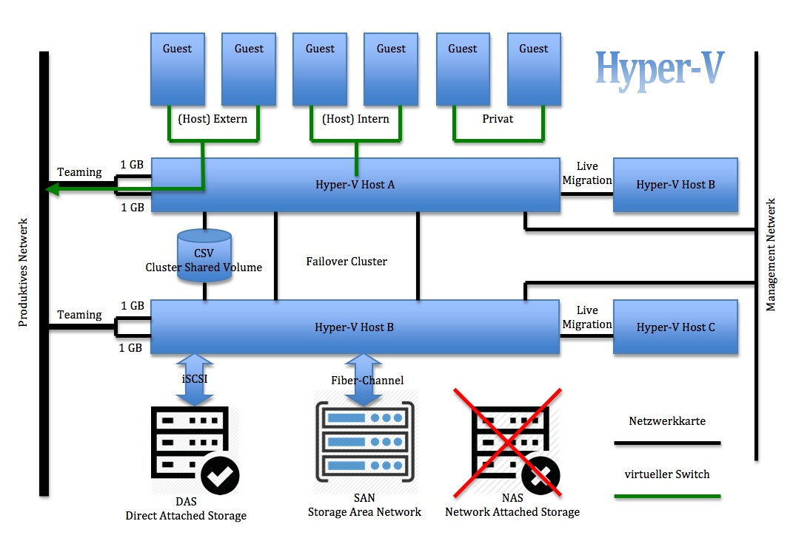

# Virtuelle Server bereitstellen

Es gibt verschiedene Möglichkeiten Windows Server bereitzustellen, eine davon ist mit HyperV und PowerShell virtuelle Computer bereitstellen. Was benötige ich um diese Herausforderung zu bewältigen? 

- Eine Strategie (Netzwerk, Server, Ausfallsicherheit, Redundanz, HyperV, Basisimages, ...)
- Windows Server 2012 R2 Lizenzen
- HyperV-Server mit Storage
- Ein [Basisimage ](/wiki/basisimage/ "Basisimage")von Windows Server 2012 R2

# HyperV Host

