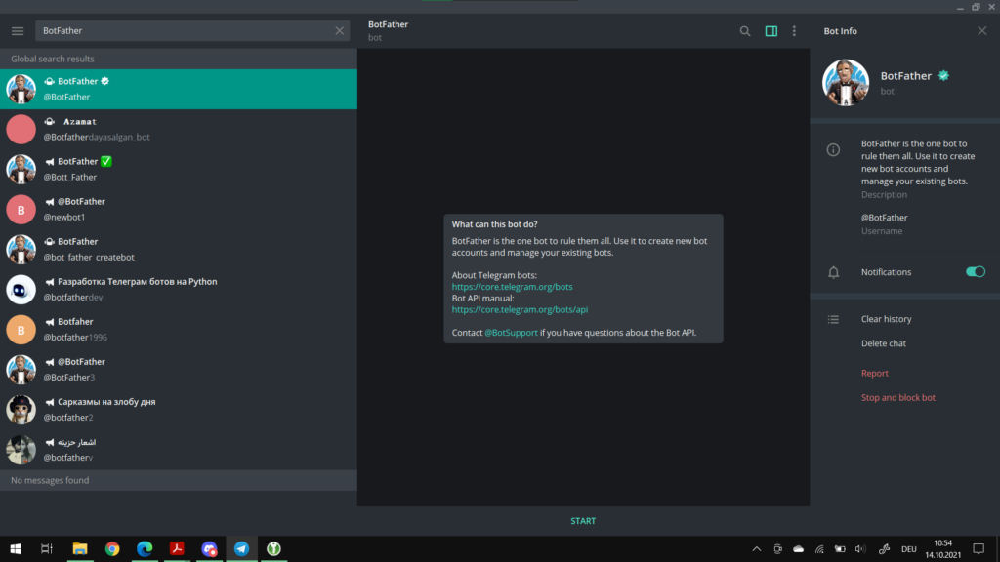
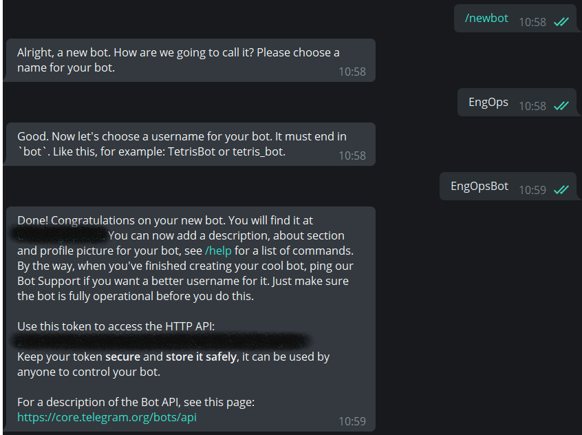
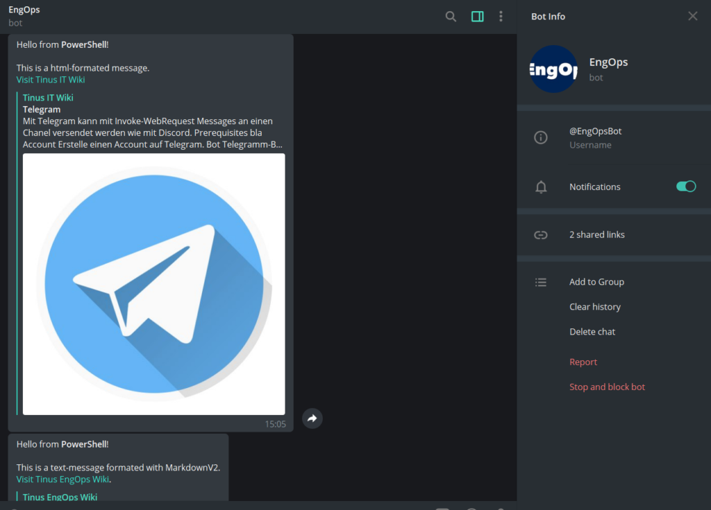

Mit Telegram kann mit Invoke-WebRequest Messages an einen Channel versendet werden wie mit Discord.

## Prerequisites

### Account

Erstelle einen Account auf [Telegram](https://telegram.org/).

### Bot

Telegramm-Bots werden über ein automatisiertes Konto namens **BotFather** erstellt.

Öffne die Telegram-App und suche nach BotFather. Klicke auf BotFather, um einen Chat zu öffnen.

[](/assets/wiki/BotFather1.png)

- Gib den Befehl **/newbot** ein
- Gib den **Anzeigenamen** deines Bots ein
- Gib einen **Benutzernamen** für den Bot ein, der Name muss mit Bot oder bot enden
- Speichere das API-Token in deinem Password-Manager
- Klicke abschliessend auf den Link, um einen Chat mit dem neu erstellten Bot zu öffnen
- Suche auf dem Telegramm-Startbildschirm nach deinem Bot und klicke ihn an
- Gib **/start** ein, damit der Bot eine Chat-ID generiert
- Rufe https://api.telegram.org/bot&lt;TOKEN&gt;/getUpdates auf, um die Chat-ID abzufragen

[](/assets/wiki/EngOpsBot.png)## Send Message

Send Message with PowerShell

```powershell
[CmdletBinding()]
param (
    [Parameter(Mandatory=$false)]
    [Switch]$Html,

    [Parameter(Mandatory=$false)]
    $Message,

    [Parameter(Mandatory=$true)]
    $Token,

    [Parameter(Mandatory=$true)]
    $ChatID
)

begin {
    [Net.ServicePointManager]::SecurityProtocol = [Net.SecurityProtocolType]::Tls12
    $webhook_url = "https://api.telegram.org/bot$($Token)/sendMessage"
}

process {
    if($Html){
        $ParseMode = 'html'
        if(-not($Message)){
$Message = '
Hello from <b>PowerShell</b>!

This is a html-formated message.
<a href="https://it.martin-walther.ch/telegram/">Visit Tinus IT Wiki</a>
'
        }
    }else{
        $ParseMode = 'MarkdownV2'
        if(-not($Message)){
$Message = '
Hello from *PowerShell*\!

This is a text\-message\ formated with MarkdownV2\.
[Visit Tinus EngOps Wiki](https://tinuwalther.github.io//)\.
'
        }
    }

    $headers = "application/json"

    $payload = @{
        "chat_id"                   = $ChatID
        "text"                      = $Message
        "parse_mode"                = $ParseMode
        "disable_web_page_preview"  = $false
        "disable_notification"      = $false
    }
    
    $Response = Invoke-RestMethod -Uri $webhook_url -Body (ConvertTo-Json -Depth 1 -InputObject $payload) -Method Post -ContentType $headers
}

end {
    $Response.result
}

```

Return

```powershell
  ok result
  -- ------
True @{message_id=12; from=; chat=; date=1634212752; text=Hello from PowerShell!; entities=System.Object[]}

```

[](/assets/wiki/EngOpsBot1.png)## References

[Send Telegram Messages from PowerShell](https://polarclouds.co.uk/send-telegram-from-powershell/), [Telegram API](https://core.telegram.org/api)

