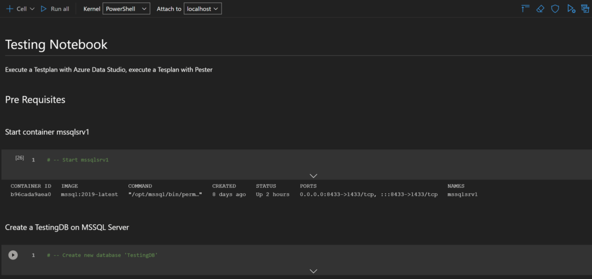
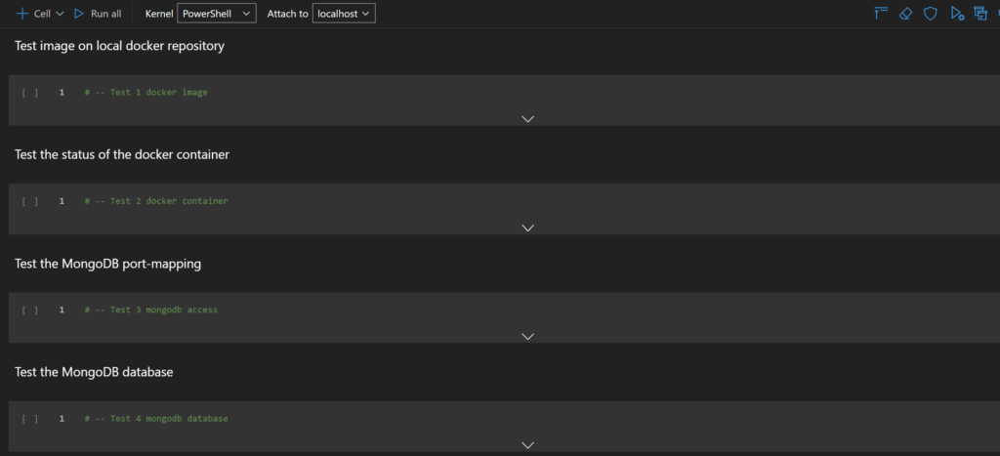
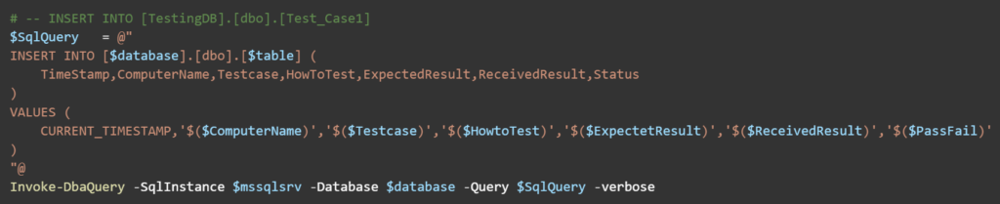
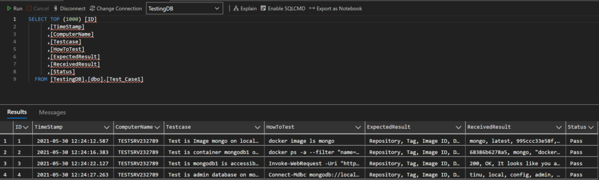
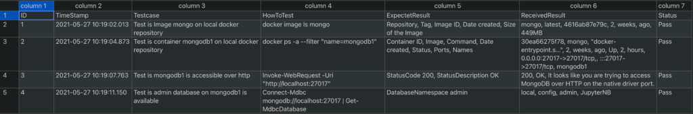
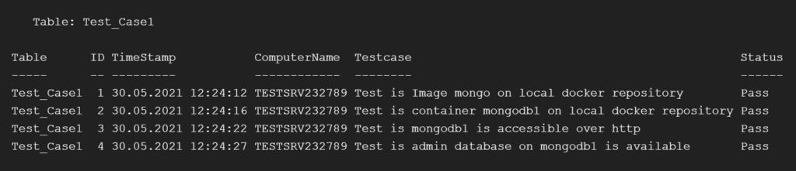

**TESTEN … TESTEN … TESTEN … TESTEN … TESTEN**

Ich habe in meinen Tätigkeiten als ICT System Engineer und DevOps Engineer so viel Zeit für Problem-Analysen ver(sch)wendet, die viel besser in ein gutes Testing investiert worden wäre.

Überlegt euch bitte vor einer Implementation, wie ihr testen könnt - **T** est **D** riven **D** evelopment.

## Testplan Allgemein

Testprozess definieren, Tests beschreiben, Tests automatisieren, Tests durchführen, Testresultate speichern, sind alles Teile eines Testplans.

### Testvorbereitung

Computer zum Testen definieren/deployen, Test Code schreiben.

| Name | Value |
|---|---|
| VMName | VM123456 |
| DNSName | VM123456.domain.int |
| IP Address | 10.x.y.z |
| Access via | vCenter: vCenter1.mgmt.int |

Testcode pro Use case beschreiben.

| Name | Value |
|---|---|
| Testcase | Test is image ‘mongo’ on local docker repository |
| HowToTest | docker image ls ‘mongo’ |
| ExpectetResult | Repository, Tag, Image ID, Date created, Size of the image |

### Testspezifikation

Testspezifikation, Testdurchführung und Testauswertung werden in einer Tabelle erfasst.

**“Never trust a test you haven’t personally seen fail.”**

Jeder Test Case wird in der Tabelle beschrieben, damit nachvollzogen werden kann wann welcher Test mit welchem Resultat wann durchgeführt worden ist.

| No | TimeStamp | ComputerName | Testcase | How to Test | Expectet Result | Received Result | Status |
|---|---|---|---|---|---|---|---|
| 1 | 29.05.2021 15:00:14.120 | VM123456 | \[NEG\] Test is Image ‘mongoZ’ on local docker repository | docker image ls ‘mongoZ’ | The docker image ‘mongoZ’ should NOT be on local repository | Passed | True |
| 2 | 29.05.2021 15:30:14.120 | VM123456 | \[POS\] Test is Image ‘mongo’ on local docker repository | docker image ls ‘mongo’ | The docker image ‘mongo’ should be on local repository | Passed | True |

## Testplan mit Azure Data Studio

Für dieses Beispiel benötige ich Docker mit einem mssql Image und Container sowie einen MongoDB Container wo ich die Tests ausführe.

### Testvorbereitung

Testvorbereitungen werden soweit dies per Code machbar ist, in Azure Data Studio durchgeführt.

#### Datenbank und Tabelle erstellen

Auf meinem MSSQL Container in Docker erstelle ich eine Datenbank für all meine Tests und pro Test je eine Tabelle mit den Feldern ID, TimeStamp, Testcase, HowToTest, ExpectetResult, ReceivedResult, Status.

[](/assets/wiki/Testnotebook.png)#### Test Computer

Test Computer definieren.

```
$ComputerName = 'TESTSRV232789' 
$ComputerName = $env:ComputerName # wenn es der lokale Computer ist
```

### Testspezifikation

Testspezifikation, Testdurchführung, Testauswertung werden mit Azure Data Studio ausgeführt und in eine Datenbank abgespeichert.

In den Variablen beschreibe ich den Testcase, HowToTest, ExpectetResult und ReceivedResult.

```
# -- Test 1 docker image
$image          = 'mongo'
$Testcase       = "Test is Image $image on local docker repository"
$HowToTest      = "docker image ls $image"
$ExpectetResult = "Repository, Tag, Image ID, Date created, Size of the Image"
$ReceivedResult = $string -join ", "

```

[](/assets/wiki/Testcases.png)Der eigentliche Test wird von Azure Data Studio mit docker ausgeführt.

```
# -- Test 1 docker image
$result = docker image ls $image 

```

### Testauswertung

Die Ausertung des Tests erfolgt mit dem folgenden Code:

```
# -- Test 1 docker image
$string   = $result[1].Trim() -split '\s+'
$PassFail = if($ReceivedResult -match $image){'Pass'}else{'Fail'}
```

### Testresultate

Mit den dbatools schreibe ich den Test in die Datenbank.

[](/assets/wiki/InsertInto.png)Die Tests können mit einem SELECT \* FROM Table aufgelistet und gleich als Excel, CSV oder JSON abgespeichert werden.

[](/assets/wiki/select.png)Mein Jupyter Notebook [Testing.ipynb](https://github.com/tinuwalther/Jupyter-Notebooks/blob/master/powershell/Testing.ipynb) steht auf meinem GitHub Profile zur Verfügung.

## Testplan mit Excel

Klappt das mit dem direkten Zugriff auf die MSSQL Datenbank und die Test Computer nicht, kann der Test Plan auch als Excel- oder CSV-File mit den Testcases erstellt werden.

[](/assets/wiki/Bildschirmfoto-2021-05-27-um-11.49.09.png)### Import CSV in Datenbank

Das File kann nach den durchgeführten Tests mit den dbatools in die MSSQL Datenbank eingelesen werden, damit man die History trotzdem in der Datenbank hat.

Wird der Parameter -Table nicht mitgegeben, so wird der Name der Tabelle aus dem File-Namen ohne die Extension erstellt (Test\_MongoDB).

```
$database = 'TestingDB'
if([String]::IsNullOrEmpty($sqlcred)){
    $secStringPassword = ConvertTo-SecureString 'yourStrong(!)Password' -AsPlainText -Force
    $sqlcred = New-Object System.Management.Automation.PSCredential ('sa', $secStringPassword)
}
$mssqlsrv = Connect-DbaInstance -SqlInstance 'localhost:8433' -SqlCredential $sqlcred -Database $database
Import-DbaCsv -Path /Downloads/Test_MongoDB.csv -SqlInstance $mssqlsrv -Database $database -NullValue "NULL" -AutoCreateTable -verbose
```

## Testplan mit Pester

Pester ist ein Test- und Mock-Framework für PowerShell und kann genutzt werden um standardisierte Tests durchzuführen. Ist man mit Pester vertraut, erkennt man Paralelen zu jedem notwendigen Tests.

### Allgemeines

Pester kann nicht in einer Code Zelle im Jupyter Notebook verwendet werden, die Tests müssen als File gespeichert werden.

#### Pester Fehlermeldung

```
Exception: /Users/Tinu/.local/share/powershell/Modules/Pester/5.2.2/Pester.psm1:9126
Line |
9126 |          throw "Pester can run only saved files interactively. Please  …
     |          ~~~~~~~~~~~~~~~~~~~~~~~~~~~~~~~~~~~~~~~~~~~~~~~~~~~~~~~~~~~~~
     | Pester can run only saved files interactively. Please save your file to a disk.


```

#### Invoke-Pester

Im Jupyter Notebook kann das File dann importiert oder direkt mit Invoke-Pester gestartet werden.

```
Invoke-Pester -Path /Users/Tinu/Temp/pTest1.ps1 -Output Detailed
```

### Testvorbereitungen

Testvorbereitungen werden soweit dies per Code machbar ist, im ScriptBlock BeforeAll{} implementiert. Hier werden vor allem auch die Functions für die Tests geschrieben, sofern sie nicht in einem Module abgelegt sind.


```powershell
BeforeAll{
    # -- Install MongoDB Module
    if(-not(Get-InstalledModule -Name Mdbc)){
        Install-Module -Name Mdbc
    }
    if(-not(Get-Module -Name Mdbc)){
        Import-Module -Name Mdbc
    }

    # -- Start containers
    function Start-Container($Name) {
        docker start $Name
    }
    # -- Start the mssqlsrv1 container to save the result
    Start-Container -Name 'mssqlsrv1'

    # -- Test docker image
    function Test-Image($Name){
        $result = docker image ls $Name 
        $string = $result[1].Trim() -split '\s+'
        $string -join ", "
    }

    # -- Test mongodb access
    function Get-ExposedPorts($Name){
        $arrport = (docker inspect --format='{{range $p, $conf := .Config.ExposedPorts}} {{$p}} {{end}}' $Name) -split '/'
        ($arrport -match '\d{2}').Trim()
    }

    function Test-MongoDbAccess($Name){
        $exposedPort = Get-ExposedPorts -Name $Name
        $result  = Invoke-WebRequest -Uri "http://localhost:$exposedPort"
        "$($result.StatusCode) $($result.StatusDescription)"
    }
    . . .
}
```


### Testspezifikation

Testspezifikation, Testdurchführung, Testauswertung werden mit `Invoke-Pester` durchgeführt.

```
Describe "Test is the image on local docker repository" {
    it "The docker image 'mongo' should be on local repository" {
        (Test-Image -Name 'mongo') | Should -Match 'mongo'
    }
}

Describe "Test the status of the docker container" {
    it "The docker container 'mongodb1' is up and running" {
        (Start-Container -Name 'mongodb1') | Should -BeExactly 'mongodb1'
    }
}

Describe "Test the MongoDB port-mapping" {
    it "The MongoDB 'mongodb1' is accessible over http" {
        (Test-MongoDbAccess -Name 'mongodb1') | Should -BeExactly '200 OK'
    }
}

Describe "Test the MongoDB database" {
    it "The 'mongodb1' contains the admin database" {
        (Test-MongoDBDatabase -Name 'mongodb1' -DB 'admin12') | Should -BeExactly 'admin'
    }
}
```

### Testauswertung

Pester Output `Invoke-Pester`

```
Starting discovery in 1 files.
Discovery finished in 98ms.
Running tests.
[+] D:\DevOps\github.com\Jupyter-Notebooks\lib\MongoDB.Tests.ps1 5.52s (4.13s|1.29s)
Tests completed in 5.52s
Tests Passed: 4, Failed: 0, Skipped: 0 NotRun: 0

```

Pester Output, wenn `Invoke-Pester` mit dem Paramter `-Output Detailed` ausgeführt wird.

```
Starting discovery in 1 files.
Discovering in D:\DevOps\github.com\Jupyter-Notebooks\lib\MongoDB.Tests.ps1.
Found 4 tests. 32ms
Discovery finished in 54ms.
Running tests.

Running tests from 'D:\DevOps\github.com\Jupyter-Notebooks\lib\MongoDB.Tests.ps1'
Describing Test is the image on local docker repository
  [+] The docker image 'mongo' should be on local repository 566ms (559ms|7ms)

Describing Test the status of the docker container
  [+] The docker container 'mongodb1' is up and running 651ms (645ms|5ms)

Describing Test the MongoDB port-mapping
  [+] The MongoDB 'mongodb1' is accessible over http 740ms (735ms|5ms)

Describing Test the MongoDB database
  [+] The 'mongodb1' contains the admin database 701ms (695ms|6ms)
Tests completed in 5.93s
Tests Passed: 4, Failed: 0, Skipped: 0 NotRun: 0
```

### Testresultate

Resultate können weiterverarbeitet werden, indem sie entweder in ein File oder direkt in eine Datenbank geschrieben werden.

```
$PesterResult = Invoke-Pester -PassThru -Output None

$AllPesterResults = @()
$ComputerName = 'TESTSRV232789'
$ColumnMap = @(
    @{l='ID';e={New-Guid}},
    @{l='TimeStamp';e={"$($_.ExecutedAt.ToString())"}},
    @{l='Computer';e={$ComputerName}},
    @{l='Testcase';e={"$($_.ExpandedPath.ToString().split('.')[0])"}},
    @{l='HowToTest';e={"$($_.ScriptBlock.ToString().Trim())"}},
    @{l='ExpectedResult';e={"$($_.ExpandedName)"}},
    @{l='ReceivedResult';e={"$($_.Result)"}},
    @{l='Status';e={"$($_.Passed.ToString())"}}
)
$AllPesterResults += $PesterResult.Passed | Select-Object $ColumnMap
$ColumnMap = @(
    @{l='ID';e={New-Guid}},
    @{l='TimeStamp';e={"$($_.ExecutedAt.ToString())"}},
    @{l='Computer';e={$ComputerName}},
    @{l='Testcase';e={"$($_.ExpandedPath.ToString().split('.')[0])"}},
    @{l='HowToTest';e={"$($_.ScriptBlock.ToString().Trim())"}},
    @{l='ExpectedResult';e={"$($_.ExpandedName.ToString())"}},
    @{l='ReceivedResult';e={"$($_.ErrorRecord.DisplayErrorMessage.ToString())"}},
    @{l='Status';e={"$($_.Passed.ToString())"}}
)
$AllPesterResults += $PesterResult.Failed | Select-Object $ColumnMap
$AllPesterResults
```

#### Pester Output

Pester Output als PSObject mit einem fehlgeschlagenen Test.

```
ID             : f64ae53d-e7af-49b2-bb9d-3e74c3062546
TimeStamp      : 30.05.2021 11:44:47
Computer       : TESTSRV232789
Testcase       : Test is the image on local docker repository
HowToTest      : (Test-Image -Name 'mongo') | Should -Match 'mongo'
ExpectedResult : The docker image 'mongo' should be on local repository
ReceivedResult : Passed
Status         : True

ID             : 04baa1c5-fdd6-45e0-a43c-fc93cff89ea2
TimeStamp      : 30.05.2021 11:44:48
Computer       : TESTSRV232789
Testcase       : Test the status of the docker container
HowToTest      : (Start-Container -Name 'mongodb1') | Should -BeExactly 'mongodb1'
ExpectedResult : The docker container 'mongodb1' is up and running
ReceivedResult : Passed
Status         : True

ID             : 8b8d6c98-2ca7-4d29-9f17-6d64bb5b6de0
TimeStamp      : 30.05.2021 11:44:49
Computer       : TESTSRV232789
Testcase       : Test the MongoDB port-mapping
HowToTest      : (Test-MongoDbAccess -Name 'mongodb1') | Should -BeExactly '200 OK'
ExpectedResult : The MongoDB 'mongodb1' is accessible over http
ReceivedResult : Passed
Status         : True

ID             : 33514905-6f5b-4d3d-b69c-5dc091df74c3
TimeStamp      : 30.05.2021 11:44:49
Computer       : TESTSRV232789
Testcase       : Test the MongoDB database
HowToTest      : (Test-MongoDBDatabase -Name 'mongodb1' -DB 'admin') | Should -BeExactly 'admin'
ExpectedResult : The 'mongodb1' contains the admin database
ReceivedResult : Passed
Status         : True
```

#### Als CSV-file

```
$Downloads = Join-Path "$($env:USERPROFILE)" -ChildPath 'Downloads'
$AllPesterResults | ConvertTo-CSV | Set-Content -Path (Join-Path $Downloads -ChildPath 'PesterTest.csv') -Encoding utf8
```

#### Als JSON-file

```
$Downloads = Join-Path "$($env:USERPROFILE)" -ChildPath 'Downloads'
$AllPesterResults | ConvertTo-JSON | Set-Content -Path (Join-Path $Downloads -ChildPath 'PesterTest.json') -Encoding utf8
```

#### Import in MSSQL database

ConvertTo-DbaDataTable und Write-DbaDbTableData

```
$table = 'TestMongoDB'
$dataset = $AllPesterResults | ConvertTo-DbaDataTable
$dataset | Write-DbaDbTableData -SqlInstance $mssqlsrv -Database $database -Table $table -AutoCreateTable

```

## Testresultate

Die Testresultate aus allen Tests (egal ob manuelle- oder automatisierte Tests) sollten in einer Datenbank abgelegt werden, damit eine History vorhanden ist. Siehe dazu [Import CSV in Datenbank](/wiki/testing/#Import_CSV_in_Datenbank) etwas weiter oben. Ohne History kann später keine Aussage zu dem Zustand der Tests gemacht werden.

Tests sollten in regelmässigen Abständen durchgeführt werden, damit sichergestellt ist, dass ein System immer dem definierten Zustand entspricht oder ggf. ein Ticket erstellt werden kann.

[](/assets/wiki/Testresults.png)## References

[dbatools](https://dbatools.io) [Pester](https://pester.dev/)

