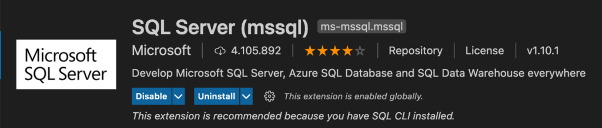
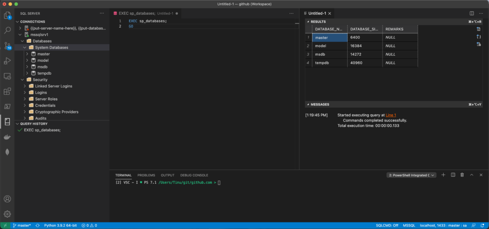
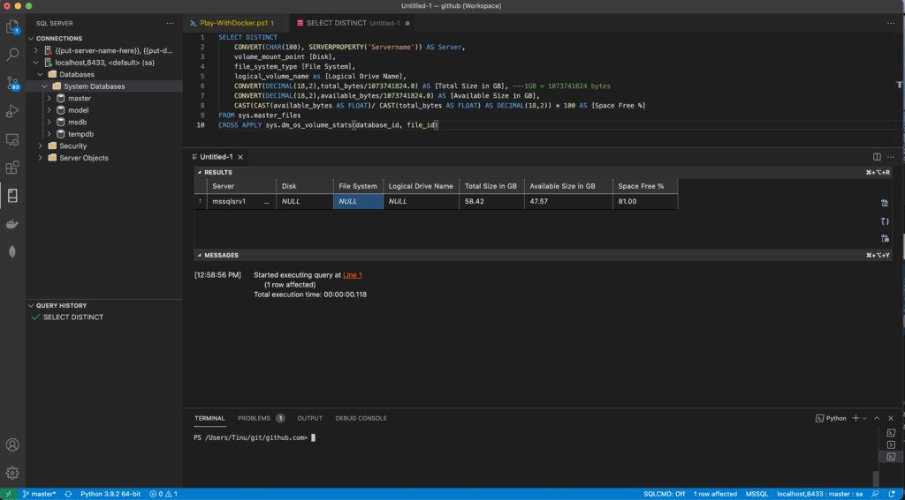
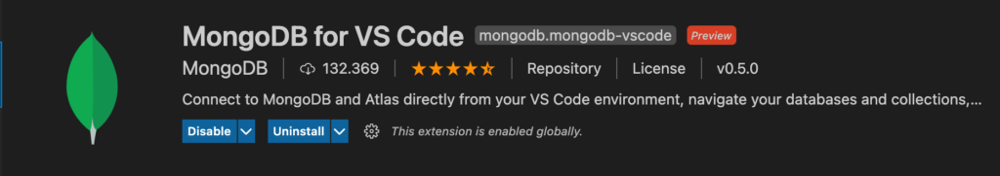
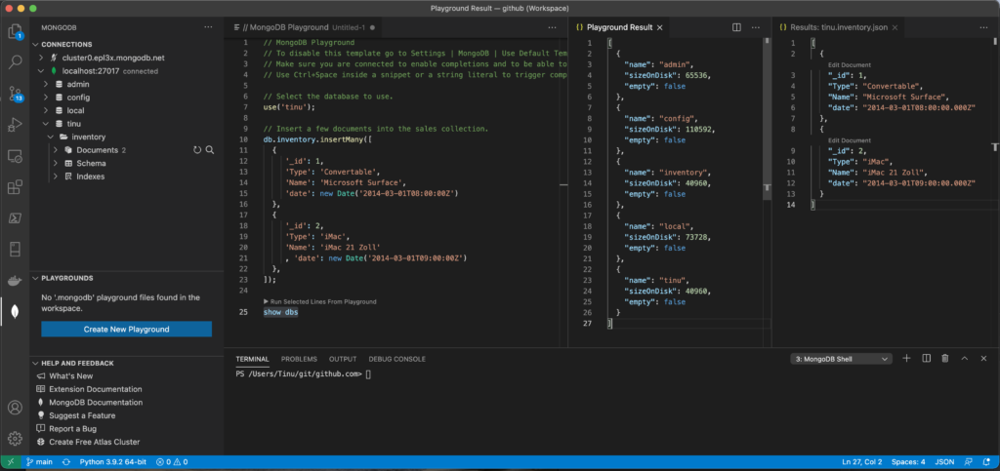

Mit den Extensions für VS Code ist es fast so einfach eine MongoDB zu administrieren, wie ein MSSQL Server.

## Extension für MSSQL Server

VS Code mssql Extension

[](/assets/wiki/Bildschirmfoto-2021-05-03-um-09.28.21.png)### Connect to MSSQL Server

Add Connection ... localhost,1433

#### Transact-SQL

##### Stored procedure list all database

Listet alle Datenbanken auf, die in einer SQL-Server Instanz enthalten sind bzw. auf die der Zugriff über ein Datenbank-Gateway möglich ist.

```
EXEC sp_databases;
GO
```

[](/assets/wiki/Bildschirmfoto-2021-05-03-um-13.20.19.png)##### Script Diskspace

Direkt aus VS Code kann mit einem SQL-Query der Diskspace aufgezeigt werden ohne ein Login auf den Server (Container) zu machen.

```
SELECT DISTINCT 
    CONVERT(CHAR(100), SERVERPROPERTY('Servername')) AS Server,
    volume_mount_point [Disk], 
    file_system_type [File System], 
    logical_volume_name as [Logical Drive Name], 
    CONVERT(DECIMAL(18,2),total_bytes/1073741824.0) AS [Total Size in GB], ---1GB = 1073741824 bytes
    CONVERT(DECIMAL(18,2),available_bytes/1073741824.0) AS [Available Size in GB],  
    CAST(CAST(available_bytes AS FLOAT)/ CAST(total_bytes AS FLOAT) AS DECIMAL(18,2)) * 100 AS [Space Free %] 
FROM sys.master_files 
CROSS APPLY sys.dm_os_volume_stats(database_id, file_id)
```

[](/assets/wiki/Bildschirmfoto-2021-05-12-um-13.01.50.png)## Extension für MongoDB

VS Code MongoDB Extension

[](/assets/wiki/Bildschirmfoto-2021-05-03-um-09.28.52.png)### Connect to MongoDB

Add Connection ... localhost:27017

#### MongoDB Playground

Listet alle Datenbanken auf, die auf dem MongoDB-Server enthalten sind.

```
show dbs
```

[](/assets/wiki/Bildschirmfoto-2021-05-03-um-16.38.16.png)## References

[Visual Studio Code Working with MongoDB](https://code.visualstudio.com/docs/azure/mongodb), [Visual Studio Code SQL Server (mssql)](https://marketplace.visualstudio.com/items?itemName=ms-mssql.mssql)

