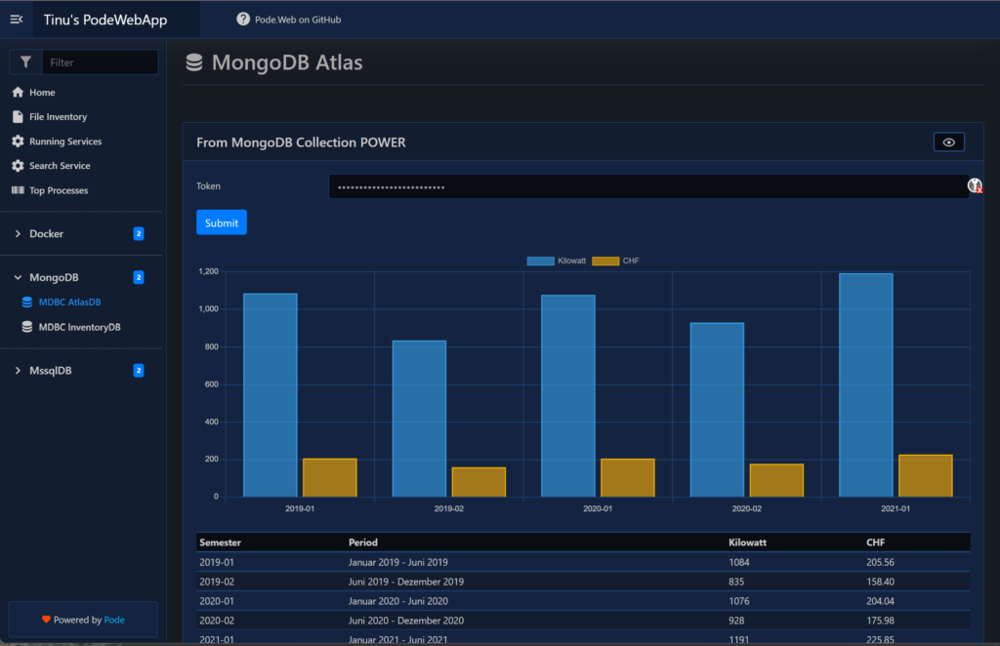
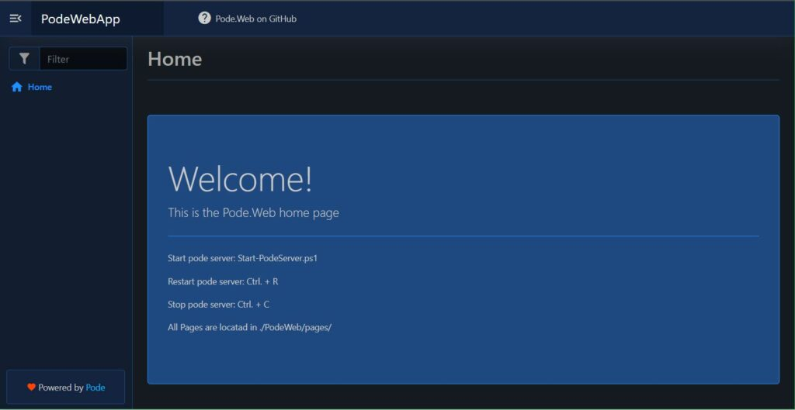
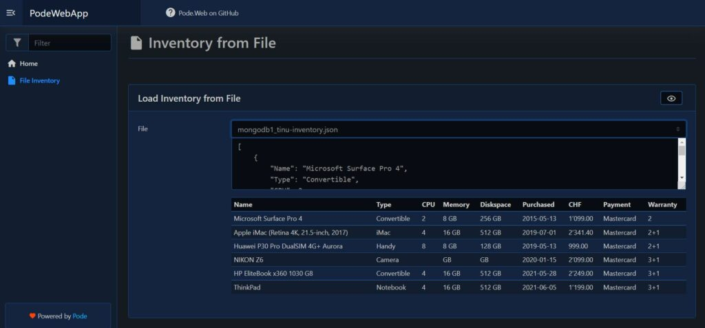
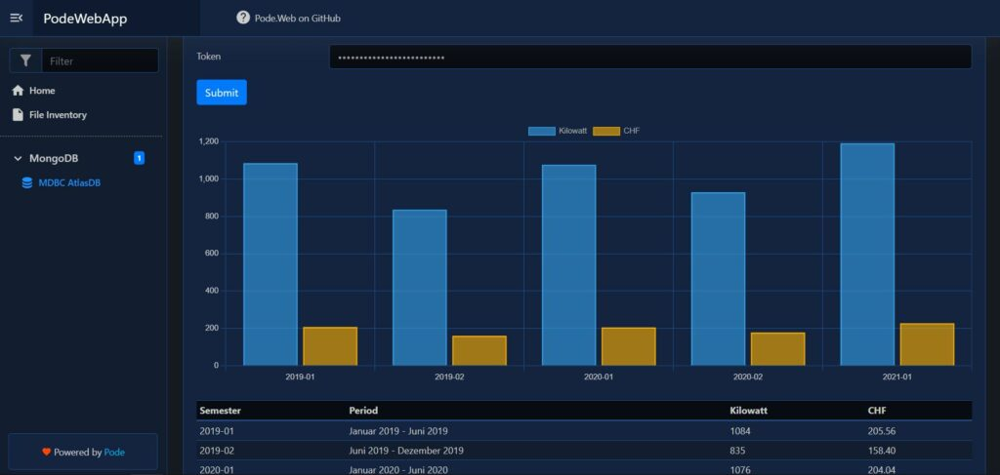
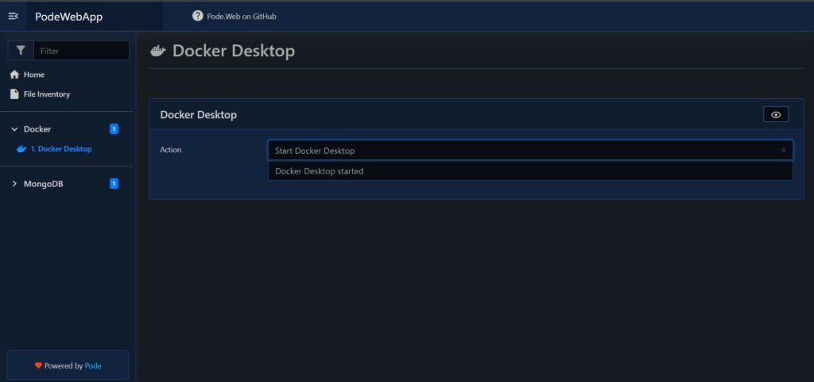
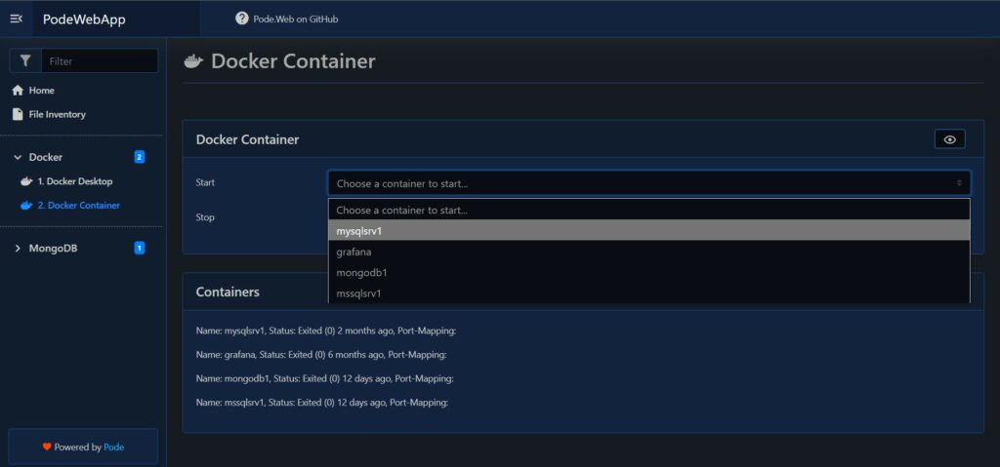
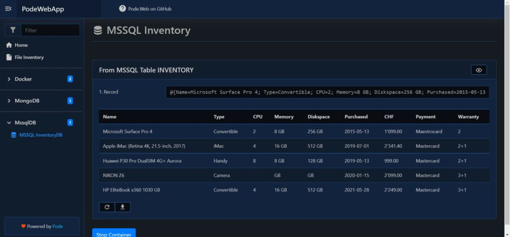

Eine **WebApp** **mit PowerShell** programmieren, kann man das? Ja klar, das geht mit den PowerShell Modulen **Pode** und **Pode.Web** von Matthew Kelly alias [Badgerati](https://github.com/Badgerati).

[](/assets/wiki/TinusPodeWebApp.png)## Voraussetzungen

PowerShell Module **Pode** und **Pode.Web**, sowie **Mdbc** und **dbatools** aus der PowerShell Gallery werden in meinen Beispielen benötigt.

```
Install-Module 'Pode', 'Pode.Web', 'Mdbc', 'dbatools'

```

## Web Server

Fast wie Apache Tomcat, basiert Pode und Pode.Web auf Files in verschiedenen Foldern.

### Folder Struktur

Folgende Folder Struktur wird innerhalb eines Windows Server angelegt:

```
.\PodeWebApp.
|   
+---functions
|     
+---logs
| 
+---pages
|   
\---uploads

```

### Pode Server

Unterhalb des Folders **PodeWebApp** wird das Script **Start-PodeServer.ps1** angelegt, welches den Pode Server beinhaltet. Dieses Script kann z. B. mit einem Shortcut, einem Scheduled Task oder Service gestartet werden.


```
Import-Module Pode.Web

Start-PodeServer {

    # Add Listener to Tcp Port 8080 on localhost
    Add-PodeEndpoint -Address localhost -Port 8080 -Protocol Http

    # Enable Loggin to File
    New-PodeLoggingMethod -Path .\logs -Name "PodeWebServer.log" | Enable-PodeErrorLogging
    
    # Use default system Theme
    Use-PodeWebTemplates -Title "Tinu's PodeWebApp" -Theme Auto

    # Add Navbar
    $Properties = @{
        Name = 'Pode.Web on GitHub'
        Url  = 'https://github.com/Badgerati/Pode.Web'
        Icon = 'help-circle'
    }
    $navgithub  = New-PodeWebNavLink @Properties -NewTab
    Set-PodeWebNavDefault -Items $navgithub
    
    # Add dynamic pages from pages-subfolder
    foreach($item in (Get-ChildItem (Join-Path $PSScriptRoot -ChildPath 'pages')))  {
        . "$($item.FullName)"
    }

    # Start Micrososft Edge
    Start-Process microsoft-edge:http://localhost:8080/ -WindowStyle maximized
}

```

### Pages

Unterhalb des Folders **pages** wird die Home-Page als Script **home-page.ps1** angelegt. Beim Aufruf von http://localhost:8080 über einen Browser wird diese Site angezeigt. Jede weitere Page wird als PS1-Script in diesem Folder angelegt und automatisch in die Side-Bar aufgenommen.


```
Set-PodeWebHomePage -Layouts @(
    New-PodeWebHero -Title 'Welcome!' -Message 'This is the Pode.Web home page' -Content @(
        New-PodeWebText -Value 'Start pode server: Start-PodeServer.ps1' -InParagraph
        New-PodeWebText -Value 'Restart pode server: Ctrl. + R' -InParagraph
        New-PodeWebText -Value 'Stop pode server: Ctrl. + C' -InParagraph
        New-PodeWebText -Value 'All Pages are locatad in ./PodeWeb/pages/' -InParagraph
    )
)

```

### Functions

Unterhalb des Folders **functions** werden die Module als PSM1-Scripts angelegt. Grössere Code-Sequenzen werden hier als PowerShell Module von den Pages separiert und können mit `Import-Module .\functions\data.psm1 -Force` in die Pages geladen werden.

### Uploads

Im Folder **uploads** können Dateien auf den Pode Server hochgeladen werden.

## Pode.Web automatisiert erstellen

Mit folgendem Code kann die Folderstruktur, der Pode Server und die Home Page automatisch erstellt werden:

```
$podeserver = @'
Import-Module Pode.Web

Start-PodeServer {

    Add-PodeEndpoint -Address localhost -Port 8080 -Protocol Http
    New-PodeLoggingMethod -Path .\logs -Name "PodeWebServer.log" | Enable-PodeErrorLogging
    
    Use-PodeWebTemplates -Title "PodeWebApp" -Theme Auto
    $Properties = @{
        Name = 'Pode.Web on GitHub'
        Url  = 'https://github.com/Badgerati/Pode.Web'
        Icon = 'help-circle'
    }
    $navgithub  = New-PodeWebNavLink @Properties -NewTab
    Set-PodeWebNavDefault -Items $navgithub
    
    foreach($item in (Get-ChildItem (Join-Path $PSScriptRoot -ChildPath 'pages')))  {
        . "$($item.FullName)"
    }

    Start-Process microsoft-edge:http://localhost:8080/ -WindowStyle maximized
}
'@

$homepage = @'
Set-PodeWebHomePage -Layouts @(
    New-PodeWebHero -Title 'Welcome!' -Message 'This is the Pode.Web home page' -Content @(
        
        New-PodeWebText -Value 'Start pode server: Start-PodeServer.ps1' -InParagraph
        New-PodeWebText -Value 'Restart pode server: Ctrl. + R' -InParagraph
        New-PodeWebText -Value 'Stop pode server: Ctrl. + C' -InParagraph
        New-PodeWebText -Value 'All Pages are locatad in ./PodeWeb/pages/' -InParagraph
        
    )
)
'@

$rootfolder = 'D:\PodeWebApp'
$subfolder  = @('pages','functions','logs','uploads')
if(-not(Test-Path $rootfolder)){
    New-Item $rootfolder -ItemType Directory
    $podeserver | Set-Content -Path "$($rootfolder)\Start-PodeServer.ps1" -Encoding UTF8
    foreach($item in $subfolder){
        New-Item -Path $rootfolder -Name $item -ItemType Directory
    }
    $homepage | Set-Content -Path "$($rootfolder)\pages\home-page.ps1" -Encoding UTF8
}

```

### Starten des Servers

Im Folder D:\\PodeWebApp das File **Start-PodeServer.ps1** mit PowerShell (7) starten.

[](/assets/wiki/HomePage.jpg)## Neue Page(s) erstellen

### File Inventory

Im Folder D:\\PodeWebApp\\pages ein neues Script mit dem Namen **file-inventory.ps1** anlegen und folgenden Code einfügen:

```
Add-PodeWebPage -Name 'File Inventory' -Title 'Inventory from File' -Icon 'file' -ScriptBlock {
    
    New-PodeWebCard -Name 'Load Inventory from File' -Content @(
            
        $array = @()
        $array += 'Choose...'
        $FilePath = Join-Path (Get-Item $PSScriptRoot).Parent -ChildPath 'uploads'
        $array += (Get-ChildItem $FilePath).Name
        
        New-PodeWebSelect -Name 'File' -Options $array |
        Register-PodeWebEvent -ArgumentList $FilePath -Type Change -ScriptBlock {
            param($FilePath)
            $properties = @(
                @{N='Name';E={$_.DeviceName}}
                @{N='Type';E={$_.DeviceType}}
                @{N='CPU';E={$_.'Physical cores'}}
                @{N='Memory';E={ "$($_.MemoryGB) GB"}}
                @{N='Diskspace';E={ "$($_.DiskspaceGB) GB"}}
                @{N='Purchased';E={ (Get-Date $_.PurchaseDate -Format 'yyyy-MM-dd') }}
                @{N='CHF';E={ "{0:N2}" -f $($_.PriceCHF) }}
                'Payment'
                'Warranty'	
            )
            try{
                $file = Join-Path $FilePath -ChildPath $($WebEvent.Data.File) -ErrorAction Stop
                #Show-PodeWebToast -Message "$($file)"
                switch -Regex ($WebEvent.Data.File){
                    '\.json' {$data = Get-Content -Path $file | ConvertFrom-Json | Select $properties}
                    '\.csv'  {$data = Import-Csv -Path $file | Select-Object $properties}
                }
                Out-PodeWebTable -Sort -Data $data
                $data | Select-Object -First 1 | Out-PodeWebTextbox -Multiline -Preformat -AsJson    
            }catch{
                New-PodeWebAlert -Type Warning -Value $($_.Exception.Message)
            }
        }        
    )
}

```

Das Script sucht im Folder D:\\PodeWebApp\\uploads nach CSV- und JSON-Files. Diese werden im Dropdown angezeigt und können ausgewählt werden. Beim Auswählen eines Files werden die Daten eingelesen und in der Tabelle dargestellt.

[](/assets/wiki/FilePage.jpg)**Example CSV**

```
"_id","ID","RunTime","DeviceType","DeviceName","Physical cores","MemoryGB","DiskspaceGB","PurchaseDate","PriceCHF","Payment","Warranty","Link"
"60ba71d604eeb5b3c47c177e","96fb423e-f36b-1410-8134-00daf9a34b4e","2021-05-21T15:00:24.09","Convertible","Microsoft Surface Pro 4","2","8","256","2015-05-13T00:00:00","1099.00","Mastercard","2",
"60ba71d604eeb5b3c47c177f","97fb423e-f36b-1410-8134-00daf9a34b4e","2021-05-22T17:04:13.177","iMac","Apple iMac (Retina 4K, 21.5-inch, 2017)","4","16","512","2019-07-01T00:00:00","2341.40","Mastercard","2+1",

```

### Daten aus Atlas MongoDB

In einer anderen Site möchte ich Daten aus meiner **Altas MongoDB (AWS)** auslesen und in einem Chart und Tabelle anzeigen. Dazu benötige ich das PowerShell-Module **Mdbc** aus der Gallery und ein neues Script mit dem Namen **mdbc-atlas.ps1** und folgendem Inhalt:

```
Add-PodeWebPage -Group 'MongoDB' -Name 'MDBC AtlasDB' -Title 'MongoDB Atlas' -Icon 'database' -ScriptBlock {

    New-PodeWebForm -Name "From MongoDB Collection POWER" -AsCard -ScriptBlock {

        if(-not(Get-InstalledModule -Name Mdbc -ea SilentlyContinue)){
            Install-Module -Name Mdbc -Force
            $Error.Clear()
        }
        if(-not(Get-Module -Name Mdbc)){ Import-Module -Name Mdbc }

        $ClusterUrl     = 'your-cluster/?retryWrites=true&w=majority'  
        $DatabaseName   = 'your-database'
        $CollectionName = 'your-collection'
        $mongo_client   = Connect-Mdbc "mongodb+srv://$($WebEvent.Data.Token)@$($ClusterUrl)"
        $mongo_db       = Get-MdbcDatabase -Name $DatabaseName
        $mongo_col      = Get-MdbcCollection -Database $mongo_db -Name $CollectionName

        if($mongo_col){
            $properties = @(
                'Semester'
                'Period'
                'Kilowatt'
                @{N='CHF';E={"{0:N2}" -f $($_.CHF)}}
            )
            $data = Get-MdbcData -Collection $mongo_col -As PS | Select-Object $properties
            $data | Out-PodeWebTable -Sort
            $data.Where({$_.Kilowatt -ne ''}) | 
             ConvertTo-PodeWebChartData -LabelProperty Semester -DatasetProperty @('Kilowatt','CHF') | 
             Out-PodeWebChart -Type Bar
        }
        
    } -Content @(
        New-PodeWebTextbox -Name 'Token' -Placeholder 'Enter user:token' -Type Password
    )
}

```

[](/assets/wiki/Atlas.jpg)Die Site wird in der Side-Bar in einer Gruppe **MongoDB** als MDBC AtlasDB dargestellt. Der Access-Token für den Connect muss in einem Input-Feld mitgegeben werden.

### Docker

Damit ich auf meine MSSQL Server DB zugreifen kann, muss zuerst Docker Desktop gestartet und danach der MSSQL Server Container gestartet werden. Dazu verwende ich zwei verschiedene Sites.

#### Docker Desktop

Wenn Docker Desktop nicht gestartet ist, wird im Dropdown die Option **Start Docker Desktop** angezeigt und wenn Docker Desktop gestartet is, kann zwischen **Stop all Container** und **Stop Docker Desktop** ausgewählt werden.

Das Script mit dem Namen **start-docker.ps1** besteht aus dem folgenden Code:

```
Add-PodeWebPage -Group 'Docker' -Name '1. Docker Desktop' -Title 'Docker Desktop' -Icon 'docker' -ScriptBlock {

    $isrunning = Get-Process "Docker Desktop" -ErrorAction SilentlyContinue
    if([String]::IsNullOrEmpty($isrunning)){
        $isrunning = 'not running'
    }else{
        $isrunning = 'running'
    }

    New-PodeWebCard -Name "Docker Desktop" -Content @(

        $array = @()
        $array += 'Choose...'
        if($isrunning -eq 'not running'){
            $array += 'Start Docker Desktop'
        }else{
            $array += 'Stop all Container'
            $array += 'Stop Docker Desktop'
        }
        
        New-PodeWebSelect -Name 'Action' -Options $array |
        Register-PodeWebEvent -Type Change -ScriptBlock {
            try{
                switch($WebEvent.Data.Action){
                    'Start Docker Desktop' {
                        Show-PodeWebToast -Message 'Start Docker Desktop, please wait...'
                        Start-Process -FilePath "$($env:ProgramFiles)\Docker\Docker\Docker Desktop.exe" -NoNewWindow
                        do {
                            Start-Sleep -Seconds 5
                            $isrunning = Get-Process "Docker Desktop" -ErrorAction SilentlyContinue
                        }
                        while ($isrunning.count -lt 5)
                        Write-Host "[$(Get-Date -f 'yyyy-MM-dd HH:mm:ss.fff')] Docker Desktop Process count $($isrunning.count)"
                        'Docker Desktop started' | Out-PodeWebTextbox
                        Write-Host "[$(Get-Date -f 'yyyy-MM-dd HH:mm:ss.fff')] Docker Desktop started"
                    }
                    'Stop all Container'   {
                        $data = docker stop $(docker ps -q)
                        if($data){
                            "Container(s) $($data) stopped" | Out-PodeWebTextbox
                            Write-Host "[$(Get-Date -f 'yyyy-MM-dd HH:mm:ss.fff')] Container(s) $($data) stopped"
                        }else{
                            "No running Container to stop" | Out-PodeWebTextbox
                        }
                    }
                    'Stop Docker Desktop'  {
                        $isrunning = Get-Process "Docker Desktop" -ErrorAction SilentlyContinue
                        if ($isrunning) {
                            $isrunning.CloseMainWindow()
                            $isrunning | Stop-Process -Force
                        }
                        do {
                            Start-Sleep -Seconds 5
                            $isrunning = Get-Process "Docker Desktop" -ErrorAction SilentlyContinue
                        }
                        while (-not([String]::IsNullOrEmpty($isrunning)))
                        'Docker Desktop stopped' | Out-PodeWebTextbox
                        Write-Host "[$(Get-Date -f 'yyyy-MM-dd HH:mm:ss.fff')] Docker Desktop stopped"
                    }
                }
            }catch{
                New-PodeWebAlert -Type Warning -Value $($_.Exception.Message)
            }

        }   
    )
}

```

[](/assets/wiki/DockerDesktop.jpg)Sobald Docker Desktop gestartet ist, wird dies unterhalb dem Dropdown angezeigt und es kann mit den Container gearbeitet werden.

#### Docker Container

Im Script **star-container.ps1** kann via Dropdown einer der bestehenden Container gestartet oder wenn dieser bereits läuft gestoppt werden:


```powershell
Add-PodeWebPage -Group 'Docker' -Name '2. Docker Container' -Title 'Docker Container' -Icon 'docker' -ScriptBlock {
    
    $isrunning = Get-Process "Docker Desktop" -ErrorAction SilentlyContinue
    if([String]::IsNullOrEmpty($isrunning)){
        $isrunning = $false
    }else{
        $isrunning = $true
    }

    if($isrunning){
        New-PodeWebCard -Name 'Docker Container' -Content @(
        
            $array = @()
            $array += 'Choose a container to start...'
            $array += docker container ls -a --format "{{.Names}}" 
            
            New-PodeWebSelect -Name 'Start' -Size 5 -Options $array |
            Register-PodeWebEvent -Type Change -ScriptBlock {
                try{
                    $container_name = $($WebEvent.Data.'Start')
                    $start_container = docker start $container_name
                    Write-Host "[$(Get-Date -f 'yyyy-MM-dd HH:mm:ss.fff')] Container $($start_container) started"
                    $data = docker container inspect $container_name --format 'Up: {{.Config.Hostname}}, StartedAt: {{.State.StartedAt}}, State: {{.State.Status}}'
                    $data | Out-PodeWebTextbox 
                }catch{
                    New-PodeWebAlert -Type Warning -Value $($_.Exception.Message)
                }
            }       
            
            $array1 = @()
            $array1 += 'Choose a container to stop...'
            $array1 += docker container ls --format "{{.Names}}"
            
            New-PodeWebSelect -Name 'Stop' -Size 5 -Options $array1 |
            Register-PodeWebEvent -Type Change -ScriptBlock {
                try{
                    $container_name = $($WebEvent.Data.'Stop')
                    $stop_container = docker stop $container_name
                    Write-Host "[$(Get-Date -f 'yyyy-MM-dd HH:mm:ss.fff')] Container $($stop_container) stopped"
                    "Container $($container_name) stopped." | Out-PodeWebTextbox
                }catch{
                    New-PodeWebAlert -Type Warning -Value $($_.Exception.Message)
                }
            }   
        )

        New-PodeWebCard -Name 'Containers' -Content @(
            $container = docker container ls -a --format "Name: {{.Names}}, Status: {{.Status}}, Port-Mapping: {{.Ports}}"
            foreach($item in $container){
                New-PodeWebText -Value "$($item)" -InParagraph
            }
        )  

    }else{
        New-PodeWebCard -Name 'Docker Container' -Content @(
            New-PodeWebText -Value "Docker Desktop is not running, please start Docker Desktop" -InParagraph
        )
    }
}
```


[](/assets/wiki/DockerContainer.jpg)### MSSQL Server Abfrage

Sobald der MSSQL Server Container gestartet ist, können die Daten mit den **dbatools** aus der Datenbank/Tabelle mit folgendem Code (mssql-inventory.ps1) ausgelesen werden:


```powershell
Add-PodeWebPage -Group 'MssqlDB' -Name 'MSSQL InventoryDB' -Title 'MSSQL Inventory' -Icon 'database' -ScriptBlock {

    $isrunning = Get-Process "Docker Desktop" -ErrorAction SilentlyContinue
    if([String]::IsNullOrEmpty($isrunning)){
        $isrunning = $false
        New-PodeWebCard -Name "Docker Container" -Content @(
            New-PodeWebText -Value "Docker Desktop is not running, please start Docker Desktop" -InParagraph
        )
    }else{
        $isrunning = $true
        $container_name = 'mssqlsrv1'
        $status = docker container ls -a --filter "Name=$($container_name)" --format "{{.Status}}"
        if($status -match 'Up'){
            $docker = docker container ls -a --filter "Name=$($container_name)" --format "{{.Names}}"
            Write-Host "[$(Get-Date -f 'yyyy-MM-dd HH:mm:ss.fff')] Container $($docker) $($status)"
        }
        if(-not([String]::IsNullOrEmpty($docker))){
        
            if(-not(Get-InstalledModule -Name dbatools -ea SilentlyContinue)){
                Install-Module -Name dbatools -Force
                $Error.Clear()
            }
            if(-not(Get-Module -Name dbatools)){ Import-Module -Name dbatools }
        
            if([String]::IsNullOrEmpty($sqlcred)){
                $secStringPassword = ConvertTo-SecureString '[yourVery$trongP@ssw0rd)' -AsPlainText -Force
                $sqlcred = New-Object System.Management.Automation.PSCredential ('sa', $secStringPassword)
            }
            $DBname   = 'your-database'
            $Table    = 'your-table'
            $SqlQuery = "SELECT * FROM [$DBname].[dbo].[$Table]"
            $mssqlsrv = Connect-DbaInstance -SqlInstance 'localhost:8433' -SqlCredential $sqlcred
        
            New-PodeWebCard -Name "From MSSQL Table $($Table.ToUpper())" -Content @(
        
                if($mssqlsrv){
                    $properties = @(
                        @{N='Name';E={$_.DeviceName}}
                        @{N='Type';E={$_.DeviceType}}
                        @{N='CPU';E={$_.'Physical cores'}}
                        @{N='Memory';E={ "$($_.MemoryGB) GB"}}
                        @{N='Diskspace';E={ "$($_.DiskspaceGB) GB"}}
                        @{N='Purchased';E={ (Get-Date $_.PurchaseDate -Format 'yyyy-MM-dd') }}
                        @{N='CHF';E={ "{0:N2}" -f $($_.Price) }}
                        'Payment'
                        'Warranty'	
                    )
                    $ResultSqlQuery = Invoke-DbaQuery -SqlInstance $mssqlsrv -Database $DBname -Query $SqlQuery
                    $data = $ResultSqlQuery | Select-Object $properties
                }
                New-PodeWebTextbox -Name '1. Record' -Preformat -Value $($data | Select-Object -First 1)
        
                New-PodeWebTable -ArgumentList @($data, $dummy) -Name 'MSSQL Table' -ScriptBlock {
                    param($data)
                    $data
                }
            )

            New-PodeWebButton -ArgumentList $container_name -Name 'Stop Container' -ScriptBlock {
                param($container_name)
                $stop_container = docker stop $container_name
                Show-PodeWebToast -Message "Container $($stop_container) stopped"
                Write-Host "[$(Get-Date -f 'yyyy-MM-dd HH:mm:ss.fff')] Container $($stop_container) stopped"
            }

        }else{
            New-PodeWebCard -Name "Docker Container $($container_name)" -Content @(
                New-PodeWebText -Value "Docker Container is $($status)" -InParagraph
            )
        }
    }
}
```


[](/assets/wiki/MssqlServer.jpg)## Zusammenfassung

In diesen kurzen Beispielen habe ich ein paar wenige Features von Pode und Pode.Web aufgezeigt, nun wünsche ich euch viel Spass beim Implementieren von euren Ideen mit Pode und Pode.Web.

## References

[Website Pode.Web](https://badgerati.github.io/Pode.Web/), [Pode.Web on github](https://github.com/Badgerati/Pode.Web), [dbatools.io](https://dbatools.io/), [MongoDB Cmdlets for PowerShell](https://github.com/nightroman/Mdbc)

