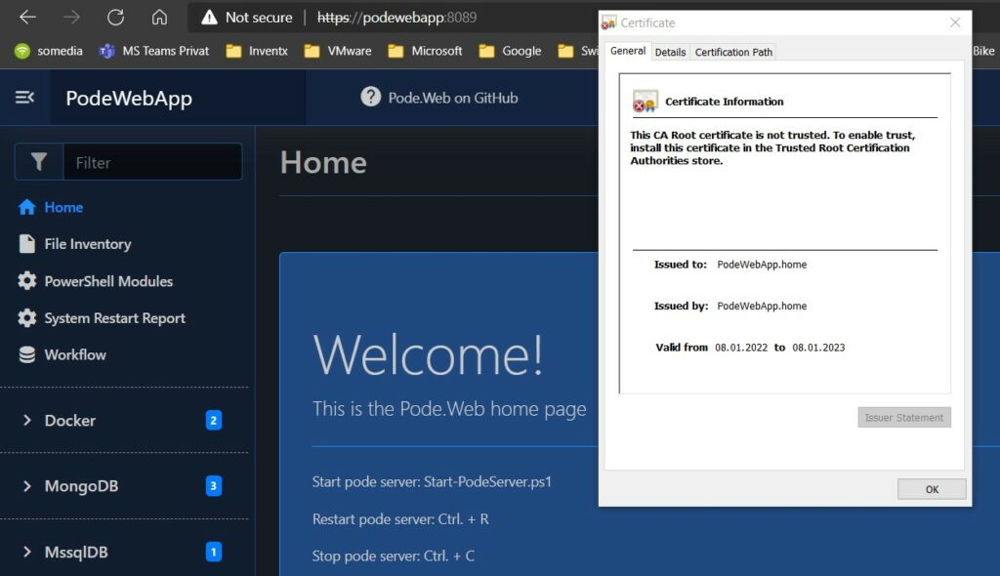
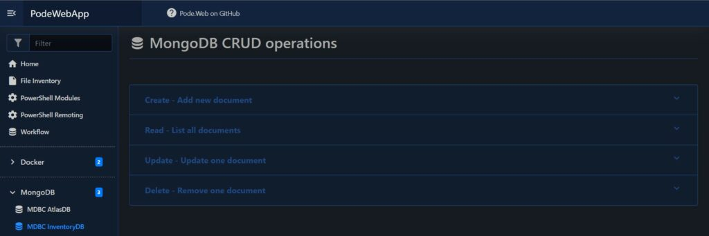
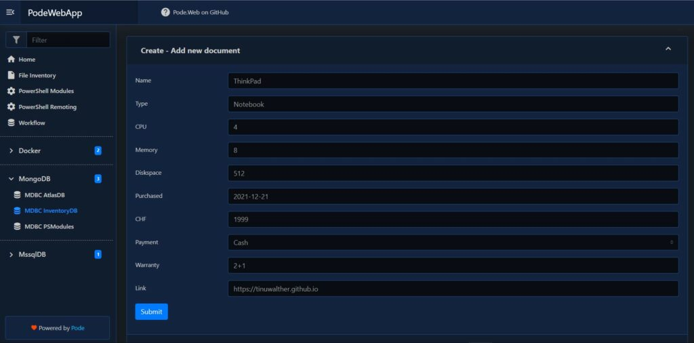
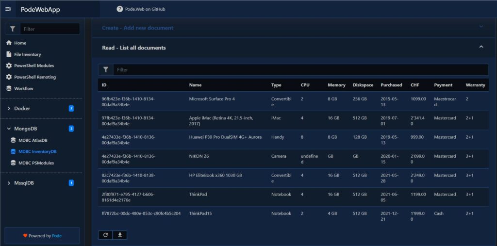
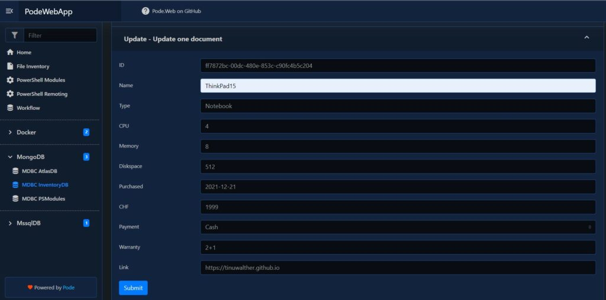
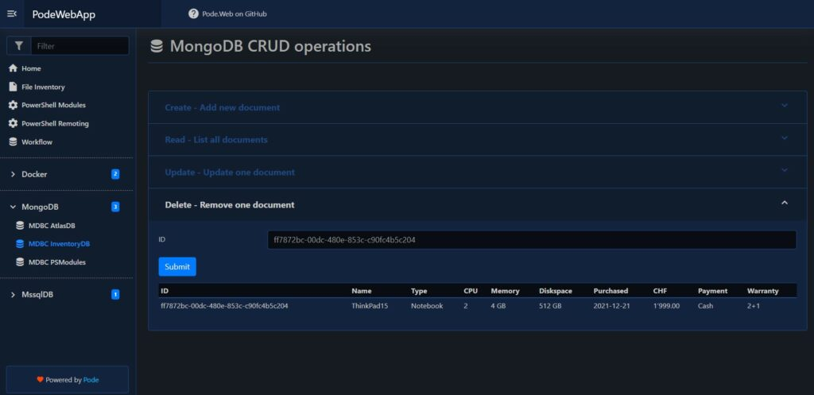
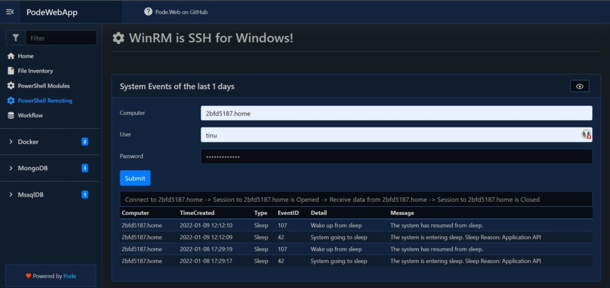
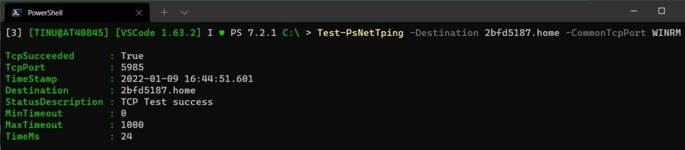
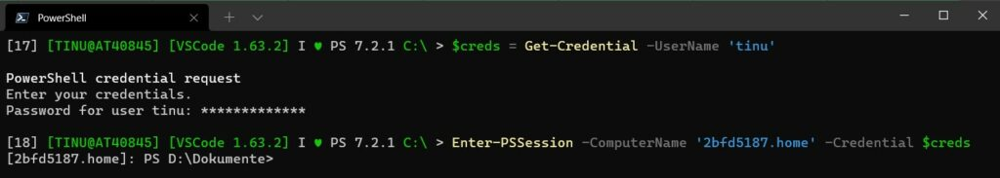

Eine **WebApp** **mit PowerShell** programmieren, kann man das? Ja klar, das geht mit den PowerShell Modulen **Pode** und **Pode.Web** von Matthew Kelly alias [Badgerati](https://github.com/Badgerati).

Hier folgt nun der 2. Teil meiner Implementierungen. Den ersten Teil könnt ihr unter [WebApps mit PowerShell Teil 1 \| (martin-walther.ch)](/wiki/webapps-mit-powershell-teil-1/) nachlesen.

## Pode Server mit Zertifikat

Als Erstes soll der Pode Server mit einem Zerifikat ausgerüstet und dann auf das Protokoll https umgestellt werden.

[](/assets/wiki/PodeCertificate.jpg)### SelfSignedCertificate erstellen

Zuerst wird ein Zertifikat für die Website erstellt. Der einfachheithalber mach ich das mit einem SelfSignedCertificate mit PowerShell. In einer produktiven Umgebung sollte natürlich ein Zertifikat von einer vertrauenswürdigen PKI bezogen werden, dann wird euch auch die **Not secure Warning** im Browser nicht angezeigt.

```
New-SelfSignedCertificate -DnsName 'PodeWeb.home' -CertStoreLocation 'Cert:\CurrentUser\My'

```

### DnsName Resolution einrichten

Nun wird entweder auf dem DNS ein A-Record erstellt, oder im lokalen Hostsfile. In diesem Beispiel mache ich das im lokalen Hostsfile mit meinem PowerShell Module [PsNetTools](https://github.com/tinuwalther/PsNetTools).

```
Add-PsNetHostsEntry -IPAddress 127.0.0.1 -Hostname 'PodeWeb' -FullyQualifiedName 'PodeWeb.home'

```

### Umstellen auf https

Nun wird der Pode Server auf https umgestellt und das Zertifikat aus dem Windows Certificate Store eingebunden.

```
Import-Module Pode.Web

Start-PodeServer {
    #region HTTPS
    $EPProperties = @{
        Address  = 'PodeWebApp'
        Port     = 8089
        Protocol = 'https'
        CertificateName = 'PodeWebApp.home'
        CertificateStoreLocation = 'CurrentUser'
    }
    Add-PodeEndpoint @EPProperties
    #endregion
    New-PodeLoggingMethod -Path .\logs -Name "PodeWebServer.log" | Enable-PodeErrorLogging
    
    Use-PodeWebTemplates -Title "PodeWebApp" -Theme Auto
    $Properties = @{
        Name = 'Pode.Web on GitHub'
        Url  = 'https://github.com/Badgerati/Pode.Web'
        Icon = 'help-circle'
    }
    $navgithub  = New-PodeWebNavLink @Properties -NewTab
    Set-PodeWebNavDefault -Items $navgithub

    foreach($item in (Get-ChildItem (Join-Path $PSScriptRoot -ChildPath 'pages')))  {
        . "$($item.FullName)"
    }

    $Path = "microsoft-edge:$($EPProperties.Protocol)://$($EPProperties.Address):$($EPProperties.Port)/"
    Start-Process $Path -WindowStyle maximized
}

```

## MongoDB CRUD Operations

CRUD operations bedeuten **C**reate, **R**ead, **U**pdate, and **D**elete documents. In diesem Beispiel, bilde ich diese Operationen in einer Website als Workkflow ab.

[](/assets/wiki/CRUD.jpg)### Page

Die Page wird mit folgendem Code aufgebaut:

```
Add-PodeWebPage -Group 'MongoDB' -Name 'MDBC InventoryDB' -Title 'MongoDB CRUD operations' -Icon 'database' -ScriptBlock {
    
    Import-Module .\functions\docker.psm1  -Force

    $IsRunning = Test-IsDockerRunning
    if($IsRunning){
        $container_name = 'mongodb1'
        $status = Test-IsContainerRunning -ContainerName $container_name
        if($status -match 'Up'){
            #Show-PodeWebToast -Message "Container $($container_name) $($status)" -> this ends in a empty page!
            New-PodeWebAccordion -Bellows @(

                New-PodeWebBellow -Name 'Create - Add new document' -Content @(
                    New-PodeWebForm -Id 1 -Name 'Add new document' -ScriptBlock {
                        Import-Module .\functions\mongodb.psm1 -Force
                        $mongo_col = Initialize-MongoDB
                        
                        $document1 = @{
                            ID               = $(New-Guid).ToString()
                            RunTime	         = Get-Date -Format s
                            DeviceName	     = $WebEvent.Data.Name
                            DeviceType	     = $WebEvent.Data.Type
                            'Physical cores' = [Int]$WebEvent.Data.CPU
                            MemoryGB         = [Int]$WebEvent.Data.Memory
                            DiskspaceGB      = [Int]$WebEvent.Data.Diskspace
                            PurchaseDate     = Get-Date $WebEvent.Data.Purchased -Format s
                            Price            = [Double]$WebEvent.Data.CHF
                            Payment	         = $WebEvent.Data.Payment
                            Warranty         = $WebEvent.Data.Warranty
                            Link             = $WebEvent.Data.Link
                        }
                        $NewDocument = Add-MongoDBDocument -Collection $mongo_col -Document $document1
                        $NewDocument | Out-PodeWebTable
                        Show-PodeWebToast -Message "Added $($NewDocument.ID)"
                        Move-PodeWebAccordion -Name 'Read - List all documents'
                    } -Content @(
                        New-PodeWebTextbox -Name 'Name'      -Value 'ThinkPad'
                        New-PodeWebTextbox -Name 'Type'      -Value 'Notebook'
                        New-PodeWebTextbox -Name 'CPU'       -Value '4'
                        New-PodeWebTextbox -Name 'Memory'	 -Value '8'
                        New-PodeWebTextbox -Name 'Diskspace' -Value '512'
                        New-PodeWebTextbox -Name 'Purchased' -Value '2021-12-21'
                        New-PodeWebTextbox -Name 'CHF'       -Value '1999'
                        New-PodeWebSelect  -Name 'Payment'   -Options @('Cash','Maestrocard','Mastercard','Visacard','Invoice')
                        New-PodeWebTextbox -Name 'Warranty'  -Value '2+1'
                        New-PodeWebTextbox -Name 'Link'      -Value 'https://tinuwalther.github.io'
                    )
                )

                New-PodeWebBellow -Name "Read - List all documents" -Content @(
                    New-PodeWebTable -Id 2 -Name 'List all documents' -SimpleSort -SimpleFilter -ScriptBlock {
                        Import-Module .\functions\mongodb.psm1 -Force
                        $mongo_col = Initialize-MongoDB
                        Get-MongoDBData -Collection $mongo_col
                    }
                )

                New-PodeWebBellow -Name 'Update - Update one document' -Content @(
                    New-PodeWebForm -Id 3 -Name 'Update one document' -ScriptBlock {
                        Import-Module .\functions\mongodb.psm1 -Force
                        $mongo_col = Initialize-MongoDB

                        $filter_json3 = @{ID = $WebEvent.Data.ID}
                        $document3 = @{
                            RunTime	         = Get-Date -Format s # --> Element name 'RunTime' is not valid'
                            DeviceName	     = [String]$WebEvent.Data.Name
                            DeviceType	     = [String]$WebEvent.Data.Type
                            'Physical cores' = [Int]$WebEvent.Data.CPU
                            MemoryGB         = [Int]$WebEvent.Data.Memory
                            DiskspaceGB      = [Int]$WebEvent.Data.Diskspace
                            PurchaseDate     = Get-Date $WebEvent.Data.Purchased -Format s
                            Price            = [Double]$WebEvent.Data.CHF
                            Payment	         = [String]$WebEvent.Data.Payment
                            Warranty         = [String]$WebEvent.Data.Warranty
                            Link             = [String]$WebEvent.Data.Link
                        }
                        $UpdateDocument = Update-MongoDBDocument -Filter $filter_json3 -Collection $mongo_col -Document $document3
                        $UpdateDocument | Out-PodeWebTable
                        Show-PodeWebToast -Message "Updated $($UpdateDocument.ID)"
                        Move-PodeWebAccordion -Name 'Read - List all documents'
                    } -Content @(
                        New-PodeWebTextbox -Name 'ID'        -Value 'Enter the ID of the document to update'
                        New-PodeWebTextbox -Name 'Name'      -Value 'ThinkPad'
                        New-PodeWebTextbox -Name 'Type'      -Value 'Notebook'
                        New-PodeWebTextbox -Name 'CPU'       -Value '4'
                        New-PodeWebTextbox -Name 'Memory'	 -Value '8'
                        New-PodeWebTextbox -Name 'Diskspace' -Value '512'
                        New-PodeWebTextbox -Name 'Purchased' -Value '2021-12-21'
                        New-PodeWebTextbox -Name 'CHF'       -Value '1999'
                        New-PodeWebSelect  -Name 'Payment'   -Options @('Cash','Maestrocard','Mastercard','Visacard','Invoice')
                        New-PodeWebTextbox -Name 'Warranty'  -Value '2+1'
                        New-PodeWebTextbox -Name 'Link'      -Value 'https://tinuwalther.github.io'
                    )
                )

                New-PodeWebBellow -Name 'Delete - Remove one document' -Content @(
                    New-PodeWebForm -Id 4 -Name "Remove document" -ScriptBlock {
                        Import-Module .\functions\mongodb.psm1 -Force
                        $mongo_col = Initialize-MongoDB

                        $filter_json4 = @{ID = $WebEvent.Data.ID} 
                        $data = Get-MongoDBDocument -Collection $mongo_col -Filter $filter_json4
                        Show-PodeWebToast -Message "Removed $($data.ID)"
                        Remove-MongoDBDocument -Collection $mongo_col -Filter $filter_json4 | Out-PodeWebTable
                        Move-PodeWebAccordion -Name 'Read - List all documents'
                    } -Content @(
                        New-PodeWebTextbox -Name 'ID'
                    )
                )
            )

        }else{
            New-PodeWebCard -Name "Docker Container $($container_name)" -Content @(
                New-PodeWebText -Value "Docker Container is $($status)" -InParagraph
            )
        }
    }else{
        New-PodeWebCard -Name "Docker Container" -Content @(
            New-PodeWebText -Value "Docker Desktop is not running, please start Docker Desktop" -InParagraph
        )
    }

}

```

#### Create

Functions für die Create Operation

- Initialize-MongoDB
- Add-MongoDBDocument

[](/assets/wiki/Create.jpg)#### Read

Functions für die Read Operation

- Initialize-MongoDB
- Get-MongoDBData

[](/assets/wiki/Read.jpg)#### Update

Functions für die Update Operation

- Initialize-MongoDB
- Update-MongoDBDocument

[](/assets/wiki/Update.jpg)#### Delete

Functions für die Delete Operation

- Initialize-MongoDB
- Get-MongoDBDocument
- Remove-MongoDBDocument

[](/assets/wiki/Delete.jpg)### Functions

Die CRUD Operations habe ich in ein Module-File ausgelagert.

#### mongodb.psm1

```
function Initialize-MongoDB {
    <#
        Return MongoDBCollection-Object
    #>
    [CmdletBinding()]
    param ()
    
    if(-not(Get-InstalledModule -Name Mdbc -ea SilentlyContinue)){
        Install-Module -Name Mdbc -Force
        $Error.Clear()
    }

    if(-not(Get-Module -Name Mdbc)){ Import-Module -Name Mdbc }

    $MdbcProperties = @{
        DatabaseName     = 'tinu'
        CollectionName   = 'inventory'
        ConnectionString = 'mongodb://localhost'
    }
    return Get-MongoDBCollection @MdbcProperties                    

}

function Get-MongoDBCollection {
    param (
        [Parameter(Mandatory=$true)]
        [String]$DatabaseName,

        [Parameter(Mandatory=$true)]
        [String]$CollectionName,

        [Parameter(Mandatory=$true)]
        [String]$ConnectionString
    )

    Connect-Mdbc -ConnectionString $ConnectionString
    $mongo_db  = Get-MdbcDatabase -Name $DatabaseName
    return (Get-MdbcCollection -Database $mongo_db -Name $CollectionName)
}

function Get-MongoDBData {
    <#
        Return all documents
    #>
    [CmdletBinding()]
    param (
        [Parameter(Mandatory=$true)]
        [Object]$Collection
    )
    $properties = @(
        @{N='ID';E={$($_.ID).ToString()}}
        @{N='Name';E={$_.DeviceName}}
        @{N='Type';E={$_.DeviceType}}
        @{N='CPU';E={$_.'Physical cores'}}
        @{N='Memory';E={ "$($_.MemoryGB) GB"}}
        @{N='Diskspace';E={ "$($_.DiskspaceGB) GB"}}
        @{N='Purchased';E={ (Get-Date $_.PurchaseDate -Format 'yyyy-MM-dd') }}
        @{N='CHF';E={ "{0:N2}" -f $($_.Price) }}
        @{N='Payment';E={ $_.Payment }}
        @{N='Warranty';E={ $_.Warranty }}
    )

    return (Get-MdbcData -Collection $Collection -As PS | Select-Object $properties)
}

function Get-MongoDBDocument {
    <#
        Return one document by filter
    #>
    [CmdletBinding()]
    param (
        [Parameter(Mandatory=$true)]
        [Object]$Collection,

        [Parameter(Mandatory=$true)]
        [Object]$Filter
    )
    $properties = @(
        @{N='ID';E={$($_.ID).ToString()}}
        @{N='Name';E={$_.DeviceName}}
        @{N='Type';E={$_.DeviceType}}
        @{N='CPU';E={$_.'Physical cores'}}
        @{N='Memory';E={ "$($_.MemoryGB) GB"}}
        @{N='Diskspace';E={ "$($_.DiskspaceGB) GB"}}
        @{N='Purchased';E={ (Get-Date $_.PurchaseDate -Format 'yyyy-MM-dd') }}
        @{N='CHF';E={ "{0:N2}" -f $($_.Price) }}
        @{N='Payment';E={ $_.Payment }}
        @{N='Warranty';E={ $_.Warranty }}
    )

    return (Get-MdbcData -Collection $Collection -Filter $Filter | Select-Object $properties)
}

function Add-MongoDBDocument {
    <#
        Return the new added document
    #>
    [CmdletBinding()]
    param (
        [Parameter(Mandatory=$true)]
        [Object]$Collection,

        [Parameter(Mandatory=$true)]
        [Object]$Document
    )
    $null = Add-MdbcData -Collection $Collection -InputObject $Document
    return (Get-MongoDBDocument -Collection $Collection -Filter @{ID = $Document.ID})
}

function Update-MongoDBDocument {
    <#
        Update the document
    #>
    [CmdletBinding()]
    param (
        [Parameter(Mandatory=$true)]
        [Object]$Filter,
        
        [Parameter(Mandatory=$true)]
        [Object]$Collection,

        [Parameter(Mandatory=$true)]
        [Object]$Document
    )
    $null = Update-MdbcData -Filter $Filter -Update @{'$set' = $Document} -Collection $Collection #-Result
    return (Get-MongoDBDocument -Collection $Collection -Filter $Filter)
}


function Remove-MongoDBDocument {
    <#
        Return nothing
    #>
    [CmdletBinding()]
    param (
        [Parameter(Mandatory=$true)]
        [Object]$Collection,

        [Parameter(Mandatory=$true)]
        [Object]$Filter
    )
    $ret = (Get-MongoDBDocument -Collection $Collection -Filter $Filter)
    $null = Remove-MdbcData -Collection $Collection -Filter $Filter
    return $ret
}

```

## Remote Operating

Mit PowerShell Remoting (WinRM) - SSH für Windows auf remote Computern Abfragen/Aktionen durchführen und in einer Website anzeigen.

[](/assets/wiki/WinRM.jpg)### Konfiguration auf dem Remote Computer

```
winrm quickconfig
Enable-PSRemoting -Force

```

### Konfiguration auf dem Admin-/Web Server

Computers in a workgroup, or different domain, should be added to allow authentication.

#### Trusted-Hosts

```
Set-Item WSMan:\localhost\Client\TrustedHosts -Concatenate -Value '2bfd5187.home'

```

#### TCP Port Test

```
Test-PsNetTping -Destination 2bfd5187.home -CommonTcpPort WINRM

```

[](/assets/wiki/PsNetTPing.jpg)#### WinRM Test

```
$creds = Get-Credential -UserName 'tinu'
Enter-PSSession -ComputerName '2bfd5187.home' -Credential $creds

```

[](/assets/wiki/PSSession.jpg)Mit <code>Exit&#45;PSSession</code> trenne ich die Verbindung zum Remote Computer wieder.

### Functions

Für mein Beispiel benötige ich die Functions remote.psm1 und eventlog.psm1, da ich Daten aus dem Eventlog auslesen will.

#### remote.psm1

```
function Connect-ToRemoteComputer {
    [CmdletBinding()]
    param (
        [Parameter(Mandatory = $false)]
        [String]$RemoteComputer,

        [Parameter(Mandatory = $true)]
        [String]$Username,

        [Parameter(Mandatory = $true)]
        [SecureString]$Password
    )

    $CachedCreds = New-Object System.Management.Automation.PSCredential ($Username, $Password)
    try{
        return (New-PSSession -ComputerName $RemoteComputer -Credential $CachedCreds -ErrorAction Stop)
    }catch{
        return [PSCustomObject]@{
            State   = 'Error'
            Message = ($_.Exception.Message)
        }
    }
}

```

#### eventlog.psm1

Meine Function um die relevanten Eventlogs auszulesen sind ebenfalls in einem Module-File separiert.

```
function Get-SystemLogs {
    [CmdletBinding()]
    param (
        [Parameter(Mandatory = $false)]
        [Object]$RemoteSession,

        [Parameter(Mandatory=$true)]
        [int[]]$EventID,

        [Parameter(Mandatory=$false)]
        [Int]$Days = 7
    )
    
    $ScriptBlockContent = {
        param(
            [Parameter(Mandatory=$true)] [Int]$Days,
            [Parameter(Mandatory=$true)] [Int[]]$EventID
        )
        $WinEventProp = @{
            LogName   = 'System'
            Id        = $EventID
            StartTime = (Get-Date).AddDays(-$Days)
            EndTime   = (Get-Date)
        }    
        Get-WinEvent -FilterHashtable $WinEventProp | Sort-Object TimeCreated -Descending
    }

    if($RemoteSession){
        $WinEvent = Invoke-Command -Session $RemoteSession -ScriptBlock $ScriptBlockContent -ArgumentList $Days,$EventID
        $Computer = $RemoteSession.ComputerName
    }else{
        $WinEvent = Invoke-Command -ScriptBlock $ScriptBlockContent -ArgumentList $Days,$EventID
        $Computer = $env:COMPUTERNAME
    }

    $ret = foreach($item in $WinEvent){
        switch($item.ID){
            13   {$detail = 'System shutdown';$Type = 'Shutdown'}
            41   {$detail = 'System stopped';$Type = 'Crash'}
            42   {$detail = 'System going to sleep';$Type = 'Sleep'}
            107  {$detail = 'Wake up from sleep';$Type = 'Sleep'}
            109  {$detail = 'System shutdown';$Type = 'Shutdown'}
            161  {$detail = 'Memory dump';$Type = 'Crash'}
            1001 {$detail = 'Memory dump';$Type = 'Crash'}
            1074 {
                $null = $item.Message -match '\w+\.exe'
                $BehalfOf = $Matches[0]
                if($item.Message -match 'power off'){
                    $detail = "Shutdown by User on behalf of $($BehalfOf)"
                    $Type = 'Shutdown'
                }
                if($item.Message -match 'restart'){
                    $Type = 'Restart'
                    if($item.Message -match 'NT AUTHORITY\\SYSTEM'){
                        $detail = "Restart by SYSTEM on behalf of $($BehalfOf)"
                    }else{
                        $detail = "Restart by User on behalf of $($BehalfOf)"
                    }
                }
            }
            1076 {
                $detail = 'Unexpected shutdown';$Type = 'Crash'
            }
            6005 {$detail = 'System startup';$Type = 'Startup'}
            6006 {$detail = 'System shutdown';$Type = 'Shutdown'}
            6008 {
                $Type = 'Shutdown'
                $detail = 'Unexpected shutdown'
                $null = $item.Message -match '\d{2}\:\d{2}\:\d{2}'
                $time = $Matches[0]
                $null = $item.Message -match '(?<=on\s)(.*)(?= was)'
                $date = $Matches[0] -replace '‎'
                $detail = "$($detail) at $(Get-Date "$($date) $($time)" -f 'yyyy-MM-dd HH:mm:ss')"
            }
            7031 {$detail = 'Service terminated unexpectedly';$Type = 'Crash'}
            default {$Type = $item.id;$detail = 'n/a'}
        }
        [PSCustomObject]@{
            Computer    = $Computer
            TimeCreated = (Get-Date $item.TimeCreated -f 'yyyy-MM-dd HH:mm:ss')
            Type        = $Type
            EventID     = $item.ID
            Detail      = $detail
            Message     = $item.Message
        }
    }
    return $ret
}

```

### Page

Die Website mit dem Login für den Remote Computer und der Anzeige der erhaltenen Daten.

```
Add-PodeWebPage -Name 'PowerShell Remoting' -Title 'WinRM is SSH for Windows!' -Icon 'cog' -ScriptBlock {

    $Days = 1

    New-PodeWebCard -Name "System Events of the last $Days days" -Content @(
        New-PodeWebForm -ArgumentList $Days -Name "Remote Computer" -ScriptBlock {
            param($Days)
            Import-Module .\functions\eventlog.psm1 -Force
            $EventIDArray = @(13,26,41,42,107,109,161,1001,1074,1076,6005,6006,6008,7022,7031,7043)
            if([String]::IsNullOrEmpty($WebEvent.Data.Computer)){
                $Message = "Connect to localhost"
                $SystemLogs = Get-SystemLogs -Days $Days -EventID $EventIDArray
                if([String]::IsNullOrEmpty($SystemLogs)){
                    $Message = "$($Message) -> No data from from $($env:COMPUTERNAME)"
                }else{
                    $Message = "$($Message) -> Receive data from $($env:COMPUTERNAME)"
                    Out-PodeWebTable -Data $SystemLogs -Sort
                }
            }else{
                Import-Module .\functions\remote.psm1 -Force
                $Properties = @{
                    RemoteComputer = $($WebEvent.Data.Computer)
                    Username       = $($WebEvent.Data.User)
                    Password       = ConvertTo-SecureString $($WebEvent.Data.Password) -AsPlainText -Force
                }
                $Message = "Connect to $($WebEvent.Data.Computer)"
                $WSMan   = Connect-ToRemoteComputer @Properties
                if($WSMan.State -eq 'Opened'){
                    $Message = "$($Message) -> Session to $($WebEvent.Data.Computer) is $($WSMan.State)"
                    Import-Module .\functions\eventlog.psm1 -Force
                    $SystemLogs = Get-SystemLogs -RemoteSession $WSMan -Days 1 -EventID $EventIDArray
                    if([String]::IsNullOrEmpty($SystemLogs)){
                        $Message = "$($Message) -> No data from from $($WebEvent.Data.Computer)"
                    }else{
                        $Message = "$($Message) -> Receive data from $($WebEvent.Data.Computer)"
                        Out-PodeWebTable -Data $SystemLogs -Sort
                    }
                    Remove-PSSession $WSMan
                    $Message = "$($Message) -> Session to $($WebEvent.Data.Computer) is $($WSMan.State)"
                }else{
                    $Message = "$($Message) -> Could not establish a remote session to $($Properties.RemoteComputer) with user $($Properties.Username), $($WSMan.Message)"
                }
            }
            Out-PodeWebTextbox -Value $($Message)
        } -Content @(
            New-PodeWebTextbox -Name 'Computer' -Placeholder 'Enter the DNSname or IPAddress of the remote Computer' -Type Text
            New-PodeWebTextbox -Name 'User'     -Placeholder 'Enter the Username of the remote Computer' -Type Text #NoForm
            New-PodeWebTextbox -Name 'Password' -Placeholder 'Enter the Password of the Username' -Type Password #-NoForm
        )
    )
}

```

In diesen kurzen Beispielen habe ich das Features SSL Zertifikat von Pode, Accordion von Pode.Web aufgezeigt. Weiter habe ich hier aufgezeigt, wie man mit PowerShell Remoting (WinRM) Daten von einem remote Computer einlesen und anzeigen kann. Die Einsatzmöglichkeiten von diesen beiden Modulen sind jedoch fast unendlich und ich habe noch so manche Idee, welche ich umsetzen möchte.

## References

[Website Pode.Web](https://badgerati.github.io/Pode.Web/), [Pode.Web on github](https://github.com/Badgerati/Pode.Web), [MongoDB Cmdlets for PowerShell](https://github.com/nightroman/Mdbc), [PsNetTools](https://github.com/tinuwalther/PsNetTools), [PowerShell Remoting: The Ultimate Guide](https://adamtheautomator.com/psremoting/)

