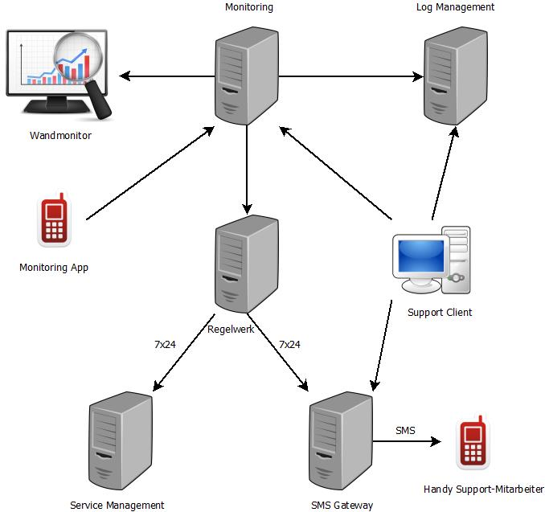

Windows Betrieb, was gehört eigentlich dazu?

# 7x24 Stunden Support

## Incident-, Change- und Problem Management

 **Incident** - Eine Störung tritt ein, wenn ein bestehender Service nicht mehr ordnungsgemäss funktioniert. Eine Störung wird in einem Incident der Verantwortlichen Stelle gemeldet. In einem Störungsfall wird ein Workaround gesucht und implementiert, damit der Service wieder ordnungsgemäss funktioniert. **Change** - Eine Änderung, Erweiterung oder Entfernung eines bestehenden Services wird in einem Request for Change (RfC) beauftragt und nach sorgfälltiger Prüfung der Verantwortlichen Stelle zur Implementierung übergeben. **Problem** - Ein Problem besteht, wenn eine Sörung mehrmals oder auf mehreren Systemen gleichzeitig auftritt. 

### Monitoring, Log &amp; Event Management

 Mit eine Früherkennung können Störungen vermieden oder sofort erkannt werden. Mit einem **Monitoringtool** werden alle Server überwacht, ein **Log Collector** ist für das Einsammeln der Logdaten von allen Servern zuständig und mit einem **Regelwerk** wird die Weiterverarbeitung von Events jeglicher bestimmt. Incidents werden an das Service Management weitergeleitet und automatisch ein Ticket erstellt. Zum Versenden von Alarmmeldungen ist es empfehlenswert, ein dediziertes SMS-Gateway zu nutzen.  Die aufgeführten Systeme sind redundant und zentral aufzubauen, damit jede Plattform (Classic und Cloud) darauf zugreifen kann. 

## Pikett

 Ein Alarm ist nur dann sinnvoll, wenn jemand diesen mitbekommt. Der Piketteur sitzt nicht vor dem PC und wartet aktiv auf Incidents. Deshalb ist es unabdingbar, dass bei einer Störung ein SMS o.ä. auf dem Piketthandy eingeht. Es wichtig zu wissen welche Changes am Abend und durch die Nacht stattfinden, damit es zu keinem Blindflug des Piketteurs kommt. 

# Betriebsengineering

## Plan-Do-Check-Act - Qualitätsverbesserung

 \[caption id="attachment\_1920" align="alignnone" width="300"\] Kontinuierlicher Verbesserungsprozess\[/caption\] Weiterentwickeln und verbessern von bestehenden Services wird vom Betriebsengineering durchgeführt - und glaubt mir, ich finde immer etwas was verbessert werden kann. **Plan** - Erkennen von Verbesserungspotential und analysieren des aktuellen Zustandes sowie entwickeln eines Konzeptes. **Do** - Durchführen von Tests des entwickelten Konzeptes aus Plan. **Check** - Prüfen der Testergebnisse und freigeben des Konzeptes. **Act** - Umsetzen bzw. einführen des Konzeptes auf breiter Front. Sobald Act beendet ist, beginnt wieder Plan . . . 

## Lifecycle Management

 Die Erde ist eine Scheibe . . . so gibt es auch keinen Grund ein Lifecycle Management aufzubauen. Operating System, Tools und Agents sind in regelmässigen Zyklen zu aktualisieren und nach Ablauf des Hersteller Supports auszuwechseln.